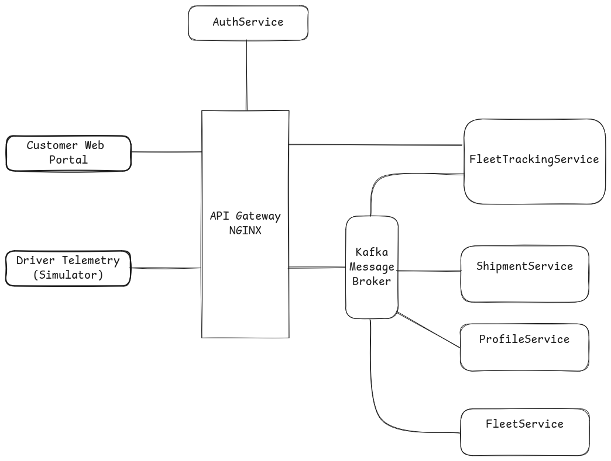

# Last-Mile Delivery Fleet & Real-Time Tracking System 
A production-grade, microservice-based logistics platform engineered for high-frequency driver telemetry processing, real-time map visualization, and transactional shipment management. 

## Documentation Suite
-   **Product Requirements Document (PRD):** 
    
-   **High-Level Architecture (HLA) Document:** 

## System Architecture Overview 
The platform uses a **Database-per-Service** pattern with strict domain isolation, decoupling ephemeral, low-latency spatial positions from durable business records.

### Core Components & Tech Stack

-   **API Gateway & Reverse Proxy:** **NGINX** handles edge routing, path-based load balancing, SSL termination, and centralized authentication token verification via subrequests.
    
-   **Authentication Service (`AuthService`):** **.NET** service managing core account credentials, roles, and cryptographic JWT issuance.
    
-   **Profile Service (`ProfileService`):** **.NET** service managing administrative and client/customer profiles.
    
-   **Fleet Management Service (`FleetService`):** **.NET** service managing driver availability profiles and vehicle assignments.
    
-   **Fleet Tracking Service (`FleetTrackingService`):** **.NET** service responsible for ingesting live GPS coordinates from drivers, updating an ephemeral **Redis** geospatial cache, and flushing audit checkpoints every 2 minutes to a local **PostgreSQL + PostGIS** instance.
    
-   **Shipment Service (`ShipmentService`):** **.NET** service managing transactional order lifecycles, statuses, and state change distribution.
    
-   **Message Broker:** **Apache Kafka** facilitates asynchronous, event-driven communication across decoupled business services.
    
-   **Driver Simulator:** A **Python** script simulating high-frequency telemetry movement.
    
-   **Customer Portal:** **React SPA** utilizing open-source mapping libraries for real-time tracking visualization.
## Data Model & Storage Strategy

-   **Relational Persistence:** Each microservice maintains an isolated PostgreSQL database instance container (`auth_db`, `profile_db`, `fleet_db`, `tracking_db`, `shipment_db`). The tracking database utilizes the **PostGIS** extension (`GEOGRAPHY(Point, 4326)`) for spatial audit trails.
    
-   **Ephemeral Geospatial Cache:** **Redis** stores live vehicle coordinates using `GEOADD` spatial sorted sets (`fleet:locations`) alongside driver session metadata hashes with automatic TTL expiration.

### Why Choose Apache Kafka?

In a high-throughput logistics platform, Apache Kafka acts as the central nervous system for asynchronous communication. It was chosen over traditional message queues or synchronous REST calls for several core reasons:

-   **Complete Service Decoupling (Pub/Sub):** When a shipment status changes,  `ShipmentService` doesn't need to synchronously call every downstream service that cares. It simply publishes an event (`ShipmentDispatched`) to Kafka. Any interested service can consume it independently without impacting the producer.
    
-   **Durability and Replayability:** Unlike fire-and-forget queues, Kafka retains event logs on disk for a configured retention period. If a consuming service crashes or goes offline for maintenance, it won't lose data; it can simply resume reading from its last committed offset once it recovers.
    
-   **Massive Scalability & High Throughput:** Kafka handles massive volumes of data streams via partitioning. This ensures that event processing can scale horizontally as the delivery fleet grows.
    
-   **Event-Driven Foundation:** It enables an event-driven architecture, making it easy to add future capabilities (like analytics, notification services, or audit loggers) simply by having them subscribe to existing Kafka topics without rewriting core business logic.
### Why Database-per-Service?

The **Database-per-Service** pattern is a core tenet of microservices architecture (and Domain-Driven Design). Instead of sharing a monolithic database or shared tables, every service owns its isolated database instance (or logical database). Here is why this pattern is essential:

-   **True Autonomous Boundaries:** It prevents "database-level coupling" (the anti-pattern where services talk to each other by querying foreign tables).  `ShipmentService` cannot directly query `drivers` or `clients` tables; it respects service boundaries by communicating via APIs or events.
    
-   **Independent Schema Evolution:** Each service can modify its schema, run migrations, or optimize indexes without coordinating with other teams or risking unintended side effects across the system.
    
-   **Performance & Blast Radius Isolation:** Heavy database operations or locks in one domain (such as `FleetTrackingService` flushing thousands of telemetry audit rows) will not degrade performance or lock tables in `ShipmentService` or `AuthService`.
    
-   **Technology Flexibility:** While all your business services use PostgreSQL here, a database-per-service approach means a specific service could theoretically use a different database engine tailored to its specific needs down the road without rewriting the rest of the application.
