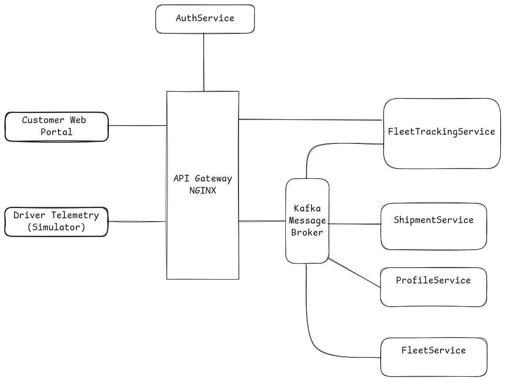

# Last-Mile Delivery Fleet & Real-Time Tracking System 
A production-grade, microservice-based logistics platform engineered for high-frequency driver telemetry processing, real-time map visualization, and transactional shipment management. 

## Documentation Suite
-   **Product Requirements Document (PRD):** 
    
-   **High-Level Architecture (HLA) Document:** 

## System Architecture Overview 
The platform uses a **Database-per-Service** pattern with strict domain isolation, decoupling ephemeral, low-latency spatial positions from durable business records.

### Core Components & Tech Stack

-   **API Gateway & Reverse Proxy:** **NGINX** handles edge routing, path-based load balancing, SSL termination, and centralized authentication token verification via subrequests.
    
-   **Authentication Service (`AuthService`):** **.NET** service managing core account credentials, roles, and cryptographic JWT issuance.
    
-   **Profile Service (`ProfileService`):** **.NET** service managing administrative and client/customer profiles.
    
-   **Fleet Management Service (`FleetService`):** **.NET** service managing driver availability profiles and vehicle assignments.
    
-   **Fleet Tracking Service (`FleetTrackingService`):** **.NET** service responsible for ingesting live GPS coordinates from drivers, updating an ephemeral **Redis** geospatial cache, and flushing audit checkpoints every 2 minutes to a local **PostgreSQL + PostGIS** instance.
    
-   **Shipment Service (`ShipmentService`):** **.NET** service managing transactional order lifecycles, statuses, and state change distribution.
    
-   **Message Broker:** **Apache Kafka** facilitates asynchronous, event-driven communication across decoupled business services.
    
-   **Driver Simulator:** A **Python** script simulating high-frequency telemetry movement.
    
-   **Customer Portal:** **React SPA** utilizing open-source mapping libraries for real-time tracking visualization.
## Data Model & Storage Strategy

-   **Relational Persistence:** Each microservice maintains an isolated PostgreSQL database instance container (`auth_db`, `profile_db`, `fleet_db`, `tracking_db`, `shipment_db`). The tracking database utilizes the **PostGIS** extension (`GEOGRAPHY(Point, 4326)`) for spatial audit trails.
    
-   **Ephemeral Geospatial Cache:** **Redis** stores live vehicle coordinates using `GEOADD` spatial sorted sets (`fleet:locations`) alongside driver session metadata hashes with automatic TTL expiration.
