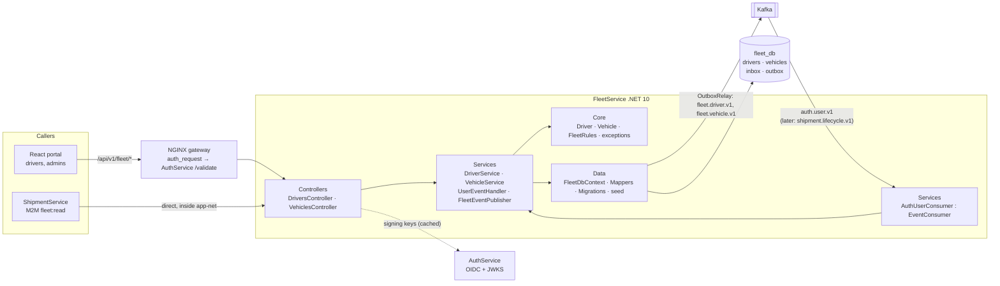
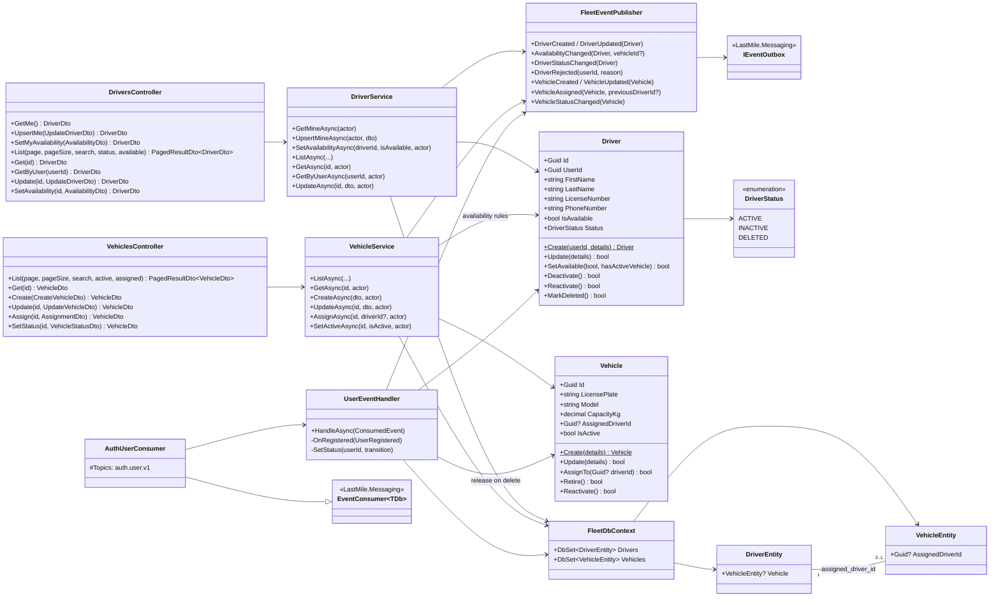

# Microservice definition: FleetService

**Version:** 1.0.0 (2026-11-11) · **Status:** ✅ implemented ([`FleetService/`](../../FleetService)) and verified end to end (§11). Written before the code. The build follows it, and the notes from building are in §11.
**Related:** [high-level-architecture.md](../high-level-architecture.md) §2 · [data-model.md](../data-model.md) §3 · [data-ownership-matrix.md](../data-ownership-matrix.md) (D3) · [kafka-architecture.md](../kafka-architecture.md) · [ProfileService](../ProfileService/ProfileService.md) (sister service, same patterns)

## 1. Description

FleetService owns **the delivery workforce and the vehicles**:
- **Drivers:** the driver profile (name, phone, license) and the driver's **availability** (decision D3, MVP: *"on shift and ready to deliver"*).
- **Vehicles:** registration, model, capacity, active or retired.
- **Driver ↔ vehicle assignment:** which vehicle each driver operates. This is the fleet concern, distinct from *which vehicle carries a shipment*, which ShipmentService snapshots at dispatch.

It answers ShipmentService's dispatch question: *"Is this driver available right now, and with which vehicle?"*

- It never creates identities. AuthService publishes `UserRegistered` (role `DRIVER`) with the driver's profile, and FleetService creates the `drivers` row (D2).
- It is the **only writer** of `drivers` and `vehicles` (`fleet_db`), and publishes `fleet.driver.v1` and `fleet.vehicle.v1`.
- It is a backend API with no interface, behind NGINX at `/api/v1/fleet/*`.

## 2. Tech stack

Identical to AuthService and ProfileService:

| Concern | Choice |
|---|---|
| Runtime | .NET 10, ASP.NET Core (controllers) |
| Persistence | PostgreSQL 16 (`fleet_db`, own container `fleet-postgres`), EF Core 10 + Npgsql, migrations at startup |
| Messaging | `LastMile.Messaging` + `LastMile.Contracts`: inbox consumer for `auth.user.v1`, outbox for `fleet.driver.v1` / `fleet.vehicle.v1`, Schema Registry (JSON Schema) |
| Security | Local JWT validation with keys from AuthService's OIDC metadata/JWKS, and NGINX `auth_request` in front |
| Docs / packaging | OpenAPI (`/openapi/v1.json`, Development), Docker image built from the repository root |

## 3. Requirements

### Functional requirements

| # | Requirement |
|---|---|
| FR-1 | Create a **driver** when `UserRegistered` arrives with role `DRIVER`. Other roles are ignored. If the license number is already taken, create nothing and publish **`DriverProfileRejected`** (matrix §8.1). |
| FR-2 | Keep driver **status** in sync with the account: `UserDeactivated` → `INACTIVE` (and unavailable), `UserReactivated` → `ACTIVE`, `UserDeleted` → `DELETED` (unavailable, vehicle released), `UserRoleChanged` away from DRIVER → `INACTIVE`, back to DRIVER → `ACTIVE` if a driver row exists. |
| FR-3 | A driver can read and edit their own profile (`/me`). `PUT /me` creates it when missing, which covers a rejected license or a role changed to DRIVER. |
| FR-4 | A driver can **start and end a shift**: `PUT /drivers/me/availability`. Admins can set any driver's availability. |
| FR-5 | **Availability invariants:** a driver can be available only if their status is `ACTIVE` **and** they have an **active vehicle** assigned. Losing either makes them unavailable automatically. |
| FR-6 | Admins **register, edit, retire and reactivate vehicles**, and **assign or unassign** a vehicle to a driver: one vehicle per driver, one driver per vehicle. |
| FR-7 | Admins and services (M2M scope `fleet:read`) **list, search and read** drivers (filter by status and availability) and vehicles (filter by active and assigned). |
| FR-8 | Publish driver and vehicle events (§8) in the same transaction as each change. |
| FR-9 | *(Pending ShipmentService)*: consume `shipment.lifecycle.v1` to flip availability on dispatch and completion (D3, §8.3). |

### Non-functional requirements

| # | Requirement |
|---|---|
| NFR-1 | **Ownership:** `drivers.user_id` is a logical reference with no FK. Email and role are never stored here. `vehicles.assigned_driver_id → drivers.id` is a real FK, because both are in `fleet_db`. |
| NFR-2 | **Idempotent, ordered consumption** (inbox, key = `userId`). Redelivered events change nothing. |
| NFR-3 | **Fresh availability:** `GET /drivers/{id}` reads the database directly, with no cache, because ShipmentService decides dispatch on it. |
| NFR-4 | **Availability under Kafka outage:** the API works, and events wait in the outbox or Kafka. |
| NFR-5 | **Security:** every endpoint is authenticated. RBAC by role (`DRIVER`, `ADMIN`) and M2M scope `fleet:read`. |
| NFR-6 | **Performance:** P95 < 100 ms for single reads. Lists are paginated (≤ 100). |
| NFR-7 | **Operability:** `/health` covers the database and outbox. Migrations run at startup. Dev seed of demo vehicles. |

## 4. Service-level architecture



The layers are the same as AuthService and ProfileService:

| Folder | Responsibility |
|---|---|
| `Controllers/` | HTTP endpoints: binding, `[Authorize]`, status codes |
| `Services/` | Use cases spanning both aggregates (availability ↔ vehicle rules), authorization (owner/admin/M2M), event publishing, the Kafka consumer |
| `Core/` | Domain models `Driver` and `Vehicle` with their invariants, field rules, domain exceptions, the API exception handler |
| `Data/` | `FleetDbContext` (+ inbox/outbox), `Mappers`, migrations, `DatabaseInitializer` (migrations + dev vehicle seed) |
| `DTOs/` | HTTP request and response contracts |
| `Models/` | EF entities `DriverEntity`, `VehicleEntity` |
| `Enums/` | `DriverStatus`, roles, scopes, policies, claims |
| `Options/` | `JwtOptions`, `SeedOptions` |

## 5. Data model (`fleet_db`)

This implements [data-model.md §3](../data-model.md#3-fleetservice--fleet_db--designed) with these changes:
- `drivers.status` for soft delete, mirroring ProfileService.
- `updated_at` on both tables.
- `is_available` defaults to **false**: a new driver is not on shift.
- License numbers and plates are stored **trimmed and upper-case**, so uniqueness ignores case.

```sql
CREATE TABLE drivers (
    id             UUID PRIMARY KEY DEFAULT gen_random_uuid(),
    user_id        UUID NOT NULL UNIQUE,                 -- → AuthService.users (logical, no FK)
    first_name     VARCHAR(100) NOT NULL,
    last_name      VARCHAR(100) NOT NULL,
    license_number VARCHAR(100) NOT NULL UNIQUE,         -- normalized: trimmed, upper-case
    phone_number   VARCHAR(50)  NOT NULL,
    is_available   BOOLEAN      NOT NULL DEFAULT FALSE,  -- D3: on shift AND ready (needs ACTIVE + active vehicle)
    status         VARCHAR(20)  NOT NULL DEFAULT 'ACTIVE' CHECK (status IN ('ACTIVE','INACTIVE','DELETED')),
    created_at     TIMESTAMPTZ  NOT NULL DEFAULT CURRENT_TIMESTAMP,
    updated_at     TIMESTAMPTZ  NOT NULL DEFAULT CURRENT_TIMESTAMP,
    CONSTRAINT ck_drivers_available_active CHECK (NOT is_available OR status = 'ACTIVE')
);
CREATE TABLE vehicles (
    id                 UUID PRIMARY KEY DEFAULT gen_random_uuid(),
    license_plate      VARCHAR(50)    NOT NULL UNIQUE,   -- normalized: trimmed, upper-case
    model              VARCHAR(100)   NOT NULL,
    capacity_kg        DECIMAL(10, 2) NOT NULL CHECK (capacity_kg > 0),
    assigned_driver_id UUID UNIQUE REFERENCES drivers(id) ON DELETE SET NULL,   -- one vehicle per driver
    is_active          BOOLEAN        NOT NULL DEFAULT TRUE,                    -- false = retired
    created_at         TIMESTAMPTZ    NOT NULL DEFAULT CURRENT_TIMESTAMP,
    updated_at         TIMESTAMPTZ    NOT NULL DEFAULT CURRENT_TIMESTAMP,
    CONSTRAINT ck_vehicles_assigned_active CHECK (assigned_driver_id IS NULL OR is_active)
);
-- + inbox (auth.user.v1) and outbox (fleet.*) from LastMile.Messaging
```

Neither drivers nor vehicles are ever hard-deleted, because shipments keep their ids. A retired vehicle (`is_active = false`) cannot be assigned.

## 6. UML class diagram



## 7. API design

Base path `/api/v1/fleet` (NGINX → `fleet-service:8080`, behind `auth_request`). JSON camelCase, enums as strings, RFC 7807 errors. M2M callers use `http://fleet-service:8080` directly with a token for audience `fleet-service`, as for ProfileService.

### Drivers

| Method & path | Access | Success | Errors | Publishes |
|---|---|---|---|---|
| `GET /fleet/drivers/me` | DRIVER | `200` Driver | `404` not created yet | — |
| `PUT /fleet/drivers/me` | DRIVER | `200` / `201` created | `400`, `409` license taken | `DriverUpdated` / `DriverCreated` |
| `PUT /fleet/drivers/me/availability` | DRIVER | `200` | `409` not ACTIVE or no active vehicle | `DriverAvailabilityChanged` |
| `GET /fleet/drivers?page&pageSize&search&status&available` | ADMIN, M2M `fleet:read` | `200` page | `403` | — |
| `GET /fleet/drivers/{id}` | ADMIN, M2M, owner | `200` | `403`, `404` | — |
| `GET /fleet/drivers/by-user/{userId}` | ADMIN, M2M, owner | `200` | `403`, `404` | — |
| `PUT /fleet/drivers/{id}` | ADMIN | `200` | `400`, `404`, `409` license taken / deleted | `DriverUpdated` |
| `PUT /fleet/drivers/{id}/availability` | ADMIN | `200` | `404`, `409` | `DriverAvailabilityChanged` |

### Vehicles

| Method & path | Access | Success | Errors | Publishes |
|---|---|---|---|---|
| `GET /fleet/vehicles?page&pageSize&search&active&assigned` | ADMIN, M2M `fleet:read` | `200` page | `403` | — |
| `GET /fleet/vehicles/{id}` | ADMIN, M2M, the assigned driver | `200` | `403`, `404` | — |
| `POST /fleet/vehicles` | ADMIN | `201` | `400`, `409` plate taken | `VehicleCreated` |
| `PUT /fleet/vehicles/{id}` | ADMIN | `200` | `400`, `404`, `409` plate taken | `VehicleUpdated` |
| `PUT /fleet/vehicles/{id}/assignment` | ADMIN | `200` | `400`, `404`, `409` (see rules) | `VehicleAssigned` (+ `DriverAvailabilityChanged` if a driver loses availability) |
| `PUT /fleet/vehicles/{id}/status` | ADMIN | `200` | `404` | `VehicleDeactivated` / `VehicleReactivated` (+ unassignment events when retiring) |

There is no DELETE endpoint: drivers follow account deletion, and vehicles are retired.

### Rules

- **Availability (`PUT …/availability {isAvailable}`):**
  - `true` requires driver `ACTIVE` and an active vehicle assigned, otherwise `409`.
  - `false` is always allowed.
  - Setting the current value again is a `200` no-op and publishes no event.
- **Assignment (`PUT /vehicles/{id}/assignment {driverId | null}`):**
  - The vehicle must be active, and the driver must exist and be `ACTIVE`, otherwise `409`.
  - A driver who already operates **another** vehicle → `409`: unassign it first.
  - Unassigning, or reassigning the vehicle to someone else, makes the previous driver **unavailable**.
- **Retiring a vehicle** (`{isActive: false}`) unassigns it first, and its driver becomes unavailable.
- **Owner access** compares the token `sub` with `drivers.user_id`. A DELETED driver is invisible to the owner, and visible to ADMIN and M2M for history.
- **Lists:**
  - Drivers default to `status=ACTIVE`, and `available=true|false` filters further. `search` matches name, license and phone.
  - Vehicles default to `active=true`, and `assigned=true|false` filters further. `search` matches plate and model.
  - Pages are 1-based with `pageSize` ≤ 100.

### Shapes

```jsonc
// PUT /fleet/drivers/me  and  PUT /fleet/drivers/{id}          (full replacement)
{ "firstName": "Jane", "lastName": "Doe", "phoneNumber": "+213 666 00 00", "licenseNumber": "DZ-123456" }
// PUT …/availability
{ "isAvailable": true }

// DriverDto
{ "id": "…", "userId": "…", "firstName": "Jane", "lastName": "Doe", "licenseNumber": "DZ-123456",
  "phoneNumber": "+213 666 00 00", "isAvailable": true, "status": "ACTIVE",
  "vehicle": { "id": "…", "licensePlate": "DEMO-001", "model": "Renault Kangoo (demo)", "capacityKg": 650.0 },   // or null
  "createdAt": "…", "updatedAt": "…" }

// POST /fleet/vehicles  and  PUT /fleet/vehicles/{id}
{ "licensePlate": "12345-120-16", "model": "Renault Kangoo", "capacityKg": 650 }        // capacity 0 < x ≤ 100000
// PUT /fleet/vehicles/{id}/assignment
{ "driverId": "…" }            // or { "driverId": null } to unassign
// PUT /fleet/vehicles/{id}/status
{ "isActive": false }

// VehicleDto
{ "id": "…", "licensePlate": "12345-120-16", "model": "Renault Kangoo", "capacityKg": 650.0,
  "isActive": true, "assignedDriverId": "…", "createdAt": "…", "updatedAt": "…" }
```

## 8. Events

### 8.1 Consumed: `auth.user.v1` (group `fleet-service`)

| Event | Action |
|---|---|
| `UserRegistered` role `DRIVER` | create the driver (unavailable). If the license is taken, publish `DriverProfileRejected` instead. Other roles are ignored. |
| `UserDeactivated` | driver → `INACTIVE`, unavailable (the vehicle stays assigned) |
| `UserReactivated` (role DRIVER) | driver → `ACTIVE` (still unavailable until the next shift) |
| `UserRoleChanged` | away from DRIVER → `INACTIVE` + unavailable; to DRIVER → `ACTIVE` if the row exists |
| `UserDeleted` | driver → `DELETED`, unavailable, vehicle unassigned |
| `UserEmailChanged` | ignored |

### 8.2 Published

**`fleet.driver.v1`** (key = `driverId`; for `DriverProfileRejected` the key is `userId`, because no driver exists):

| Event | Payload |
|---|---|
| `DriverCreated`, `DriverUpdated` | `driverId, userId, firstName, lastName, licenseNumber, phoneNumber` |
| `DriverAvailabilityChanged` | `driverId, userId, isAvailable, vehicleId?` |
| `DriverDeactivated`, `DriverReactivated`, `DriverDeleted` | `driverId, userId` |
| `DriverProfileRejected` | `userId, licenseNumber, reason` |

**`fleet.vehicle.v1`** (key = `vehicleId`):

| Event | Payload |
|---|---|
| `VehicleCreated`, `VehicleUpdated` | `vehicleId, licensePlate, model, capacityKg` |
| `VehicleAssigned` | `vehicleId, driverId?, previousDriverId?` (`driverId` null = unassigned) |
| `VehicleDeactivated`, `VehicleReactivated` | `vehicleId` |

These replace the provisional names in the matrix (§6): `DriverUnavailable` becomes `DriverDeactivated` plus `DriverAvailabilityChanged(false)`.

### 8.3 Pending: `shipment.lifecycle.v1` (when ShipmentService exists)

`ShipmentDispatched` → driver unavailable. `ShipmentDelivered`, `ShipmentFailed` and `ShipmentCancelled` → available again, if the driver is still on shift. The payload contracts belong to ShipmentService, so this consumer is added together with that service. Until then, drivers manage their availability with FR-4.

## 9. Configuration

```jsonc
{
  "ConnectionStrings": { "FleetDb": "Host=fleet-postgres;Database=fleet_db;Username=fleet_user;Password=…;GSS Encryption Mode=Disable" },
  "Jwt": { "MetadataAddress": "http://auth-service:8080/.well-known/openid-configuration",
           "Issuer": "https://auth.lastmile.internal", "Audiences": [ "last-mile-api", "fleet-service" ] },
  "Kafka": { "BootstrapServers": "kafka:9092", "SchemaRegistryUrl": "http://schema-registry:8081" },
  "Seed": { "Vehicles": [ { "LicensePlate": "DEMO-001", "Model": "Renault Kangoo (demo)", "CapacityKg": 650 } ] }   // Development
}
```

## 10. Running it

| | |
|---|---|
| Container | `fleet-service` (port 8080 on `app-net`). Through NGINX at `http://localhost/api/v1/fleet/…` |
| Database | `fleet_postgres_db` (`fleet_db`, user `fleet_user`), host port **5435**. Migrations and the demo-vehicle seed run at startup. |
| Kafka | consumer group `fleet-service` on `auth.user.v1`; publishes `fleet.driver.v1`, `fleet.vehicle.v1` |
| OpenAPI | `docker exec schema-registry curl -s fleet-service:8080/openapi/v1.json` (Development) |
| M2M client (dev) | `shipment-service` / `dev-shipment-secret-123`, scope `fleet:read`, audience `fleet-service`. Call `http://fleet-service:8080` directly. |
| Demo data | vehicles `DEMO-001` (assigned to Jane) and `DEMO-002`. Jane (`jane@doe.com` / `Driver12345!`) can start a shift right away with `PUT /api/v1/fleet/drivers/me/availability {"isAvailable": true}`. |

## 11. Verification and implementation notes (2026-11-11)

| Check | Result |
|---|---|
| Startup on empty `fleet_db` | migration applied, 2 demo vehicles seeded (`VehicleCreated`), and the `auth.user.v1` history replayed. Jane became a driver, earlier test drivers ended `DELETED`, and the client whose role briefly changed to DRIVER got no row (it had no driver data). |
| Availability rules | no vehicle → 409. With a vehicle → available. Unassigning, or retiring the vehicle, made the driver unavailable automatically. |
| Assignment rules | a driver who already has a vehicle → 409. A retired vehicle → 409. Reassignment after reactivation works. |
| Duplicate license at registration | no driver row, `DriverProfileRejected {reason}` published, and `GET /me` 404. `PUT /me` with another license → 201. |
| Account lifecycle | deactivate → `INACTIVE`, unavailable, vehicle kept. Reactivate → `ACTIVE`, still unavailable. Delete → `DELETED`, vehicle released (`VehicleAssigned` with `driverId: null`). |
| RBAC | no token 401 · CLIENT 403 · DRIVER: own profile and own vehicle only (other vehicle 403) · ADMIN all · M2M `fleet:read`: reads 200, writes 403 |
| Validation | plates and licenses are unique regardless of case and spacing (`" demo-001 "` = `DEMO-001` → 409). Capacity 0 → 400. |
| Events | all 12 event types seen on `fleet.driver.v1` / `fleet.vehicle.v1`. 10 Schema Registry subjects. Outbox drained. |

**Notes:**
- Both invariants are enforced twice, in the domain and as database `CHECK` constraints: an available driver must be `ACTIVE`, and an assigned vehicle must be active.
- `DriverAvailabilityChanged` is published on **every** flip, including automatic ones (vehicle lost, account deactivated or deleted). ShipmentService can rely on it as its read model of who is dispatchable.
- FR-9 (`shipment.lifecycle.v1`) is not built yet, by design (§8.3).

## 12. Open points

1. **Shift vs delivery** are one flag in the MVP (D3). A later MVP splits `shift_status` from a "busy" state derived from active shipments.
2. **Dispatch race** (kafka-architecture.md §7.2): two dispatches can both see `isAvailable = true`. ShipmentService guards against it for now. A reservation endpoint on FleetService is the long-term fix.
