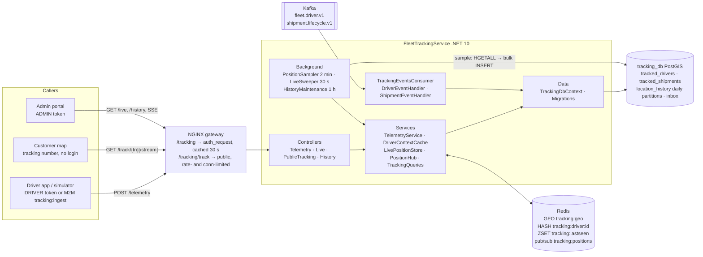
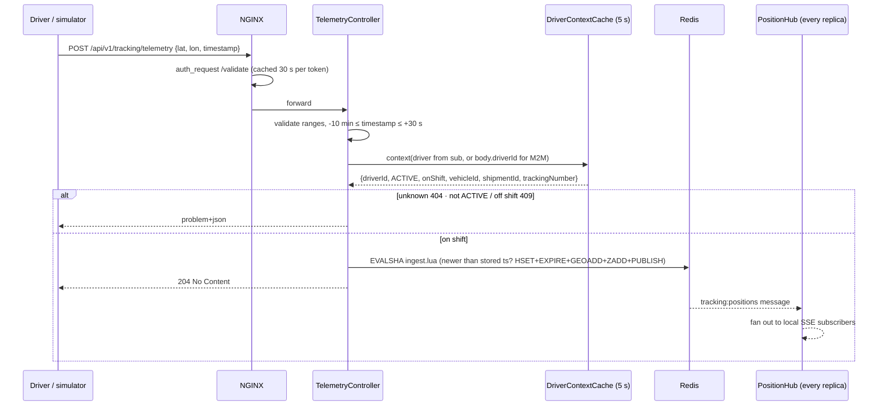
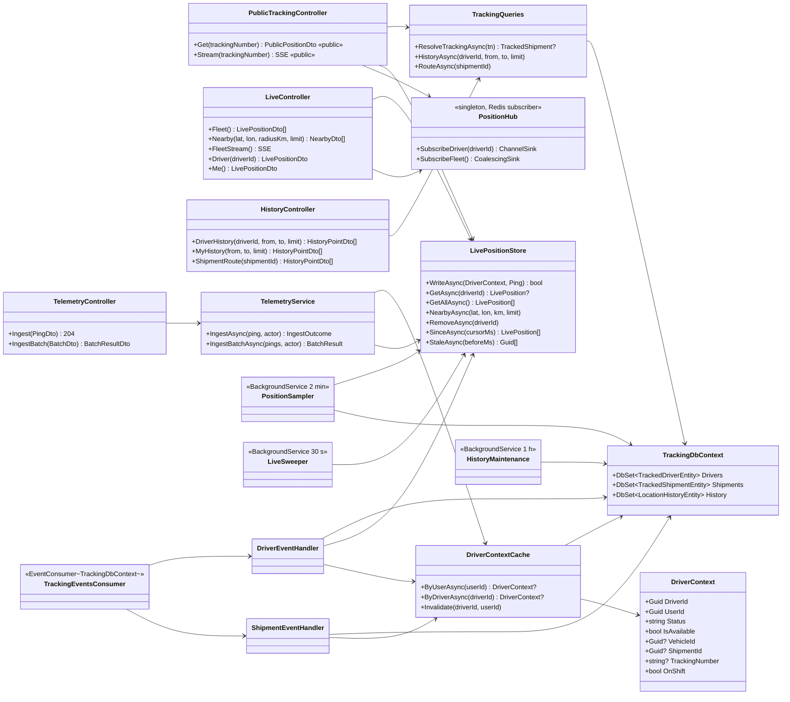

# Microservice definition: FleetTrackingService

**Version:** 1.0.0 (2026-11-11) · **Status:** ✅ implemented ([`FleetTrackingService/`](../../FleetTrackingService)) and verified with API tests (§11). This document was written before the code, and the build follows it. Notes from the build are in §11.
**Related:** [high-level-architecture.md](../high-level-architecture.md) §2, §4.1, §4.2 · [product-requirements-document.md](../product-requirements-document.md) UC-1, UC-2, FR-1–FR-3 · [data-model.md](../data-model.md) §5 · [data-ownership-matrix.md](../data-ownership-matrix.md) ("Where a driver is") · [kafka-architecture.md](../kafka-architecture.md) §2, §3 · [FleetService](../FleetService/FleetService.md) · [ShipmentService](../ShipmentService/ShipmentService.md) (S3)

## 1. Description

FleetTrackingService owns **where every driver is**:
- It ingests GPS pings from the driver app or the simulator, at up to **1 000 pings/s**.
- It keeps the **live position** of every driver on shift in **Redis**.
- It pushes live positions to the **customer map** and the **admin fleet map**.
- It keeps a **sampled GPS audit trail**, one point per driver every 2 minutes, in PostgreSQL for **30 days**.

It is the only service that stores coordinates (matrix §4). Shipment status is **never** inferred from GPS. That stays with ShipmentService.

- **It publishes no events.** At 1 000 writes/s, per-ping events would flood Kafka (matrix §6).
- **It consumes** `fleet.driver.v1` and `shipment.lifecycle.v1` into a small local read model. From that model it knows, for every ping:
  - which **driver** sent it (the token `sub` is mapped to a `driverId`)
  - whether the driver is **on shift**
  - which **vehicle** the driver operates, and which **shipment and tracking number** the driver is carrying
- It never calls another service synchronously. If Auth, Fleet or Shipment is down, ingestion and live tracking keep working.

### Product decisions for this service (2026-11-11)

| # | Decision |
|---|---|
| T1 | **The ping metadata is derived on the server.** A ping carries only `latitude`, `longitude` and `timestamp`, plus optional `speedKmh`, `headingDeg` and `accuracyM`. **`driverId` comes from the JWT.** **`vehicleId`, `shipmentId` and `trackingNumber` come from the read model.** The `address` field of the original spec is dropped, because the destination is already in `ShipmentCreated` and sending it on every ping would waste bandwidth. A simulator acting as a GPS gateway uses an M2M token with scope **`tracking:ingest`** and names the `driverId`. It also gets a **batch** endpoint. |
| T2 | **Live delivery uses Server-Sent Events (SSE) plus polling.** Each replica holds **one** Redis pub/sub subscription and fans updates out to its own SSE connections. A plain `GET` returns the latest position for clients that poll. The admin fleet stream is **coalesced to one batch per second**. |
| T3 | **Visibility depends on the role.** **Public by tracking number** (like ShipmentService S3, rate-limited): the position is returned **only while the shipment is `DISPATCHED` or `IN_TRANSIT`**, without the driver's identity, vehicle or history. **ADMIN** sees the whole fleet, history, routes and nearby search. **DRIVER** sees only their own data. **M2M `tracking:read`** gets the admin read endpoints, without streams. |
| T4 | **Pings are stored only while the driver is on shift.** "On shift" means an `ACTIVE` driver who is available or carrying an active shipment. Off-shift pings get `409` and are **not stored**, for privacy. To protect AuthService from 1 000 `auth_request`/s, NGINX **caches `/auth/validate` for 30 s per token** on the tracking routes, so a revoked token stops working within 30 s. |
| T5 | **History is kept for 30 days.** This spec replaces the "2 months" in the HLA, the matrix and the data model, which are updated, and matches the 30-day Kafka retention. The history table is **partitioned by day**. The purge **drops whole partitions**, with no `DELETE` and no table bloat. |
| T6 | **"Cold" means sampled.** Every 2 minutes, one replica copies the **latest live position of every driver who pinged since the previous run** from Redis into `location_history`, with one bulk `INSERT` and no per-ping database writes. For 1 000 drivers that is about 720 k rows per day and about 21.6 M rows over 30 days. |

### Review of the original spec

| Spec item | Verdict |
|---|---|
| Header "ProfileService" | Copy-paste slip. This is FleetTrackingService. |
| FR and NFR lists swapped | Throughput and storage tiers are non-functional. Role-based delivery is functional. Fixed in §3. |
| Ping metadata `driver_id, vehicle_id, delivery_id, address` sent by the client | **Spoofable.** Any token holder could write positions for any driver or shipment. Replaced by T1. |
| "Send hot GPS data to customers and admins requesting it" | Kept, made concrete as SSE plus polling (T2) and role rules (T3). |
| Save cold positions every 2 minutes | Kept, as sampling from Redis (T6). |
| Purge history older than 30 days, daily | Kept. It conflicted with the HLA's 2 months, and 30 days wins (T5). |
| 1 000 positions/s | Kept as NFR-1. That is twice the PRD's 500/s and covers 1 000 vehicles pinging every second. |

## 2. Tech stack

| Concern | Choice |
|---|---|
| Runtime | .NET 10, ASP.NET Core (controllers) |
| Live store | **Redis 7.4** (`tracking-redis`): GEO set, hash per driver, ZSET of last-seen times, pub/sub. **Ephemeral by design** (no persistence): after a restart the live state is rebuilt by the next pings, 2–5 s later. Client: StackExchange.Redis. |
| History | **PostgreSQL 16 + PostGIS** (`tracking_db`, container `tracking-postgres`, image `postgis/postgis`). EF Core 10 + Npgsql. `location_history` is created with raw SQL in the migration, because EF cannot model partitioned tables. |
| Messaging | `LastMile.Messaging` + `LastMile.Contracts`: an **inbox consumer** of `fleet.driver.v1` and `shipment.lifecycle.v1`. No outbox. |
| Security | Local JWT validation (AuthService OIDC/JWKS), plus NGINX `auth_request` with a **30 s cache**. The public tracking routes are rate-limited and connection-limited at NGINX. |
| Push | SSE (`text/event-stream`), written directly to the response, with `X-Accel-Buffering: no` and a heartbeat every 15 s |
| Docs / packaging | OpenAPI (Development), Docker image built from the repository root |
| Tools | `tools/telemetry-simulator/simulator.py` (Python, stdlib only): a driver route replay and an M2M load mode |

## 3. Requirements

### Functional requirements

| # | Requirement |
|---|---|
| FR-1 | **Ingest a ping** (T1). DRIVER: `driverId` = the driver mapped from `sub`. M2M `tracking:ingest`: `driverId` in the body. The rules are in §4.2: the driver must be known, `ACTIVE` and on shift (T4), with valid coordinates and a timestamp that is neither in the future nor stale. |
| FR-2 | **Batch ingest** of up to 500 pings in one request (M2M, or a DRIVER for their own buffered pings). Each ping is accepted, ignored (older than the live one) or rejected with a reason, and one bad ping never fails the batch. |
| FR-3 | **Live store (hot):** the newest ping per driver goes to Redis (GEO + hash). An out-of-order (older) ping never overwrites a newer one. A driver who stops pinging disappears after **10 minutes** (PRD retention). A driver who goes **off shift** or is **deactivated** disappears at once. |
| FR-4 | **Live delivery (T2, T3):** public by tracking number (snapshot plus SSE stream); ADMIN fleet snapshot, nearby search (`GEOSEARCH`) and coalesced fleet stream; one driver's live position for ADMIN, M2M and that driver. |
| FR-5 | **History (cold, T6):** sample every **2 minutes** into `location_history`, with the `vehicleId` and `shipmentId` at that moment. |
| FR-6 | **History queries:** a driver's track over a time range (ADMIN, and the driver for themselves), and a shipment's route (ADMIN, M2M `tracking:read`). |
| FR-7 | **Retention (T5):** daily partitions are created ahead of time, and partitions older than **30 days** are dropped. The check runs at startup and every hour, so each day is dropped within an hour of expiring. |
| FR-8 | **Read model** from `fleet.driver.v1` (driver identity, status, availability, vehicle) and `shipment.lifecycle.v1` (tracking number, status, driver, vehicle), applied idempotently through the inbox. |

### Non-functional requirements

| # | Requirement |
|---|---|
| NFR-1 | **Throughput:** at least **1 000 pings/s** on one replica, without per-ping database writes or row locks. A ping costs one cached context lookup plus **one Redis round trip** (a Lua script). |
| NFR-2 | **Latency:** ingestion P95 < **50 ms**. Live position fetch P95 < **100 ms**. Ping to SSE subscriber < **500 ms** (PRD). |
| NFR-3 | **Resilience:** an outage of this service never affects shipments (PRD). If Redis is down, ingestion and live reads return **503**, while history and the consumer keep working. If PostgreSQL is down, ingestion keeps working, because the context cache serves for 5 s and then ingestion returns 503 as well. Sampling retries on the next run. |
| NFR-4 | **Horizontal scaling:** replicas share Redis and PostgreSQL. A **Redis lock** ensures that only one replica samples or sweeps, and a **PostgreSQL advisory lock** that only one replica runs partition maintenance. Pub/sub reaches every replica's SSE clients. |
| NFR-5 | **Security and privacy:** RBAC by role and scope (T3). Public responses never contain driver identity, vehicle or history. Off-shift positions are never stored (T4). NGINX caches token checks for at most 30 s. |
| NFR-6 | **Storage:** 30 days × 720 samples/day × 1 000 drivers ≈ 21.6 M rows, about 3 GB with indexes. The purge is a constant-time `DROP TABLE` per day. |
| NFR-7 | **Operability:** `/health` covers the database and Redis. Structured logs for samples (count and duration), sweeps and partition changes. Development OpenAPI. |

## 4. Service-level architecture



### 4.1 Redis layout

| Key | Type | Content | Expiry |
|---|---|---|---|
| `tracking:driver:{driverId}` | hash | `lat lon ts rcv spd hdg acc veh shp trk` (`ts` = device ms, `rcv` = server ms) | TTL **10 min**, refreshed on each accepted ping |
| `tracking:geo` | GEO set | member `driverId` at the latest lon/lat | removed by the sweeper, or when the driver goes off shift |
| `tracking:lastseen` | ZSET | member `driverId`, score = `rcv` | the sweeper removes members older than 10 min, and the sampler reads members newer than its cursor |
| `tracking:positions` | pub/sub channel | JSON `{type:"position", …}` or `{type:"offline", driverId}` | — |
| `tracking:sampler:cursor` | string | server ms of the last sample run | — |
| `tracking:lock:{job}` | string | owner id, `SET NX PX` | lease, about 90 % of the job interval |

### 4.2 Ingesting a ping



**Validation:** `latitude` −85.05…85.05 (the Redis GEO / Web Mercator limit), `longitude` −180…180, `speedKmh` 0…300, `headingDeg` 0…<360, `accuracyM` ≥ 0. The `timestamp` must be no more than 30 s in the future and no more than 10 min old. Stale pings would be invisible on the live map and are never stored. An **older** ping than the stored one returns `204` but changes nothing ("ignored"), so retries and reordering are harmless.

**On shift (T4)** = `status = ACTIVE` **and** (`is_available` **or** an active shipment, `DISPATCHED` or `IN_TRANSIT`). D3 sets `is_available = false` while the driver is on a delivery, which is why the active shipment counts too.

**Event timing:** the two topics are not ordered relative to each other. Around a dispatch or a delivery, the driver can therefore appear off shift for the second or two between `ShipmentDispatched` / `ShipmentDelivered` and FleetService's `DriverAvailabilityChanged`. Pings in that window get `409`, and the next ping succeeds. This is accepted for the MVP.

### 4.3 Live delivery (T2, T3)

- **PositionHub** (singleton per replica) subscribes once to `tracking:positions`, and every SSE connection registers a sink:
  - **Per-driver sink:** a bounded channel (64, drop-oldest), used by the public stream.
  - **Coalescing sink:** the latest message per driver, flushed every 1 s, used by the admin fleet stream. At 1 000 pings/s this sends one batch per second with at most one entry per driver.
- **Public stream** `GET /track/{tn}/stream`:
  1. The tracking number is resolved in `tracked_shipments` (`404` if unknown), and the first event is `status`.
  2. While the shipment is active, the stream sends the current Redis position and then every new one, without driver or vehicle ids.
  3. Every 15 s it sends a `heartbeat` and re-checks the status. When the shipment leaves `DISPATCHED`/`IN_TRANSIT`, the stream sends `status`, then `ended`, and closes. A `CREATED` shipment keeps the stream open and starts sending positions after dispatch.
- **Event names:** `status` `{status}` · `position` `{latitude, longitude, recordedAt, speedKmh?, headingDeg?}` · `positions` (admin) `[LivePositionDto]` · `offline` `{driverId}` (admin) · `heartbeat` · `ended`.

### 4.4 Sampling, sweeping, retention

| Job | Every | Lock | What it does |
|---|---|---|---|
| `PositionSampler` | 2 min | Redis `tracking:lock:sampler` | `ZRANGEBYSCORE lastseen (cursor +inf` → pipelined `HGETALL` → one `INSERT … SELECT unnest(…) ON CONFLICT DO NOTHING` → cursor = run start. Idempotent: `(driver_id, recorded_at)` is unique. |
| `LiveSweeper` | 30 s | Redis `tracking:lock:sweeper` | `ZRANGEBYSCORE lastseen -inf now-10min` → `ZREM geo`, `ZREM lastseen`, publish `offline`. The hash has already expired by its TTL. |
| `HistoryMaintenance` | startup + 1 h | `pg_try_advisory_xact_lock` | Create the partitions for yesterday through 3 days ahead, drop the partitions whose day ended more than 30 days ago, and delete expired rows from the default partition |

**Layers** (same as the other services):

| Folder | Responsibility |
|---|---|
| `Controllers/` | `TelemetryController`, `LiveController` (admin, driver), `PublicTrackingController`, `HistoryController` |
| `Services/` | `TelemetryService`, `DriverContextCache`, `LivePositionStore` (Redis + Lua), `PositionHub` + sinks, `TrackingQueries`, `SseWriter`, authorization helpers |
| `Services/Events/` | `TrackingEventsConsumer`, `DriverEventHandler`, `ShipmentEventHandler` |
| `Services/Background/` | `PositionSampler`, `LiveSweeper`, `HistoryMaintenance`, `RedisLock` |
| `Core/` | `Ping` rules, `DriverContext` (on-shift rule), `TrackingNumber` normalisation, domain exceptions, API exception handler |
| `Data/` | `TrackingDbContext` (+ inbox), migrations (raw SQL for the partitioned table), `DatabaseInitializer` |
| `DTOs/`, `Models/`, `Enums/`, `Options/` | HTTP contracts, EF entities, roles/scopes/policies/claims, `JwtOptions` + `TrackingOptions` |

## 5. Data model (`tracking_db`)

This replaces the proposal in [data-model.md §5](../data-model.md):
- **read-model tables** fed by Kafka
- extra columns on the history table, including PostGIS
- **daily partitions**
- **30-day** retention

```sql
-- Read model from fleet.driver.v1 (owner: FleetService). Read-only copy, rebuildable from the topic.
CREATE TABLE tracked_drivers (
    driver_id    UUID PRIMARY KEY,                      -- → FleetService.drivers (logical)
    user_id      UUID NOT NULL UNIQUE,                  -- → AuthService.users: maps the token sub to the driver
    status       VARCHAR(20) NOT NULL CHECK (status IN ('ACTIVE','INACTIVE','DELETED')),
    is_available BOOLEAN NOT NULL DEFAULT FALSE,
    vehicle_id   UUID,                                  -- vehicle at the last availability change
    updated_at   TIMESTAMPTZ NOT NULL DEFAULT CURRENT_TIMESTAMP
);

-- Read model from shipment.lifecycle.v1 (owner: ShipmentService).
CREATE TABLE tracked_shipments (
    shipment_id     UUID PRIMARY KEY,                   -- → ShipmentService.shipments (logical)
    tracking_number VARCHAR(20) NOT NULL UNIQUE,
    status          VARCHAR(20) NOT NULL CHECK (status IN ('CREATED','DISPATCHED','IN_TRANSIT','DELIVERED','FAILED','CANCELLED')),
    driver_id       UUID,
    vehicle_id      UUID,
    updated_at      TIMESTAMPTZ NOT NULL DEFAULT CURRENT_TIMESTAMP
);
CREATE INDEX idx_tracked_shipments_driver_active ON tracked_shipments(driver_id)
    WHERE status IN ('DISPATCHED','IN_TRANSIT');

-- GPS audit trail: sampled every 2 min, partitioned by day, kept 30 days.
CREATE EXTENSION IF NOT EXISTS postgis;
CREATE TABLE location_history (
    driver_id   UUID NOT NULL,                          -- → FleetService.drivers (logical)
    vehicle_id  UUID,                                   -- context at that moment (snapshot)
    shipment_id UUID,                                   -- active shipment at that moment, if any
    latitude    DOUBLE PRECISION NOT NULL,
    longitude   DOUBLE PRECISION NOT NULL,
    position    GEOGRAPHY(Point, 4326)
        GENERATED ALWAYS AS (ST_SetSRID(ST_MakePoint(longitude, latitude), 4326)::geography) STORED,
    speed_kmh   REAL,
    heading_deg REAL,
    accuracy_m  REAL,
    recorded_at TIMESTAMPTZ NOT NULL,                   -- device timestamp of the sampled ping
    received_at TIMESTAMPTZ NOT NULL,                   -- server time of that ping
    PRIMARY KEY (driver_id, recorded_at)                -- includes the partition key; makes sampling idempotent
) PARTITION BY RANGE (recorded_at);
CREATE INDEX idx_location_history_shipment ON location_history(shipment_id, recorded_at) WHERE shipment_id IS NOT NULL;
CREATE TABLE location_history_default PARTITION OF location_history DEFAULT;   -- safety net, normally empty
-- Daily partitions, created by HistoryMaintenance:
--   CREATE TABLE location_history_p20261111 PARTITION OF location_history
--       FOR VALUES FROM ('2026-11-11 00:00+00') TO ('2026-11-12 00:00+00');
-- + inbox (consumer idempotency)
```

- **No FKs** to other services (ownership rule 2). `tracked_*` are read models: they are written only by the consumer and can always be rebuilt from the topics.
- PostGIS: the `position` column is generated, so the application writes plain doubles, and later spatial queries (for example "was the driver within 100 m of the destination?") need no migration.
- **Backfill gap:** the read model is built from the topics' 30-day history (`AutoOffsetReset=Earliest`). A driver who has had no event for more than 30 days is unknown until their next event, which is the next shift start. Open point §12.1.

## 6. UML class diagram



## 7. API design

Base path `/api/v1/tracking`. JSON camelCase, RFC 7807 errors. Timestamps are ISO-8601 UTC.

| Method & path | Access | Success | Errors |
|---|---|---|---|
| `POST /telemetry` | DRIVER (self), M2M `tracking:ingest` (`driverId` required) | `204` | `400` invalid / stale / future, `403`, `404` no driver profile, `409` not ACTIVE or not on shift, `503` Redis |
| `POST /telemetry/batch` | M2M `tracking:ingest`, DRIVER (self, `driverId` must be absent or their own) | `200` `{accepted, ignored, rejected:[{index, reason}]}` | `400` empty or > 500, `403`, `503` |
| `GET /track/{trackingNumber}` | **public** (rate-limited) | `200` PublicPosition | `404` |
| `GET /track/{trackingNumber}/stream` | **public** SSE (rate- and connection-limited) | `200 text/event-stream` | `404` |
| `GET /live` | ADMIN, M2M `tracking:read` | `200` LivePosition[] | `403`, `503` |
| `GET /live/nearby?lat&lon&radiusKm=5&limit=20` | ADMIN, M2M `tracking:read` | `200` Nearby[] (sorted by distance) | `400`, `403`, `503` |
| `GET /live/stream` | ADMIN | SSE `positions` (1/s), `offline` | `403` |
| `GET /drivers/{driverId}/live` | ADMIN, M2M `tracking:read`, the driver themselves | `200` LivePosition | `403`, `404` not live |
| `GET /drivers/me/live` | DRIVER | `200` | `404` |
| `GET /drivers/{driverId}/history?from&to&limit` | ADMIN, M2M `tracking:read`, the driver themselves | `200` HistoryPoint[] | `400` range > 7 days, `403` |
| `GET /drivers/me/history?from&to&limit` | DRIVER | `200` | `400` |
| `GET /shipments/{shipmentId}/route` | ADMIN, M2M `tracking:read` | `200` HistoryPoint[] | `403`, `404` unknown shipment |

History defaults: `to` = now, `from` = `to` − 24 h. The range is at most 7 days. `limit` defaults to 1 000 (max 10 000), in ascending time order.

### Shapes

```jsonc
// POST /telemetry (DRIVER). M2M adds "driverId".
{ "latitude": 36.7538, "longitude": 3.0588, "timestamp": "2026-11-11T10:00:00Z",
  "speedKmh": 32.5, "headingDeg": 270, "accuracyM": 8 }           // optional

// POST /telemetry/batch
{ "pings": [ { "driverId": "…", "latitude": …, "longitude": …, "timestamp": "…" }, … ] }   // 1..500
// → { "accepted": 498, "ignored": 1, "rejected": [ { "index": 7, "reason": "Driver is not on shift." } ] }

// PublicPositionDto (T3): no driver, vehicle or history
{ "trackingNumber": "LM-7K3F9Q2X8M4P", "status": "IN_TRANSIT", "live": true,
  "position": { "latitude": 36.75, "longitude": 3.06, "recordedAt": "…", "speedKmh": 32.5, "headingDeg": 270 } }
//   position = null when the shipment isn't DISPATCHED/IN_TRANSIT or the driver isn't live

// LivePositionDto (ADMIN / M2M / driver self)
{ "driverId": "…", "vehicleId": "…", "shipmentId": "…", "trackingNumber": "LM-…",
  "latitude": 36.75, "longitude": 3.06, "recordedAt": "…", "receivedAt": "…",
  "speedKmh": 32.5, "headingDeg": 270, "accuracyM": 8 }
// NearbyPositionDto = { "distanceKm": 0.698, "position": LivePositionDto }

// HistoryPointDto
{ "latitude": …, "longitude": …, "recordedAt": "…", "speedKmh": …, "headingDeg": …,
  "vehicleId": "…", "shipmentId": "…" }
```

```text
// SSE, public stream
event: status
data: {"status":"IN_TRANSIT"}

event: position
data: {"latitude":36.75,"longitude":3.06,"recordedAt":"2026-11-11T10:00:02Z","speedKmh":32.5,"headingDeg":270}

event: heartbeat
data: {}
```

**Browser note for the portal:** `EventSource` cannot send an `Authorization` header. The public stream needs none. The admin stream must use a fetch-based SSE client (for example `@microsoft/fetch-event-source`).

### Changes in other components

- **NGINX:**
  - `/api/v1/tracking/track/` is public, with `limit_req` (5 r/s, burst 20) and `limit_conn` (10 streams per IP).
  - `/api/v1/tracking/` uses `auth_request /_auth_cached`: the `/auth/validate` result is cached **30 s, keyed by the full `Authorization` header**, and only `200` responses are cached.
  - Both locations disable buffering for SSE and set a 1 h read timeout.
  - The tracking routes use an `upstream` with a **keepalive pool** (`resolve`, so a recreated container is found), and the gateway runs `worker_processes auto` (§11).
- **AuthService `/auth/validate`** uses a second JwtBearer scheme, `Gateway`. It runs every check except the audience, so M2M tokens issued for `tracking-service` pass the gateway. AuthService API reference 1.3.0, §5.
- **AuthService dev seed:** new M2M client `telemetry-simulator` (scopes `tracking:ingest tracking:read`, audience `tracking-service`). The `shipment-service` client already has `tracking:read` and `tracking-service`, but ShipmentService does not use them yet.
- **No new Kafka topics or contracts.**

## 8. Events consumed (group `tracking-service`)

| Topic / event | Effect on the read model | Live-store side effect |
|---|---|---|
| `fleet.driver.v1` `DriverCreated`, `DriverUpdated` | upsert `driver_id`, `user_id` (status `ACTIVE` when new) | — |
| `DriverAvailabilityChanged` | upsert `is_available`, `vehicle_id` | if now **off shift** (not available, no active shipment): remove from Redis + `offline` |
| `DriverDeactivated` / `DriverDeleted` | `status` = `INACTIVE` / `DELETED`, `is_available = false` | remove from Redis + `offline` |
| `DriverReactivated` | `status = ACTIVE` | — |
| `DriverProfileRejected` | ignored (no driver) | — |
| `shipment.lifecycle.v1` `ShipmentCreated` | upsert `shipment_id`, `tracking_number`, `CREATED` | — |
| `ShipmentDispatched` | status, `driver_id`, `vehicle_id` | — |
| `ShipmentInTransit` | status | — |
| `ShipmentDelivered` / `Failed` / `Cancelled` | final status. A final status is never overwritten by a non-final one (replay guard). | — (FleetService flips availability back, and that event decides) |

- Every event invalidates the replica's context cache for that driver. Other replicas pick up the change within the 5 s cache TTL.
- Redis side effects are **best-effort**: they are logged, and the event is never failed because of them. If a removal is missed, the 10-minute TTL removes the driver anyway.
- Every driver event carries `UserId`, so an event for an unknown driver still creates the row ("upsert everywhere").

## 9. Configuration

```jsonc
{
  "ConnectionStrings": {
    "TrackingDb": "Host=tracking-postgres;Database=tracking_db;Username=tracking_user;…",
    "Redis": "tracking-redis:6379,abortConnect=false"
  },
  "Jwt": { "MetadataAddress": "http://auth-service:8080/.well-known/openid-configuration",
           "Issuer": "https://auth.lastmile.internal", "Audiences": [ "last-mile-api", "tracking-service" ] },
  "Tracking": {
    "LiveTtl": "00:10:00", "MaxFutureSkew": "00:00:30", "MaxPingAge": "00:10:00",
    "SampleInterval": "00:02:00", "SweepInterval": "00:00:30", "MaintenanceInterval": "01:00:00",
    "HistoryRetentionDays": 30, "PartitionsAhead": 3,
    "MaxBatchSize": 500, "ContextCacheSeconds": 5,
    "FleetStreamInterval": "00:00:01", "HeartbeatInterval": "00:00:15"
  },
  "Kafka": { "BootstrapServers": "kafka:9092", "SchemaRegistryUrl": "http://schema-registry:8081" }
}
```

## 10. Running it

| | |
|---|---|
| Container | `tracking-service` (port 8080 on `app-net`), through NGINX at `http://localhost/api/v1/tracking…` |
| Database | `tracking_postgres_db` (`tracking_db`, user `tracking_user`, PostGIS), host port **5437**. Migrations and partition creation run at startup. |
| Redis | `tracking_redis` (no persistence), host port **6380** |
| Kafka | consumes `fleet.driver.v1` and `shipment.lifecycle.v1` (group `tracking-service`) |
| M2M identity | `telemetry-simulator` / `dev-telemetry-secret-123` (scopes `tracking:ingest tracking:read`) |
| Simulator | `python3 tools/telemetry-simulator/simulator.py drive --email jane@doe.com --password Driver12345!` (route replay), or `… load --driver-id <id> --rate 1000 --seconds 30` (M2M batch load) |

## 11. Verification and implementation notes (2026-11-11)

These are API tests against the full docker compose stack, through NGINX unless noted otherwise.

| Check | Result |
|---|---|
| Read model (FR-8) | On first start, the consumer replayed 30 days of `fleet.driver.v1` and `shipment.lifecycle.v1`. 4 drivers (1 ACTIVE, 3 DELETED) and 6 shipments matched FleetService and ShipmentService. |
| Ingest rules (T1, T4) | Off shift 409 · on shift 204 · same or older timestamp 204 (ignored) · stale 11 min 400 · +2 min 400 · lat 89 400 · no timestamp 400 · DRIVER spoofing `driverId` 403 · CLIENT/ADMIN 403 · no token 401 · M2M without `driverId` 400 · deleted driver 409 · unknown driver 404 · M2M for Jane 204 |
| Derived context (T1) | After dispatch, Jane's live position carries `shipmentId`, `trackingNumber` and the dispatch vehicle, none of which were sent by the client |
| Public tracking (T3) | CREATED → `position: null` · DISPATCHED → live position · lower-case tracking number accepted · after delivery → `position: null` · unknown → 404 |
| Public SSE | `status CREATED` → heartbeat → `status DISPATCHED` → `position` × n → `status DELIVERED` → `ended`. **Ping-to-SSE latency (10 pings): average 31 ms, max 249 ms**, against the < 500 ms target. **0** post-delivery pings leaked (see the fix below). |
| Admin and roles | `/live`, `/live/nearby` (0.698 km hit; empty far away; radius 0 → 400), `/live/stream` snapshot and batches · CLIENT 403 on live, nearby, driver and history · a driver reading another driver 403, self 200 · history range 8 days 400 · route unknown 404, DRIVER 403 · M2M `tracking:read` 200 on `/live`, 403 on the admin stream |
| Off shift (FR-3) | `PUT availability false` → removed from Redis at once (`/live` empty, `/me/live` 404, GEO card 0), and the next ping returns 409 |
| Sampling (T6) | One row per driver per 2 min, landing in `location_history_p20261111`. The shipment route returns the sampled point tagged with the shipment. |
| Retention (T5) | Planted partitions for 1 Oct and 12 Oct, then restarted: `p20261001` dropped, `p20261012` kept (its day had not fully passed the 30-day cutoff), partitions through today+3 present |
| Redis down (NFR-3) | Ping 503 · live 503 · history 200 · ShipmentService 200. With Redis back, ingestion returns 204 with no restart. |
| **Throughput (NFR-1, NFR-2)** | Single pings, DRIVER token, own .NET load generator, 64 connections: **service direct 1 000/s, p95 2.3 ms** · **through NGINX 1 000/s, p95 1.7 ms** (2.0 ms from the host), **2 000/s, p95 4.0 ms**, all 204. M2M batches (simulator): 1 000/s in batches of 250, batch p95 60 ms (0.24 ms per ping), and 5 000/s with no HTTP errors. The "future" rejections in that run are an artifact of a single test driver. AuthService CPU 0.2 % during the load: the 30 s auth cache works. |

**Issues found and fixed during testing:**
1. **Gateway rejected M2M tokens for `tracking-service`** (401). `/auth/validate` checked AuthService's own audiences. Fix: AuthService `Gateway` scheme with no audience check (§7). FleetService still rejects a token issued for another audience (verified, 401).
2. **Privacy leak in the public stream.** A ping sent between delivery and the next 15 s status re-check was still forwarded. Fix: the public snapshot and the stream forward **only positions tagged with that shipment's id**. The tag is derived on the server at ping time.
3. **The NGINX gateway saturated** at about 600 req/s, at 99 % CPU, with p95 230 ms. It ran a single worker and opened a new upstream connection per ping. Fix: `worker_processes auto` and a keepalive `upstream` for the tracking service, which brought p95 to 1.7 ms at 1 000/s.
4. Latitude is limited to ±85.05° (the Redis GEO / Web Mercator range) instead of ±90°.

**Notes:**
- The `postgis/postgis` image also installs the tiger geocoder and topology extensions in `tracking_db`. They are harmless and unused.
- Scale was tested with **one** driver on shift: the worst case for key contention. Sampler and fleet-stream behaviour with 1 000 *distinct* drivers is not measured yet, because that needs 1 000 registered drivers with vehicles.

## 12. Open points

1. **Read-model backfill:** a driver idle for more than 30 days (beyond Kafka retention) is unknown until their next fleet event. Later: a backfill on startup from FleetService's paginated `GET /fleet/drivers` (M2M `fleet:read`).
2. **Late or offline pings:** pings older than 10 minutes are rejected, so a driver who was offline for a long time leaves a gap in history. If that matters, an `offline` batch path could write straight to history.
3. **Stop and ETA detection, geofencing** (arrived near the destination) would need geocoded destination coordinates, which ShipmentService does not have yet.
4. **Coarse events** such as `DriverWentOffline` (matrix §6) are not published. Add them if NotificationService needs them.
5. **Redis HA:** a single node, with no persistence by design. In production: Redis Sentinel or a managed Redis. Losing the live state costs one ping interval.
