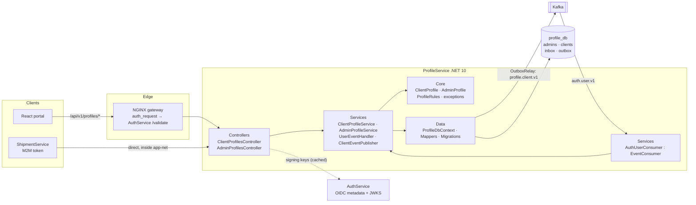
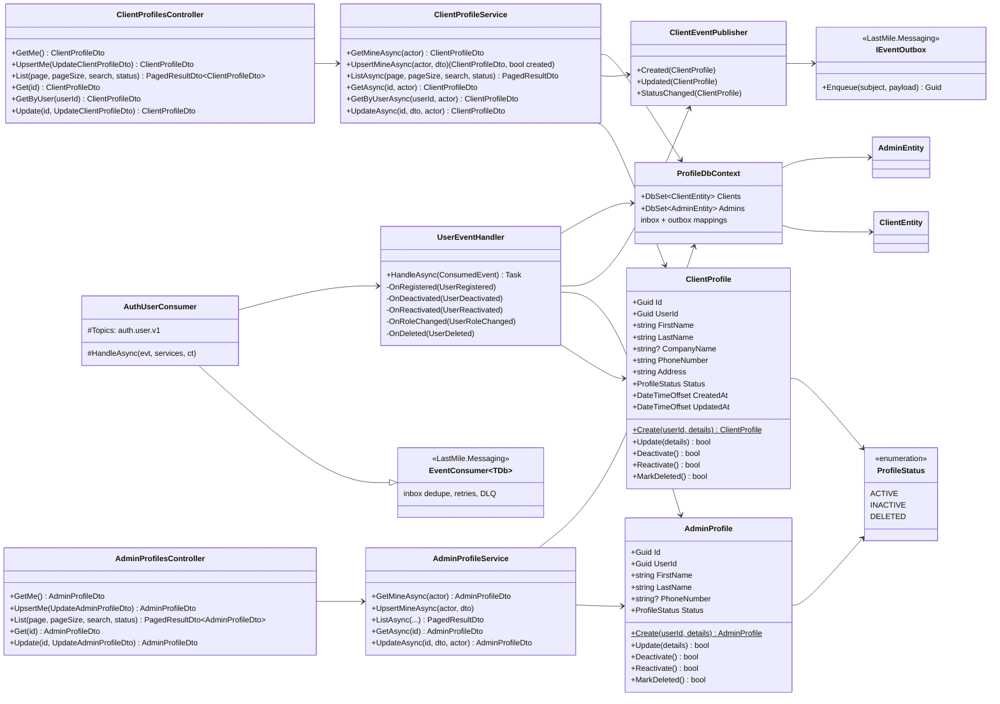

# Microservice definition: ProfileService

**Version:** 1.0.0 (2026-11-10) · **Status:** ✅ implemented ([`ProfileService/`](../../ProfileService)) and verified end to end (§11). Written before the code. The build follows it, and the few clarifications found while building are in §11.
**Related:** [high-level-architecture.md](../high-level-architecture.md) §2 · [data-model.md](../data-model.md) §2 · [data-ownership-matrix.md](../data-ownership-matrix.md) · [kafka-architecture.md](../kafka-architecture.md) · [AuthService API](../AuthService/api-reference.md)

## 1. Description

ProfileService owns the **personal and business profiles of administrators and clients** (shipment senders and recipients). It answers *"who is this person?"* for every account that is not a driver. Driver profiles belong to FleetService.

- It never creates identities. AuthService creates accounts and publishes `UserRegistered` with the profile fields collected at registration (decision D2). ProfileService **consumes** that event and creates the `admins` / `clients` row.
- It is the **only writer** of `admins` and `clients` (database-per-service, `profile_db`).
- It publishes `profile.client.v1` events so that ShipmentService can keep a read model of clients.
- It is a backend API with no interface. The React portal and other services call it through NGINX, or directly inside the docker network for M2M calls.

## 2. Tech stack

Same stack and structure as AuthService:

| Concern | Choice |
|---|---|
| Runtime | .NET 10, ASP.NET Core (controllers) |
| Persistence | PostgreSQL 16 (`profile_db`, own container `profile-postgres`), EF Core 10 + Npgsql, migrations applied at startup |
| Messaging | Kafka via the shared `LastMile.Messaging` + `LastMile.Contracts` libraries: inbox consumer for `auth.user.v1`, transactional outbox for `profile.client.v1`, Schema Registry (JSON Schema) |
| Security | JWT bearer validation **locally**, with keys discovered from AuthService's OIDC metadata/JWKS (RS256). NGINX `auth_request` in front for blacklist checks. |
| Docs | OpenAPI (`/openapi/v1.json`, Development), this document |
| Packaging | Docker image built from the repository root (needs `shared/`), run by `docker-compose.yml` |

## 3. Requirements

### Functional requirements

| # | Requirement |
|---|---|
| FR-1 | Create an **admin** or **client** profile when `UserRegistered` arrives for role `ADMIN` / `CLIENT`. `DRIVER` events are ignored (FleetService owns drivers). |
| FR-2 | Keep profile **status** in sync with the account: `UserDeactivated` → `INACTIVE`, `UserReactivated` → `ACTIVE`, `UserDeleted` → `DELETED` (soft delete), `UserRoleChanged` away from the role → `INACTIVE`, and back to it → `ACTIVE` if a profile exists. |
| FR-3 | Let a signed-in client or admin **read and edit their own profile** (`/me`). If no profile exists (e.g. the role changed to CLIENT), `PUT /me` creates it. |
| FR-4 | Let administrators **list, search, read and edit** any client or admin profile. |
| FR-5 | Let other services (M2M, scope `profiles:read`) **look up clients** by id, by user id, or by search. ShipmentService uses this to validate senders and recipients. |
| FR-6 | Publish `ClientCreated`, `ClientUpdated`, `ClientDeactivated`, `ClientReactivated` and `ClientDeleted` on `profile.client.v1`, in the same transaction as the change. |
| FR-7 | Log every write (structured logs with actor, profile and correlation id). |

### Non-functional requirements

| # | Requirement |
|---|---|
| NFR-1 | **Ownership:** no foreign key to `users`. `user_id` is a logical reference. Email, password and role are never stored here (matrix §4). |
| NFR-2 | **Idempotent, ordered consumption:** each event is applied once (inbox), and the events of one user are applied in order (Kafka key = `userId`). |
| NFR-3 | **Eventual consistency:** a profile appears shortly after registration, typically in under 2 s. Clients treat an early `404` on `/me` as "being created". |
| NFR-4 | **Availability:** reads and writes work when Kafka is down. Outgoing events wait in the outbox, and incoming ones are consumed once Kafka is back. |
| NFR-5 | **Security:** every endpoint requires a valid token. RBAC is enforced in the service (`ADMIN`, `CLIENT`, M2M scope). Personal data is returned only to the owner, admins and authorized services. |
| NFR-6 | **Performance:** P95 < 100 ms for single-profile reads. Lists are paginated (max 100). |
| NFR-7 | **Operability:** `/health` covers the database and outbox lag. Migrations run on startup, with retries while the DB starts. |

## 4. Service-level architecture



**Request path:** NGINX checks the token against AuthService (`auth_request /_auth`, which catches blacklisted tokens). ProfileService then **validates the JWT again locally**: signature from JWKS, issuer, audience and expiry. It applies RBAC from the `role` / `scope` claims. Service-to-service calls (M2M) go straight to `profile-service:8080` on the internal network and are validated locally only.

**Event path:**
1. `AuthUserConsumer` reads `auth.user.v1` as consumer group `profile-service`.
2. For each event, the inbox insert, the profile change and the outgoing `profile.client.v1` outbox row commit in **one transaction**.
3. `OutboxRelay` publishes the outbox row.

**Layers** (same as AuthService):

| Folder | Responsibility |
|---|---|
| `Controllers/` | HTTP endpoints only: binding, `[Authorize]` and status codes. They delegate to services. |
| `Services/` | Use cases and orchestration: authorization rules (owner/admin/M2M), transactions, event publishing, the Kafka consumer |
| `Core/` | Domain models `ClientProfile` and `AdminProfile` with their invariants (validation, status transitions), domain exceptions, the API exception handler |
| `Data/` | `ProfileDbContext` (EF mappings + `AddInbox()`/`AddOutbox()`), `Mappers` (domain ↔ entity), migrations, `DatabaseInitializer` |
| `DTOs/` | Request and response contracts of the HTTP API |
| `Models/` | EF persistence entities (`ClientEntity`, `AdminEntity`) |
| `Enums/` | `ProfileStatus`, roles, claim names, scopes |
| `Options/` | Typed configuration (`JwtOptions`) |

## 5. Data model (`profile_db`)

This implements [data-model.md §2](../data-model.md#2-profileservice--profile_db--designed) and closes its known gaps: soft delete and `updated_at`.

```sql
CREATE TABLE clients (
    id           UUID PRIMARY KEY DEFAULT gen_random_uuid(),
    user_id      UUID NOT NULL UNIQUE,              -- → AuthService.users (logical, no FK)
    first_name   VARCHAR(100) NOT NULL,
    last_name    VARCHAR(100) NOT NULL,
    company_name VARCHAR(255),
    phone_number VARCHAR(50)  NOT NULL,
    address      VARCHAR(1000) NOT NULL,
    status       VARCHAR(20)  NOT NULL DEFAULT 'ACTIVE' CHECK (status IN ('ACTIVE','INACTIVE','DELETED')),
    created_at   TIMESTAMPTZ  NOT NULL DEFAULT CURRENT_TIMESTAMP,
    updated_at   TIMESTAMPTZ  NOT NULL DEFAULT CURRENT_TIMESTAMP
);
CREATE TABLE admins (
    id           UUID PRIMARY KEY DEFAULT gen_random_uuid(),
    user_id      UUID NOT NULL UNIQUE,              -- → AuthService.users (logical, no FK)
    first_name   VARCHAR(100) NOT NULL,
    last_name    VARCHAR(100) NOT NULL,
    phone_number VARCHAR(50),
    status       VARCHAR(20)  NOT NULL DEFAULT 'ACTIVE' CHECK (status IN ('ACTIVE','INACTIVE','DELETED')),
    created_at   TIMESTAMPTZ  NOT NULL DEFAULT CURRENT_TIMESTAMP,
    updated_at   TIMESTAMPTZ  NOT NULL DEFAULT CURRENT_TIMESTAMP
);
-- + inbox (consumed auth.user.v1 event ids) and outbox (profile.client.v1), shared mappings from LastMile.Messaging
```

`address` is `VARCHAR(1000)` instead of `TEXT`, so it matches the limit AuthService validates at registration. Rows are never hard-deleted: `DELETED` keeps the row, because shipments reference `clients.id` and ShipmentService may still need to resolve it.

## 6. UML class diagram



## 7. API design

Base path `/api/v1/profiles` (NGINX → `profile-service:8080`). JSON camelCase, enums as strings, errors as RFC 7807 problem details (same conventions as [AuthService](../AuthService/api-reference.md#1-conventions)). **There are no POST or DELETE endpoints:** profiles are created by `UserRegistered` (or by `PUT …/me` when missing) and deleted when the account is deleted in AuthService.

### Endpoints

| Method & path | Access | Success | Errors | Publishes |
|---|---|---|---|---|
| `GET /profiles/clients/me` | CLIENT | `200` ClientProfile | `404` not created yet | — |
| `PUT /profiles/clients/me` | CLIENT | `200` updated / `201` created | `400` | `ClientUpdated` / `ClientCreated` |
| `GET /profiles/clients?page&pageSize&search&status` | ADMIN, M2M `profiles:read` | `200` page | `403` | — |
| `GET /profiles/clients/{id}` | ADMIN, M2M `profiles:read`, owner | `200` | `403`, `404` | — |
| `GET /profiles/clients/by-user/{userId}` | ADMIN, M2M `profiles:read`, owner | `200` | `403`, `404` | — |
| `PUT /profiles/clients/{id}` | ADMIN | `200` | `400`, `404`, `409` deleted | `ClientUpdated` |
| `GET /profiles/admins/me` | ADMIN | `200` AdminProfile | `404` | — |
| `PUT /profiles/admins/me` | ADMIN | `200` / `201` | `400` | — |
| `GET /profiles/admins?page&pageSize&search&status` | ADMIN | `200` page | `403` | — |
| `GET /profiles/admins/{id}` | ADMIN | `200` | `404` | — |
| `PUT /profiles/admins/{id}` | ADMIN | `200` | `400`, `404`, `409` deleted | — |

- **Default listing** shows `status=ACTIVE`. Pass `status=INACTIVE|DELETED` explicitly. `search` matches first name, last name, company and phone (case-insensitive). Pages are 1-based, `pageSize` ≤ 100, ordered by last name then first name.
- **Owner access** compares the token's `sub` with `user_id`. An owner can read their profile through `/clients/{id}` and `/by-user/{userId}` too.
- **`DELETED` profiles** are returned by id or by user to ADMIN/M2M (for shipment history) but never to owners, and they cannot be edited (`409`).

### Request / response shapes

```jsonc
// PUT /profiles/clients/me  and  PUT /profiles/clients/{id}   (full replacement)
{ "firstName": "Jane", "lastName": "Doe", "companyName": "Acme", "phoneNumber": "+213 555 12 34", "address": "12 Rue …, Alger" }
//   firstName, lastName ≤100 required · phoneNumber ≤50 required · address ≤1000 required · companyName ≤255 optional

// ClientProfileDto
{ "id": "…", "userId": "…", "firstName": "Jane", "lastName": "Doe", "companyName": "Acme",
  "phoneNumber": "+213 555 12 34", "address": "12 Rue …, Alger", "status": "ACTIVE",
  "createdAt": "2026-11-10T22:27:13Z", "updatedAt": "2026-11-10T22:27:13Z" }

// PUT /profiles/admins/me  and  PUT /profiles/admins/{id}
{ "firstName": "Sam", "lastName": "Admin", "phoneNumber": null }      // phoneNumber optional

// AdminProfileDto
{ "id": "…", "userId": "…", "firstName": "Sam", "lastName": "Admin", "phoneNumber": null,
  "status": "ACTIVE", "createdAt": "…", "updatedAt": "…" }

// Page
{ "items": [ … ], "page": 1, "pageSize": 20, "totalCount": 42 }
```

### Authentication and authorization

| Caller | Token | Accepted when |
|---|---|---|
| Human (portal) | user access token, `aud = last-mile-api` | `role` claim = `CLIENT` / `ADMIN` as listed above |
| Service (M2M) | client-credentials token, `aud = profile-service` | `scope` contains `profiles:read` |

Tokens are validated with AuthService's signing keys, fetched from `{AuthService}/.well-known/openid-configuration` → `jwks_uri` and cached. Unknown `kid`s trigger a refresh, so key rotation works.

## 8. Events

### Consumed: `auth.user.v1` (consumer group `profile-service`)

| Event | Action |
|---|---|
| `UserRegistered` role `CLIENT` | create `clients` row from `profile`, then publish `ClientCreated` |
| `UserRegistered` role `ADMIN` | create `admins` row |
| `UserRegistered` role `DRIVER` | ignore (FleetService) |
| `UserDeactivated` | profile for that user → `INACTIVE` (+ `ClientDeactivated`) |
| `UserReactivated` (role = current role) | profile of that role → `ACTIVE` (+ `ClientReactivated`) |
| `UserRoleChanged` | profile of `previousRole` → `INACTIVE`. An existing profile of the new `role` → `ACTIVE`. |
| `UserDeleted` | profile → `DELETED` (+ `ClientDeleted`) |
| `UserEmailChanged` | ignore (email is not stored here) |

An event for a user without a profile here (e.g. accounts created before D2) is a no-op. A `UserRegistered` for a user who already has a profile is a no-op too, so redelivery is safe. Invalid payloads (e.g. a CLIENT without an address) go to `auth.user.v1.dlq`.

### Published: `profile.client.v1` (key = `clientId`)

| Event | Payload |
|---|---|
| `ClientCreated`, `ClientUpdated` | `clientId, userId, firstName, lastName, companyName?, phoneNumber, address` |
| `ClientDeactivated`, `ClientReactivated`, `ClientDeleted` | `clientId, userId` |

Admin profiles publish nothing, because no service consumes them yet.

## 9. Configuration

```jsonc
{
  "ConnectionStrings": { "ProfileDb": "Host=profile-postgres;Database=profile_db;Username=profile_user;Password=…;GSS Encryption Mode=Disable" },
  "Jwt": {
    "MetadataAddress": "http://auth-service:8080/.well-known/openid-configuration",
    "Issuer": "https://auth.lastmile.internal",
    "Audiences": [ "last-mile-api", "profile-service" ]
  },
  "Kafka": { "BootstrapServers": "kafka:9092", "SchemaRegistryUrl": "http://schema-registry:8081" }
}
```

## 10. Running it

| | |
|---|---|
| Container | `profile-service` (port 8080 on `app-net`, not published). Reach it through NGINX at `http://localhost/api/v1/profiles/…` |
| Database | `profile_postgres_db` (`profile_db`, user `profile_user`), host port **5434** for local tooling. Migrations run at startup. |
| Kafka | consumer group `profile-service` on `auth.user.v1`, publishes `profile.client.v1` |
| OpenAPI | `GET /openapi/v1.json` (Development), e.g. `docker exec schema-registry curl -s profile-service:8080/openapi/v1.json` |
| Health | `GET /health` (database + outbox lag) |
| M2M client (dev) | `shipment-service` / `dev-shipment-secret-123`, scope `profiles:read`, audience `profile-service` (seeded by AuthService) |

Local run outside docker: `dotnet run` uses `appsettings.json` (DB on `localhost:5434`, Kafka on `localhost:9094`, JWT metadata via `http://localhost/.well-known/openid-configuration`).

## 11. Verification and implementation notes (2026-11-10)

Verified against the running stack:

| Check | Result |
|---|---|
| Startup on an empty `profile_db` | migration applied, then the full `auth.user.v1` history replayed in order: demo admin and John got profiles, Jane (DRIVER) was skipped, and earlier test users ended `DELETED` after their role, status and delete events |
| Registration → profile | the new client's profile was readable through `GET /clients/me` **1.5 s** after `POST /auth/register` (NFR-3) |
| Account deactivate / delete | profile → `INACTIVE` → `DELETED`, with `ClientDeactivated` / `ClientDeleted` published |
| RBAC | no token → 401 · CLIENT: own profile 200, other client 403, list 403, admins 403 · DRIVER on `/clients/me` 403 · ADMIN: all reads, edit of a DELETED profile 409, unknown id 404 · validation 400 |
| M2M (`profiles:read`, inside `app-net`) | list and by-user 200, admins 403 |
| Revoked token (after logout) | 401 at the gateway (`auth_request`) |
| Schema Registry | 5 subjects `profile.client.v1-Client*` registered |

**Clarifications made while building:**
- **M2M calls must go container to container** (`http://profile-service:8080`), not through NGINX. The gateway's `auth_request` validates against AuthService's user-token audience (`last-mile-api`), so it rejects M2M tokens (`aud = profile-service`) with 401. This is intended: the gateway is the entry point for users only.
- **Personal-data replay:** a new consumer group starts from the earliest offset, so ProfileService rebuilds from the 30 days of `auth.user.v1` history. Test accounts created during development therefore appear as `DELETED` rows.
- **Shared library change:** `EventConsumer.HandleAsync` now receives the scope's `IServiceProvider`, so handlers can use scoped services (like `IEventOutbox`) inside the inbox transaction.

## 12. Open points

1. **Choosing a recipient:** a CLIENT creating a shipment must pick another client as the recipient (D1). Client search is limited to ADMIN/M2M on purpose, for privacy. The recipient-selection flow belongs to ShipmentService's design.
2. `UserEmailChanged` is ignored. If a screen needs to show emails next to profiles, add a read-model column fed by that event (matrix §4).
