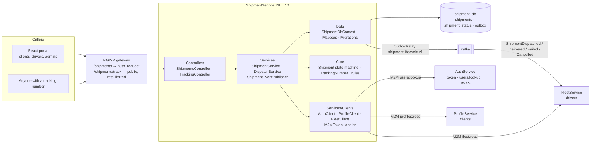
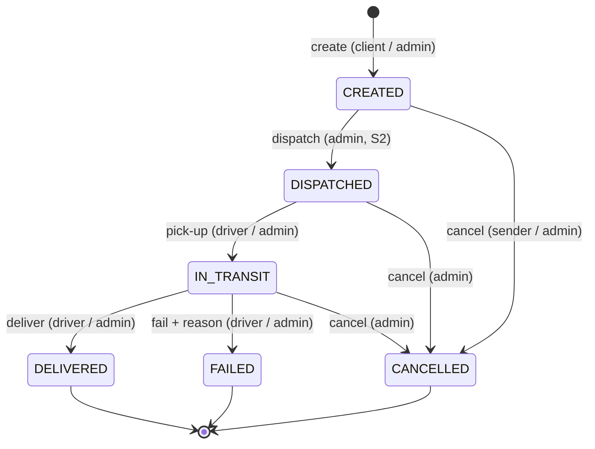
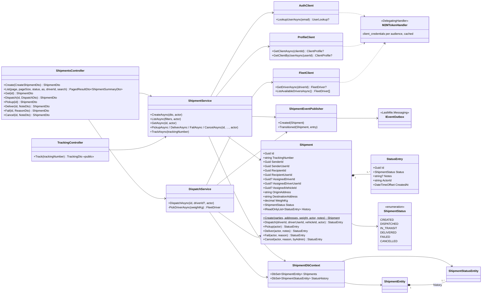

# Microservice definition: ShipmentService

**Version:** 1.0.0 (2026-11-11) · **Status:** ✅ implemented ([`ShipmentService/`](../../ShipmentService)) and verified end to end (§11). Written before the code. The build follows it, and the notes from building are in §11.
**Related:** [high-level-architecture.md](../high-level-architecture.md) §2, §4.3 · [product-requirements-document.md](../product-requirements-document.md) UC-3, FR-4, FR-5 · [data-model.md](../data-model.md) §4 · [data-ownership-matrix.md](../data-ownership-matrix.md) (D1, D3) · [kafka-architecture.md](../kafka-architecture.md) §7.2 · [ProfileService](../ProfileService/ProfileService.md) · [FleetService](../FleetService/FleetService.md)

## 1. Description

ShipmentService owns **the transactional lifecycle of shipments**, from the order (CREATED) to the outcome (DELIVERED, FAILED or CANCELLED). It is the system of record for *who sends what to whom, who carries it, and what happened to it*.

- It stores each shipment with **snapshots** taken at the right moment:
  - **at creation:** the sender and recipient client ids, and both addresses
  - **at dispatch:** the driver and vehicle
- It keeps an **append-only status history** (`shipment_status`), which is the shipment audit trail.
- It **publishes every transition** on `shipment.lifecycle.v1` (HLA §4.3, PRD FR-5). FleetService uses these events to flip driver availability (D3), and later FleetTrackingService and NotificationService will consume them too.
- It reads other services' data **only through their APIs**, with M2M tokens:
  - **AuthService:** recipient lookup by email
  - **ProfileService:** sender and recipient client profiles
  - **FleetService:** available drivers and their vehicles

### Product decisions for this service (2026-11-11)

| # | Decision |
|---|---|
| S1 | **Creation:** a CLIENT creates a shipment for themselves as sender and names the recipient **by email**. ShipmentService resolves the email through a new M2M lookup in AuthService, then the recipient's client profile in ProfileService. An ADMIN can create a shipment for any sender and recipient by client id (or recipient email). |
| S2 | **Dispatch:** an ADMIN dispatches a CREATED shipment to a chosen available driver. If no driver is given, ShipmentService **auto-picks** an available driver whose vehicle capacity fits the weight, choosing the smallest vehicle that fits. |
| S3 | **Public tracking:** `GET /shipments/track/{trackingNumber}` works **without login** and returns limited data: status, timeline, and driver/vehicle ids for the live map. It never returns names, addresses, phones or notes. Tracking numbers are random (`LM-` + 12 characters, about 60 bits), so they can't be guessed. |

## 2. Tech stack

Same as AuthService, ProfileService and FleetService:

| Concern | Choice |
|---|---|
| Runtime | .NET 10, ASP.NET Core (controllers) |
| Persistence | PostgreSQL 16 (`shipment_db`, container `shipment-postgres`), EF Core 10 + Npgsql, migrations at startup |
| Messaging | `LastMile.Messaging` + `LastMile.Contracts`: **outbox** for `shipment.lifecycle.v1`, Schema Registry (JSON Schema). No consumer yet (§10). |
| Service-to-service | typed `HttpClient`s with an **M2M token handler**: OAuth client credentials against AuthService, with tokens cached per audience until shortly before they expire. 5 s timeout. A failure maps to **503**. |
| Security | Local JWT validation (AuthService OIDC/JWKS) and NGINX `auth_request`, except for the public tracking route, which is rate-limited at NGINX |
| Docs / packaging | OpenAPI (Development), Docker image built from the repository root |

## 3. Requirements

### Functional requirements

| # | Requirement |
|---|---|
| FR-1 | **Create a shipment (S1).** The sender is the calling client, or any client for an ADMIN. The recipient is identified by email or client id, and must be an **ACTIVE CLIENT** different from the sender. Weight is between 0 and 100 000 kg. The origin address defaults to the sender's profile address and the destination to the recipient's, and either can be overridden. Both addresses are **snapshotted**. A random tracking number is generated. Status `CREATED`. |
| FR-2 | **Dispatch (S2, ADMIN).** The shipment must be CREATED. The driver must be ACTIVE and available, with a vehicle whose capacity is at least the weight, and **no other active shipment**. The driver, the driver's user id and the vehicle are snapshotted. Status `DISPATCHED`. |
| FR-3 | **Driver progress (assigned driver, or ADMIN):** pick-up (`IN_TRANSIT`), then **deliver** (`DELIVERED`, with an optional proof-of-delivery note, PRD UC-3) or **fail** (`FAILED`, with a required reason). |
| FR-4 | **Cancel:** an ADMIN can cancel any shipment that isn't finished yet. The sender can cancel only while it's `CREATED`. A reason is optional. |
| FR-5 | **Read:** ADMIN and M2M (`shipments:read`) see all shipments. A CLIENT sees shipments where they are the sender or the recipient, and a DRIVER the shipments assigned to them. Lists can be filtered and paginated. Details include the full history. |
| FR-6 | **Public tracking (S3)** by tracking number, without login. |
| FR-7 | **Publish** `shipment.lifecycle.v1` for every transition, in the same transaction as the change (§8). |
| FR-8 | **Audit:** every status row records who did it (`actor_id`) and when. History is append-only. |

### Non-functional requirements

| # | Requirement |
|---|---|
| NFR-1 | **Ownership:** sender, recipient, driver and vehicle are logical references (ids plus snapshots) with no FKs across services. Only `shipment_status → shipments` is a real FK. |
| NFR-2 | **One active shipment per driver** (D3) is enforced by a **partial unique index**, not only by code, which closes the dispatch race (kafka-architecture.md §7.2). |
| NFR-3 | **Resilience (PRD):** status lookups and tracking need only `shipment_db`. Creation and dispatch depend on Auth/Profile/Fleet and fail fast with **503** when one is down. An outage of FleetTrackingService never affects this service. |
| NFR-4 | **Consistency:** the status change, the history row and the outbox event commit in **one transaction**, and `current_status` always equals the latest history row. |
| NFR-5 | **Security:** RBAC by role, M2M scope and ownership (sender, recipient or assigned driver by token `sub`). The public endpoint exposes no personal data and is rate-limited at the gateway. |
| NFR-6 | **Performance:** P95 < 100 ms for reads and tracking. Create and dispatch < 500 ms, including the M2M calls (tokens are cached). |
| NFR-7 | **Operability:** `/health` covers the database and outbox. Structured logs for every transition. |

## 4. Service-level architecture



**Creating a shipment (client, S1):**
1. `ProfileClient.GetClientByUser(sub)` gets the sender's profile, which must be ACTIVE.
2. `AuthClient.LookupUser(email)` returns the recipient's `{userId, role, isActive}`, which must be an active CLIENT.
3. `ProfileClient.GetClientByUser(userId)` gets the recipient's profile, which must be ACTIVE.
4. One transaction inserts the shipment, the `CREATED` history row and the `ShipmentCreated` outbox row.

**Dispatching (S2):**
1. `FleetClient` reads the chosen driver, or, for auto-pick, lists available drivers.
2. The capacity check runs, then the transaction: the snapshots, the `DISPATCHED` history row and the `ShipmentDispatched` outbox row. If the driver already has an active shipment, the partial unique index rejects it with 409.
3. FleetService consumes `ShipmentDispatched` and makes the driver unavailable. After `ShipmentDelivered`, `ShipmentFailed` or `ShipmentCancelled`, it makes them available again, if they still have an active vehicle.

**Layers** (same as the other services):

| Folder | Responsibility |
|---|---|
| `Controllers/` | HTTP endpoints (`ShipmentsController`, `TrackingController` for the public route) |
| `Services/` | Use cases (create, read, transitions), dispatch and driver selection, authorization, event publishing |
| `Services/Clients/` | Typed HTTP clients for AuthService, ProfileService and FleetService, and the M2M token handler |
| `Core/` | `Shipment` aggregate (state machine, history), `TrackingNumber` generator, rules, domain exceptions, API exception handler |
| `Data/` | `ShipmentDbContext` (+ outbox), `Mappers`, migrations, `DatabaseInitializer` |
| `DTOs/` | HTTP contracts |
| `Models/` | EF entities `ShipmentEntity`, `ShipmentStatusEntity` |
| `Enums/` | `ShipmentStatus`, roles, scopes, policies, claims |
| `Options/` | `JwtOptions`, `ServiceEndpointsOptions` (base URLs + M2M credentials) |

## 5. Data model (`shipment_db`)

This implements [data-model.md §4](../data-model.md#4-shipmentservice--shipment_db--designed) and adds:
- the **user ids** of the sender, recipient and driver, so ownership checks need no remote call
- `actor_id` on history rows
- the partial unique index for one active shipment per driver

```sql
CREATE TABLE shipments (
    id                      UUID PRIMARY KEY DEFAULT gen_random_uuid(),
    tracking_number         VARCHAR(20)  NOT NULL UNIQUE,         -- LM-XXXXXXXXXXXX
    sender_id               UUID NOT NULL,                        -- → ProfileService.clients (snapshot)
    sender_user_id          UUID NOT NULL,                        -- → AuthService.users (ownership checks)
    recipient_id            UUID NOT NULL,                        -- → ProfileService.clients (snapshot)
    recipient_user_id       UUID NOT NULL,
    assigned_driver_id      UUID,                                 -- → FleetService.drivers   (snapshot at dispatch)
    assigned_driver_user_id UUID,
    assigned_vehicle_id     UUID,                                 -- → FleetService.vehicles  (snapshot at dispatch)
    origin_address          VARCHAR(1000) NOT NULL,               -- snapshot
    destination_address     VARCHAR(1000) NOT NULL,               -- snapshot
    weight_kg               DECIMAL(10, 2) NOT NULL CHECK (weight_kg > 0),
    current_status          VARCHAR(20) NOT NULL DEFAULT 'CREATED'
        CHECK (current_status IN ('CREATED','DISPATCHED','IN_TRANSIT','DELIVERED','FAILED','CANCELLED')),
    created_at              TIMESTAMPTZ NOT NULL DEFAULT CURRENT_TIMESTAMP,
    updated_at              TIMESTAMPTZ NOT NULL DEFAULT CURRENT_TIMESTAMP
);
CREATE INDEX idx_shipments_sender_user    ON shipments(sender_user_id);
CREATE INDEX idx_shipments_recipient_user ON shipments(recipient_user_id);
CREATE INDEX idx_shipments_assigned_driver ON shipments(assigned_driver_id);
-- D3: at most one active shipment per driver (closes the dispatch race)
CREATE UNIQUE INDEX ux_shipments_driver_active ON shipments(assigned_driver_id)
    WHERE current_status IN ('DISPATCHED', 'IN_TRANSIT');

CREATE TABLE shipment_status (                                  -- append-only audit trail
    id          UUID PRIMARY KEY DEFAULT gen_random_uuid(),
    shipment_id UUID NOT NULL REFERENCES shipments(id) ON DELETE CASCADE,
    status      VARCHAR(20) NOT NULL CHECK (status IN ('CREATED','DISPATCHED','IN_TRANSIT','DELIVERED','FAILED','CANCELLED')),
    notes       VARCHAR(1000),
    actor_id    VARCHAR(255) NOT NULL,                            -- user id, M2M client id, or "system"
    created_at  TIMESTAMPTZ NOT NULL DEFAULT CURRENT_TIMESTAMP
);
CREATE INDEX idx_shipment_status_shipment_id ON shipment_status(shipment_id, created_at);
-- + outbox (shipment.lifecycle.v1)
```

### State machine



Any other transition returns **409**. `DELIVERED`, `FAILED` and `CANCELLED` are final, so a failed delivery is retried with a new shipment.

## 6. UML class diagram



## 7. API design

Base path `/api/v1/shipments`. JSON camelCase, enums as strings, RFC 7807 errors.

| Method & path | Access | Success | Errors | Publishes |
|---|---|---|---|---|
| `POST /shipments` | CLIENT (self as sender), ADMIN | `201` Shipment | `400`, `404` recipient/sender not found, `409` inactive party, `503` dependency down | `ShipmentCreated` |
| `GET /shipments?page&pageSize&status&as&driverId&search` | ADMIN, M2M `shipments:read`: all · CLIENT: own (`as=sender\|recipient`, default both) · DRIVER: assigned | `200` page of summaries | `403` | — |
| `GET /shipments/{id}` | ADMIN, M2M, sender, recipient, assigned driver | `200` Shipment (+ history) | `403`, `404` | — |
| `GET /shipments/track/{trackingNumber}` | **public** (rate-limited) | `200` Tracking | `404` | — |
| `POST /shipments/{id}/dispatch` | ADMIN | `200` | `404`, `409` wrong state / driver not dispatchable / no driver available, `503` | `ShipmentDispatched` |
| `POST /shipments/{id}/pickup` | assigned DRIVER, ADMIN | `200` | `403`, `409` | `ShipmentInTransit` |
| `POST /shipments/{id}/deliver` | assigned DRIVER, ADMIN | `200` | `403`, `409` | `ShipmentDelivered` |
| `POST /shipments/{id}/fail` | assigned DRIVER, ADMIN | `200` | `400` reason missing, `403`, `409` | `ShipmentFailed` |
| `POST /shipments/{id}/cancel` | ADMIN (any non-final), sender (CREATED only) | `200` | `403`, `409` | `ShipmentCancelled` |

Shipments are never edited or deleted. Mistakes are cancelled and recreated, which keeps the audit trail honest.

### Shapes

```jsonc
// POST /shipments: CLIENT
{ "recipientEmail": "jane.recipient@acme.com", "weightKg": 12.5,
  "destinationAddress": null,              // optional override; default = recipient profile address
  "originAddress": null,                   // optional override; default = sender profile address
  "notes": "Fragile" }                     // optional, stored on the CREATED history row (≤1000)
// POST /shipments: ADMIN (sender required; recipient by id or email)
{ "senderClientId": "…", "recipientClientId": "…", "weightKg": 3 }

// POST …/dispatch
{ "driverId": "…" }                        // or {} / { "driverId": null } → auto-pick (S2)
// POST …/deliver | …/cancel               { "notes": "Left with the concierge" }   (optional)
// POST …/fail                             { "reason": "Recipient absent" }         (required)

// ShipmentDto
{ "id": "…", "trackingNumber": "LM-7K3F9Q2X8M4P", "status": "IN_TRANSIT",
  "senderId": "…", "senderUserId": "…", "recipientId": "…", "recipientUserId": "…",
  "originAddress": "…", "destinationAddress": "…", "weightKg": 12.5,
  "assignedDriverId": "…", "assignedVehicleId": "…",
  "history": [ { "status": "CREATED", "notes": "Fragile", "actorId": "…", "createdAt": "…" }, … ],
  "createdAt": "…", "updatedAt": "…" }

// TrackingDto (public, S3): no personal data
{ "trackingNumber": "LM-7K3F9Q2X8M4P", "status": "IN_TRANSIT",
  "assignedDriverId": "…", "assignedVehicleId": "…",          // for the live map (FleetTrackingService)
  "timeline": [ { "status": "CREATED", "at": "…" }, { "status": "DISPATCHED", "at": "…" }, … ],
  "updatedAt": "…" }
```

### AuthService addition (S1)

`GET /api/v1/users/lookup?email=…` → `200 { "id": "…", "role": "CLIENT", "isActive": true }`, or `404`.
- **Access:** ADMIN, or an M2M token with scope **`users:lookup`**.
- **Audience:** AuthService additionally accepts M2M tokens with audience **`auth-service`**.
- **Dev seed:** the `shipment-service` client gets `users:lookup`, `profiles:read` and `fleet:read`, with audiences `auth-service`, `profile-service` and `fleet-service`.

## 8. Events: `shipment.lifecycle.v1` (key = `shipmentId`)

| Event | Payload |
|---|---|
| `ShipmentCreated` | `shipmentId, trackingNumber, senderId, recipientId, originAddress, destinationAddress, weightKg` |
| `ShipmentDispatched` | `shipmentId, trackingNumber, driverId, vehicleId` |
| `ShipmentInTransit` | `shipmentId, trackingNumber, driverId` |
| `ShipmentDelivered` | `shipmentId, trackingNumber, driverId, notes?` |
| `ShipmentFailed` | `shipmentId, trackingNumber, driverId, reason` |
| `ShipmentCancelled` | `shipmentId, trackingNumber, driverId?, reason?` (`driverId` null if it was never dispatched) |

**FleetService consumes these events** (FleetService.md §8.3, built together with this service):
- `ShipmentDispatched` → the driver becomes unavailable.
- `ShipmentDelivered`, `ShipmentFailed` and `ShipmentCancelled` with a driver → the driver becomes available again, if still ACTIVE with an active vehicle.

FleetTrackingService (next) and NotificationService (future) will subscribe with their own groups.

## 9. Configuration

```jsonc
{
  "ConnectionStrings": { "ShipmentDb": "Host=shipment-postgres;Database=shipment_db;Username=shipment_user;…" },
  "Jwt": { "MetadataAddress": "http://auth-service:8080/.well-known/openid-configuration",
           "Issuer": "https://auth.lastmile.internal", "Audiences": [ "last-mile-api", "shipment-service" ] },
  "Services": {
    "AuthBaseUrl": "http://auth-service:8080", "ProfileBaseUrl": "http://profile-service:8080", "FleetBaseUrl": "http://fleet-service:8080",
    "ClientId": "shipment-service", "ClientSecret": "dev-shipment-secret-123", "TimeoutSeconds": 5
  },
  "Kafka": { "BootstrapServers": "kafka:9092", "SchemaRegistryUrl": "http://schema-registry:8081" }
}
```

## 10. Running it

| | |
|---|---|
| Container | `shipment-service` (port 8080 on `app-net`). Through NGINX at `http://localhost/api/v1/shipments…`. Public tracking: `http://localhost/api/v1/shipments/track/{trackingNumber}` (5 req/s per IP, burst 20, then 429). |
| Database | `shipment_postgres_db` (`shipment_db`, user `shipment_user`), host port **5436**. Migrations run at startup. |
| Kafka | publishes `shipment.lifecycle.v1`; FleetService (group `fleet-service`) consumes it |
| M2M identity | service client `shipment-service` (dev secret in `appsettings.Development.json`), scopes `users:lookup profiles:read fleet:read` |
| Demo accounts | sender `john@doe.com` / `Client12345!`, recipient **`mary@doe.com` / `Client12345!`** (seeded for this service), driver `jane@doe.com` / `Driver12345!` (DEMO-001, 650 kg), admin `admin@lastmile.local` / `Admin12345!` |

**Demo script** (the same flow as the verification):
1. Jane starts a shift: `PUT /fleet/drivers/me/availability {"isAvailable":true}`.
2. John creates a shipment: `POST /shipments {"recipientEmail":"mary@doe.com","weightKg":12.5}`.
3. The admin dispatches it with auto-pick: `POST /shipments/{id}/dispatch {}`.
4. Jane picks it up, then delivers it: `/pickup`, then `/deliver {"notes":"…"}`.
5. Anyone can follow it at `/shipments/track/{trackingNumber}`.

## 11. Verification and implementation notes (2026-11-11)

| Check | Result |
|---|---|
| Create (S1) | John → `MARY@doe.com` (email is case-insensitive): 201, `LM-…` tracking number, addresses snapshotted from both profiles, note stored on the CREATED row |
| Create validation | unknown email 404 · recipient is a DRIVER 409 · ship to self 400 · weight 0 400 · client setting `senderClientId` 400 · DRIVER creating 403 |
| Read | recipient sees the shipment with history · an unassigned driver gets 403 · lists are scoped (John 1, Mary as sender 0, Jane 0) · no token 401 |
| Public tracking (S3) | 200 without a token, lower-case input accepted, keys = `trackingNumber, status, timeline, assignedDriverId, assignedVehicleId, updatedAt` only · unknown 404 · 40 rapid calls → 24 × 200, 16 × 429 |
| Dispatch (S2) | chosen driver off shift 409 · auto with nobody on shift 409 · auto 700 kg > 650 kg van 409 · auto 12.5 kg → Jane |
| D3 via Kafka | `ShipmentDispatched` → FleetService made Jane unavailable. `Delivered`, `Failed` and `Cancelled` (after dispatch) → available again. |
| Driver progress | client pick-up 403 · deliver before pick-up 409 · pick-up → deliver with note → DELIVERED · deliver twice 409 · fail without reason 400, with reason → FAILED |
| Cancel | sender while CREATED 200 · sender while IN_TRANSIT 409 · admin while DISPATCHED 200 |
| Race (NFR-2) | two concurrent dispatches to Jane → one 200, one 409 "This driver already has an active shipment." |
| Resilience (NFR-3) | ProfileService stopped → create 503 in 0.14 s, while tracking and listing still 200 |
| Events | all 6 types on `shipment.lifecycle.v1`, 6 Schema Registry subjects, outbox drained. Every `users:lookup` is in AuthService `audit_logs`. |

**Notes:**
- `DispatchService` checks "driver already busy" locally before writing. The partial unique index `ux_shipments_driver_active` is the backstop for true concurrency, and the API maps its violation to a 409 with a clear message.
- The recipient lookup tells a client whether an email has an account (404 vs 201). This is accepted for the MVP, and every lookup is audited.
- The test run left 6 shipments in `shipment_db` (1 delivered, 1 failed, 4 cancelled), which is useful demo history.

## 12. Open points

1. **Driver lost after dispatch:** if a dispatched driver is deactivated, the shipment stays DISPATCHED or IN_TRANSIT until an admin cancels it. Later, a `fleet.driver.v1` consumer could flag those shipments for reassignment (matrix §5).
2. **Re-dispatch:** the MVP has no reassignment of an active shipment. Cancel it and create a new one.
3. **Notifications** (NotificationService, future) will subscribe to `shipment.lifecycle.v1`. No change is needed here.
