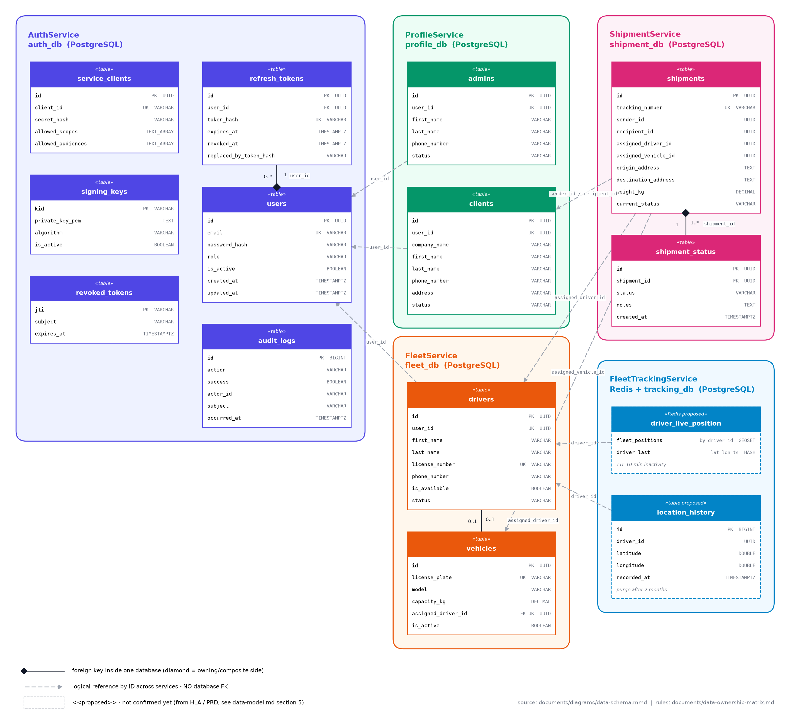

# Data Model — as of 2026-11-10

> The current data model of the Last-Mile platform, split **one database per service**.
> It replaces the legacy monolithic `data.sql` (deleted on 2026-11-10; it is still in git history before that date).
>
> - **Who owns what and how services share data:** [data-ownership-matrix.md](data-ownership-matrix.md)
> - **Diagram:** [diagrams/data-schema.png](diagrams/data-schema.png) · source [diagrams/data-schema.mmd](diagrams/data-schema.mmd)
> - **Service domains:** [high-level-architecture.md](high-level-architecture.md)



## Status legend

| Status | Meaning | Source of truth |
|---|---|---|
| ✅ **Built** | Running in code, created by EF Core migrations | the service's `DbContext` + `Migrations/` |
| 📐 **Designed** | Agreed schema, service not built yet | **this document** (the DDL below), carried over from `data.sql` |
| 💡 **Proposed** | Derived from the HLA/PRD, still to be confirmed | this document |

When a service is built, its EF Core migrations become the source of truth. Update this document in the same PR.

## Conventions (all PostgreSQL databases)

- Primary keys are `UUID DEFAULT gen_random_uuid()`. High-volume append-only logs use a `BIGINT` identity key instead.
- Timestamps are `TIMESTAMP WITH TIME ZONE`, with `created_at` defaulting to `CURRENT_TIMESTAMP`.
- Enumerations are stored as `VARCHAR` + `CHECK` constraints, in UPPER_SNAKE_CASE.
- Table and column names are `snake_case`, and tables are named in the plural.
- **References to another service's data are plain `UUID` columns with no `REFERENCES` clause.** They are marked `-- → Service.table` in the DDL below. Foreign keys exist only inside one database.

---

## 1. AuthService · `auth_db` — ✅ Built

Source of truth: [`AuthService/Data/AuthDbContext.cs`](../AuthService/Data/AuthDbContext.cs), migration `20261104201112_InitialCreate`.

### `users`: human identities
| Column | Type | Null | Notes |
|---|---|:-:|---|
| `id` | uuid | | PK, `gen_random_uuid()`. **The identity key used by every other service as `user_id`.** |
| `email` | varchar(255) | | unique (`idx_users_email`), stored normalized |
| `password_hash` | varchar(255) | | |
| `role` | varchar(50) | | CHECK `ADMIN`, `DRIVER`, `CLIENT` |
| `is_active` | boolean | | default `true`. Can the account log in? |
| `created_at`, `updated_at` | timestamptz | | default now |

### `refresh_tokens`: opaque refresh tokens (7 days, rotated on every use)
| Column | Type | Null | Notes |
|---|---|:-:|---|
| `id` | uuid | | PK |
| `user_id` | uuid | | FK → `users(id)` **ON DELETE CASCADE**, indexed |
| `token_hash` | varchar(64) | | unique. The raw token is never stored. |
| `expires_at` | timestamptz | | |
| `created_at` | timestamptz | | default now |
| `created_by_ip` | varchar(64) | ✓ | |
| `revoked_at` | timestamptz | ✓ | |
| `revoked_reason` | varchar(100) | ✓ | |
| `replaced_by_token_hash` | varchar(64) | ✓ | rotation chain |

### `revoked_tokens`: access-token blacklist (by `jti`)
| Column | Type | Null | Notes |
|---|---|:-:|---|
| `jti` | varchar(64) | | PK |
| `subject` | varchar(255) | | user id or M2M client id |
| `expires_at` | timestamptz | | indexed. Rows can be purged after this time. |
| `revoked_at` | timestamptz | | default now |
| `reason` | varchar(100) | ✓ | |

### `service_clients`: M2M principals (OAuth client credentials)
| Column | Type | Null | Notes |
|---|---|:-:|---|
| `id` | uuid | | PK |
| `client_id` | varchar(100) | | unique |
| `name` | varchar(255) | | |
| `secret_hash` | varchar(255) | | |
| `allowed_scopes` | text[] | | |
| `allowed_audiences` | text[] | | |
| `is_active` | boolean | | default `true` |
| `created_at` | timestamptz | | default now |

> The `M2M` role is used only in tokens for `service_clients`. It is never stored in `users.role`.

### `signing_keys`: RS256 JWT signing keys (published as JWKS)
| Column | Type | Null | Notes |
|---|---|:-:|---|
| `kid` | varchar(64) | | PK |
| `private_key_pem` | text | | never leaves AuthService |
| `algorithm` | varchar(16) | | `RS256` |
| `created_at` | timestamptz | | default now |
| `is_active` | boolean | | default `true` |

### `audit_logs`: security audit trail
| Column | Type | Null | Notes |
|---|---|:-:|---|
| `id` | bigint | | PK, identity |
| `occurred_at` | timestamptz | | default now, indexed |
| `action` | varchar(64) | | e.g. login, refresh, role change |
| `success` | boolean | | |
| `actor_id` | varchar(255) | ✓ | indexed |
| `subject` | varchar(255) | ✓ | |
| `ip_address` | varchar(64) | ✓ | |
| `details` | text | ✓ | |

### `outbox`: integration events waiting to be published (added 2026-11-10, migration `AddOutbox`)

Shared mapping from `LastMile.Messaging` (`modelBuilder.AddOutbox()`). Every service that publishes events gets the same table. See [kafka-architecture.md §5](kafka-architecture.md#5-reliable-publishing-transactional-outbox).

| Column | Type | Null | Notes |
|---|---|:-:|---|
| `id` | bigint | | PK, identity: publish order |
| `event_id` | uuid | | unique; = envelope `eventId` |
| `topic` | varchar(200) | | e.g. `auth.user.v1` |
| `message_key` | varchar(100) | | aggregate id (`userId`) |
| `event_type` | varchar(100) | | e.g. `UserRegistered` |
| `payload` | jsonb | | full event envelope |
| `correlation_id` | varchar(100) | ✓ | from `X-Request-Id` |
| `occurred_at` | timestamptz | | default now |
| `published_at` | timestamptz | ✓ | set by the relay. Published rows are deleted after 1 hour. |
| `attempts` | int | | default 0 |
| `last_error` | text | ✓ | last publish failure |

> Rows can carry `UserRegistered` profile fields. AuthService only relays these and does not own them, which is why published rows are deleted after 1 hour.

---

## 2. ProfileService · `profile_db` — ✅ Built

Source of truth: [`ProfileService/Data/ProfileDbContext.cs`](../ProfileService/Data/ProfileDbContext.cs), migration `InitialCreate`. Service design: [ProfileService/ProfileService.md](ProfileService/ProfileService.md).

Profiles are created by consuming `UserRegistered` (decision D2). The profile fields come from the registration request: see [data-ownership-matrix.md §8.1](data-ownership-matrix.md#81-registration--profile-contract-d2). Compared with the original design, the build adds `status` (soft delete) and `updated_at`, and `address` is `VARCHAR(1000)` to match the registration limit.

```sql
CREATE TABLE admins (
    id           UUID PRIMARY KEY DEFAULT gen_random_uuid(),
    user_id      UUID UNIQUE NOT NULL,                 -- → AuthService.users (role = ADMIN)
    first_name   VARCHAR(100) NOT NULL,
    last_name    VARCHAR(100) NOT NULL,
    phone_number VARCHAR(50),
    status       VARCHAR(20) NOT NULL DEFAULT 'ACTIVE' CHECK (status IN ('ACTIVE','INACTIVE','DELETED')),
    created_at   TIMESTAMP WITH TIME ZONE DEFAULT CURRENT_TIMESTAMP,
    updated_at   TIMESTAMP WITH TIME ZONE DEFAULT CURRENT_TIMESTAMP
);

-- Shipment senders AND recipients: every recipient has an account (decision D1)
CREATE TABLE clients (
    id           UUID PRIMARY KEY DEFAULT gen_random_uuid(),
    user_id      UUID UNIQUE NOT NULL,                 -- → AuthService.users (role = CLIENT)
    company_name VARCHAR(255),
    first_name   VARCHAR(100) NOT NULL,
    last_name    VARCHAR(100) NOT NULL,
    phone_number VARCHAR(50) NOT NULL,
    address      VARCHAR(1000) NOT NULL,
    status       VARCHAR(20) NOT NULL DEFAULT 'ACTIVE' CHECK (status IN ('ACTIVE','INACTIVE','DELETED')),
    created_at   TIMESTAMP WITH TIME ZONE DEFAULT CURRENT_TIMESTAMP,
    updated_at   TIMESTAMP WITH TIME ZONE DEFAULT CURRENT_TIMESTAMP
);
-- Indexes: unique user_id on both tables; clients (status, last_name, first_name) for listings.
-- Plus the shared `inbox` (consumed auth.user.v1) and `outbox` (profile.client.v1) tables.
```

`status`: `ACTIVE`, then `INACTIVE` (account deactivated or role changed away, reversible), then `DELETED` (account deleted, final; the row is kept for shipment history).

---

## 3. FleetService · `fleet_db` — ✅ Built

Source of truth: [`FleetService/Data/FleetDbContext.cs`](../FleetService/Data/FleetDbContext.cs), migration `InitialCreate`. Service design: [FleetService/FleetService.md](FleetService/FleetService.md).

Compared with the original design, the build:
- adds `drivers.status` (soft delete) and `updated_at`
- defaults `is_available` to **false**, because a new driver isn't on shift
- stores license numbers and plates **normalized** (trimmed, upper-case), so uniqueness ignores case
- adds two `CHECK` constraints for the D3 invariants

```sql
CREATE TABLE drivers (
    id             UUID PRIMARY KEY DEFAULT gen_random_uuid(),
    user_id        UUID UNIQUE NOT NULL,               -- → AuthService.users (role = DRIVER)
    first_name     VARCHAR(100) NOT NULL,
    last_name      VARCHAR(100) NOT NULL,
    license_number VARCHAR(100) UNIQUE NOT NULL,       -- normalized
    phone_number   VARCHAR(50) NOT NULL,
    is_available   BOOLEAN NOT NULL DEFAULT FALSE,     -- MVP: "on shift AND ready to deliver" (decision D3)
    status         VARCHAR(20) NOT NULL DEFAULT 'ACTIVE' CHECK (status IN ('ACTIVE','INACTIVE','DELETED')),
    created_at     TIMESTAMP WITH TIME ZONE DEFAULT CURRENT_TIMESTAMP,
    updated_at     TIMESTAMP WITH TIME ZONE DEFAULT CURRENT_TIMESTAMP,
    CHECK (NOT is_available OR status = 'ACTIVE')
);

-- Which vehicle a driver operates (fleet concern; ≠ which vehicle carries a shipment)
CREATE TABLE vehicles (
    id                 UUID PRIMARY KEY DEFAULT gen_random_uuid(),
    license_plate      VARCHAR(50) UNIQUE NOT NULL,    -- normalized
    model              VARCHAR(100) NOT NULL,
    capacity_kg        DECIMAL(10, 2) NOT NULL CHECK (capacity_kg > 0),
    assigned_driver_id UUID UNIQUE REFERENCES drivers(id) ON DELETE SET NULL,   -- same DB: real FK
    is_active          BOOLEAN NOT NULL DEFAULT TRUE,  -- false = retired
    created_at         TIMESTAMP WITH TIME ZONE DEFAULT CURRENT_TIMESTAMP,
    updated_at         TIMESTAMP WITH TIME ZONE DEFAULT CURRENT_TIMESTAMP,
    CHECK (assigned_driver_id IS NULL OR is_active)
);
-- Plus the shared `inbox` (auth.user.v1) and `outbox` (fleet.driver.v1, fleet.vehicle.v1) tables.
```

`is_available` is changed only by FleetService:
- the driver starts or ends a shift (`PUT /fleet/drivers/me/availability`); `true` requires `ACTIVE` and an active vehicle
- automatically set to `false` when the driver loses their vehicle (unassigned, reassigned, retired) or on `UserDeactivated` / `UserDeleted`
- *(pending ShipmentService)*: `false` on `ShipmentDispatched`, `true` again on `ShipmentDelivered`, `ShipmentFailed` or `ShipmentCancelled`

---

## 4. ShipmentService · `shipment_db` — 📐 Designed

```sql
CREATE TABLE shipments (
    id                  UUID PRIMARY KEY DEFAULT gen_random_uuid(),
    tracking_number     VARCHAR(100) UNIQUE NOT NULL,
    sender_id           UUID NOT NULL,                 -- → ProfileService.clients
    recipient_id        UUID NOT NULL,                 -- → ProfileService.clients
    assigned_driver_id  UUID,                          -- → FleetService.drivers   (snapshot at dispatch)
    assigned_vehicle_id UUID,                          -- → FleetService.vehicles  (snapshot at dispatch)
    origin_address      TEXT NOT NULL,                 -- snapshot, not live-linked to clients.address
    destination_address TEXT NOT NULL,                 -- snapshot
    weight_kg           DECIMAL(10, 2) NOT NULL,
    current_status      VARCHAR(50) NOT NULL DEFAULT 'CREATED',  -- = latest shipment_status row, same transaction
    created_at          TIMESTAMP WITH TIME ZONE DEFAULT CURRENT_TIMESTAMP,
    updated_at          TIMESTAMP WITH TIME ZONE DEFAULT CURRENT_TIMESTAMP
);
CREATE INDEX idx_shipments_tracking_number ON shipments(tracking_number);
CREATE INDEX idx_shipments_assigned_driver ON shipments(assigned_driver_id);

-- Append-only status history (the shipment audit trail)
CREATE TABLE shipment_status (
    id          UUID PRIMARY KEY DEFAULT gen_random_uuid(),
    shipment_id UUID NOT NULL REFERENCES shipments(id) ON DELETE CASCADE,       -- same DB: real FK
    status      VARCHAR(50) NOT NULL
                CHECK (status IN ('CREATED', 'DISPATCHED', 'IN_TRANSIT', 'DELIVERED', 'FAILED', 'CANCELLED')),
    notes       TEXT,
    created_at  TIMESTAMP WITH TIME ZONE DEFAULT CURRENT_TIMESTAMP
);
CREATE INDEX idx_shipment_status_shipment_id ON shipment_status(shipment_id);
```

Status lifecycle: `CREATED → DISPATCHED → IN_TRANSIT → DELIVERED | FAILED`. `CANCELLED` is allowed from any status before `DELIVERED`. Each transition appends a `shipment_status` row and publishes the matching `Shipment*` event.

---

## 5. FleetTrackingService · Redis + `tracking_db` — 💡 Proposed

From PRD FR-1 (payload `latitude`, `longitude`, `timestamp`, `driver_id`), the HLA (flush every 2 min, 2-month retention) and the PRD retention rule (live data expires after 10 min of inactivity).

**Redis (live positions):**

| Key | Type | Content | Expiry |
|---|---|---|---|
| `fleet:positions` | GEO set | member = `driver_id`, position = last lon/lat | member removed when the driver is inactive for 10 min |
| `driver:{driverId}:last` | hash | `lat`, `lon`, `ts` | TTL 10 min, refreshed on every ping |

**PostgreSQL `tracking_db` (GPS audit trail):**

```sql
CREATE TABLE location_history (
    id          BIGINT GENERATED ALWAYS AS IDENTITY PRIMARY KEY,
    driver_id   UUID NOT NULL,                         -- → FleetService.drivers
    latitude    DOUBLE PRECISION NOT NULL,
    longitude   DOUBLE PRECISION NOT NULL,
    recorded_at TIMESTAMP WITH TIME ZONE NOT NULL      -- device timestamp from the ping
);
CREATE INDEX idx_location_history_driver_time ON location_history(driver_id, recorded_at);
CREATE INDEX idx_location_history_recorded_at ON location_history(recorded_at);   -- daily purge of rows older than 2 months
```

Still to confirm: whether to use PostGIS `geography(Point)` instead of two doubles, and whether to partition by month so the purge is a cheap `DROP PARTITION`.

---

## 6. Cross-service references at a glance

| Column | Points to | Kept consistent by |
|---|---|---|
| `admins.user_id`, `clients.user_id`, `drivers.user_id` | AuthService `users.id` | `UserRegistered` / `UserDeactivated` events |
| `shipments.sender_id`, `shipments.recipient_id` | ProfileService `clients.id` | sync check at shipment creation; clients are only soft-deleted |
| `shipments.assigned_driver_id`, `shipments.assigned_vehicle_id` | FleetService `drivers.id`, `vehicles.id` | sync availability check at dispatch; `DriverUnavailable` event |
| `location_history.driver_id`, Redis members | FleetService `drivers.id` | `fleet.driver.v1` events |

The deletion behaviour for each reference is in [data-ownership-matrix.md §5](data-ownership-matrix.md#5-cross-service-references-replacing-the-fks-in-the-legacy-datasql).

## 7. Known gaps (to be addressed when each service is built)

- **Soft delete:** done for `admins`, `clients` and `drivers` (`status`). Vehicles are retired (`is_active`).
- **Inbox tables:** `outbox` is built in auth_db (§1). Each *consuming* service (profile_db, fleet_db, shipment_db, tracking_db) adds the shared `inbox` table (`modelBuilder.AddInbox()`), and each *publishing* service adds `outbox`. See [kafka-architecture.md §5–§6](kafka-architecture.md).
- **`is_available` will be split** into separate shift and delivery states in a later MVP (D3).

## 8. Change history

| Date | Change |
|---|---|
| 2026-11-11 | FleetService built: `fleet_db` with driver `status`, `updated_at`, normalized identifiers, D3 check constraints, `inbox`, `outbox`. |
| 2026-11-10 | ProfileService built: `profile_db` with `status` + `updated_at`, `inbox`, `outbox`. |
| 2026-11-10 | `outbox` table added to auth_db (Kafka integration). |
| 2026-11-10 | First version. Legacy monolithic `data.sql` split per service and deleted. Its wrong ownership labels and cross-database FKs were corrected (see [changelog/data-ownership-101126.md](changelog/data-ownership-101126.md)). |
