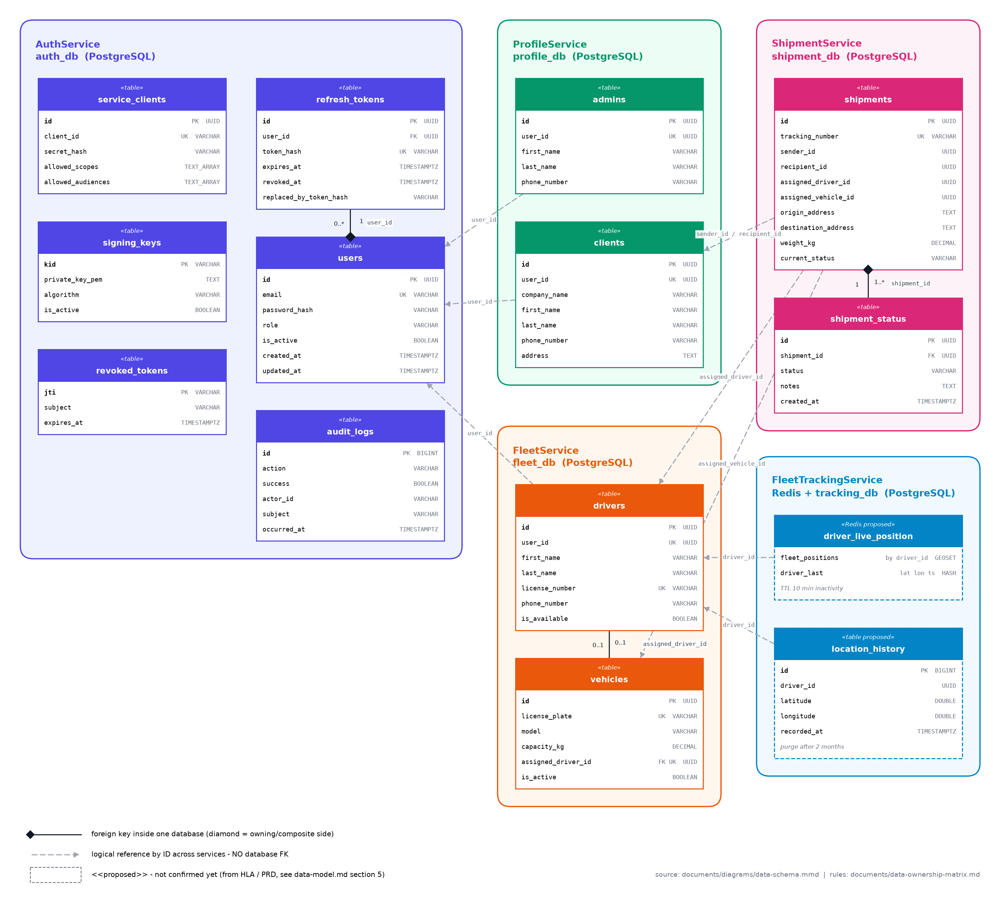

# Data Ownership Matrix

> **Purpose:** the single answer to *"which service owns this data, and where does it live?"*
> If a piece of data is not listed here, it has no owner yet. Add it here **before** writing code that stores it.
>
> **Sources:** [data-model.md](data-model.md) (current data model per service; replaces the legacy `data.sql`), [`AuthService/Data/AuthDbContext.cs`](../AuthService/Data/AuthDbContext.cs) (as-built auth schema),
> [high-level-architecture.md](high-level-architecture.md) (service domains), [product-requirements-document.md](product-requirements-document.md) (telemetry & retention).
> **Diagram:** [diagrams/data-schema.png](diagrams/data-schema.png) · Mermaid source [diagrams/data-schema.mmd](diagrams/data-schema.mmd)



---

## 1. Ownership rules

1. **One owner per entity.** Only the owning service writes the data, and only to its own database. Every other service is a *consumer*.
2. **No cross-database foreign keys and no shared tables.** A reference to another service's entity is a plain `UUID` column, which we call a **logical reference**. It is never a `REFERENCES` constraint.
3. **Consumers get data in one of three ways**, chosen per row in §3:
   - **Claim**: read from the JWT (`sub`, `role`, `email`). Use this for the caller's own identity and nothing else.
   - **Sync query**: call the owner's REST API through the gateway, or service-to-service with an M2M token. Use it when the data must be fresh at that moment, for example *"is this driver available right now?"*.
   - **Local read model**: keep a copy in the consumer's own DB, filled from the owner's Kafka events. The copy is read-only for the consumer and can always be rebuilt from the events.
4. **Snapshots are allowed and encouraged** when the business needs the value *as it was at that time*. Examples are the addresses on a shipment or the vehicle assigned at dispatch. A snapshot belongs to the consumer, and later changes at the owner do not update it.
5. **A user's `id` is the identity key everywhere.** AuthService creates it. Every profile carries it as `user_id`, and no other service creates identities. Profiles are created by consuming `UserRegistered` (D2). Every client, recipients included, has an account (D1).
6. **Deletes are logical across services.** The owner deactivates the record and publishes an event, and each consumer decides what that event means for its own data. Cascades are allowed only *inside* one database.

---

## 2. Service → data store map

| Service | Store | Holds | Status |
|---|---|---|---|
| **AuthService** | PostgreSQL `auth_db` | identities, credentials, roles, tokens, signing keys, M2M clients, security audit | ✅ built |
| **ProfileService** | PostgreSQL `profile_db` | admin and client profiles | ⏳ not started |
| **FleetService** | PostgreSQL `fleet_db` | driver profiles, availability, vehicles, driver↔vehicle assignment | ⏳ not started |
| **FleetTrackingService** | Redis (live) + PostgreSQL `tracking_db` (history) | live GPS positions, GPS audit trail (kept 2 months) | ⏳ not started |
| **ShipmentService** | PostgreSQL `shipment_db` | shipments, status history, shipment↔driver/vehicle assignment | ⏳ not started |
| **API Gateway (NGINX)** | none | stateless; forwards `X-Auth-Subject` / `X-Auth-Role` | ✅ built |
| **Kafka** | topics | transports events; **does not own any data** | ⏳ not started |

---

## 3. Entity ownership matrix

`W` = owner (only writer) · `R` = reads it · `—` = no access. Rows marked *proposed* are not built or fully designed yet (see [data-model.md](data-model.md) §5).

| Entity (table / key) | Owner | Store | Auth | Profile | Fleet | Tracking | Shipment | How consumers read it |
|---|---|---|:-:|:-:|:-:|:-:|:-:|---|
| `users` | **AuthService** | auth_db | **W** | R | R | — | R | JWT claims (`sub`, `role`, `email`); `GET /users/{id}` (ADMIN/M2M); events `User*` |
| `refresh_tokens` | **AuthService** | auth_db | **W** | — | — | — | — | private |
| `revoked_tokens` | **AuthService** | auth_db | **W** | — | — | — | — | private (checked through `/auth/validate`) |
| `signing_keys` | **AuthService** | auth_db | **W** | R | R | R | R | public half only, through `/auth/jwks.json`; private key never leaves AuthService |
| `service_clients` | **AuthService** | auth_db | **W** | — | — | — | — | private (M2M token endpoint) |
| `audit_logs` (security) | **AuthService** | auth_db | **W** | — | — | — | — | private; other services keep their own audit |
| `admins` | **ProfileService** | profile_db | — | **W** | — | — | — | sync query `/profiles/admins/{id}` |
| `clients` | **ProfileService** | profile_db | — | **W** | — | — | R | sync query at shipment creation, then **snapshot** (see §4) |
| `drivers` | **FleetService** | fleet_db | — | — | **W** | R | R | sync query for availability; read model `driver_id → name` from `Driver*` events |
| `drivers.is_available` | **FleetService** | fleet_db | — | — | **W** | — | R | sync query before assigning a driver (must be fresh) |
| `vehicles` | **FleetService** | fleet_db | — | — | **W** | — | R | sync query; read model from `Vehicle*` events |
| `vehicles.assigned_driver_id` | **FleetService** | fleet_db | — | — | **W** | — | R | which vehicle a driver is operating (fleet concern) |
| `shipments` | **ShipmentService** | shipment_db | — | — | — | R | **W** | REST `/shipments/*`; events `Shipment*` |
| `shipments.assigned_driver_id / assigned_vehicle_id` | **ShipmentService** | shipment_db | — | — | R | R | **W** | which driver/vehicle carries *this shipment* (delivery concern) |
| `shipments.current_status` | **ShipmentService** | shipment_db | — | — | — | — | **W** | denormalised latest row of `shipment_status`, written in the same transaction |
| `shipment_status` | **ShipmentService** | shipment_db | — | — | — | — | **W** | REST `/shipments/{id}/history`; append-only |
| live position *(proposed)* `GEOSET fleet_positions`, `HASH driver_last:{driverId}` | **FleetTrackingService** | Redis | — | — | — | **W** | — | REST `/tracking/*` (customer map, admin map); TTL 10 min of inactivity |
| `location_history` *(proposed)* | **FleetTrackingService** | tracking_db | — | — | — | **W** | — | REST `/tracking/history`; flushed every 2 min, purged after 2 months |

---

## 4. Contested fields: who owns what, and why

These are the fields most likely to get mixed up as the project grows.

| Data | Owner | Not owned by | Rule |
|---|---|---|---|
| **Email, password, role, account active flag** | AuthService (`users`) | ProfileService, FleetService | Profiles **must not** store email or role. If one is needed for display, keep it as a read-model copy updated from `UserEmailChanged`. A profile type must match the role: `ADMIN`→`admins`, `CLIENT`→`clients`, `DRIVER`→`drivers`. |
| **First/last name, phone, address, license number** | the service holding that profile (Profile for admins/clients, Fleet for drivers) | AuthService | AuthService is identity only. It collects these fields at registration and relays them in `UserRegistered` (§8.1), but never stores them in `users`. |
| **"Can this person log in?"** vs **"Is this driver on shift and ready?"** | `users.is_active` → AuthService · `drivers.is_available` → FleetService | the other one | Two different facts. In the MVP, `is_available` means *on shift **and** not on a delivery* (see D3). Deactivating a user (Auth) makes FleetService set `is_available = false` when it consumes the event. FleetService never changes `users`. |
| **Driver ↔ vehicle** | FleetService (`vehicles.assigned_driver_id`) | ShipmentService | Records who operates which vehicle. |
| **Shipment ↔ driver/vehicle** | ShipmentService (`shipments.assigned_*`) | FleetService | Records who carries this shipment. When dispatching, ShipmentService asks FleetService for the driver's availability and current vehicle and **snapshots** both IDs. A later vehicle swap does not rewrite delivered shipments. |
| **Client address** vs **shipment origin/destination** | `clients.address` → ProfileService · `shipments.*_address` → ShipmentService | — | The shipment addresses are a **snapshot** taken at creation. Editing a client's address must not change shipments already in progress. |
| **Shipment status** | ShipmentService | FleetTrackingService, FleetService | A driver marking "Delivered" calls ShipmentService, which writes the status and publishes the event. Tracking never infers a status from GPS. |
| **Where a driver is** | FleetTrackingService | FleetService, ShipmentService | No other service stores coordinates. Anything that needs a position asks Tracking or reads it from Redis through Tracking's API. |
| **Audit logs** | each service owns its own | — | `audit_logs` in auth_db covers security events only. `shipment_status` is the shipment audit trail and `location_history` is the GPS audit trail. There is no shared audit table. |

---

## 5. Cross-service references (replacing the FKs in the legacy data.sql)

The legacy `data.sql` (deleted 2026-11-10) was written as one database. Under database-per-service, every constraint below crosses a service boundary, so it was dropped from the per-service schemas in [data-model.md](data-model.md) and is handled as described.

| Legacy `data.sql` constraint | Becomes | Validated on write by | When the referenced record goes away |
|---|---|---|---|
| `admins.user_id → users(id) ON DELETE CASCADE` | logical ref `user_id UUID UNIQUE NOT NULL` | `sub` claim / `UserRegistered` event | on `UserDeactivated` / `UserDeleted`: soft-delete the profile (undo on `UserReactivated`) |
| `clients.user_id → users(id) ON DELETE CASCADE` | same | same | same, but keep the row while shipments reference it |
| `drivers.user_id → users(id) ON DELETE CASCADE` | same | same | set `is_available = false`, publish `DriverUnavailable` |
| `shipments.sender_id / recipient_id → clients(id) ON DELETE RESTRICT` | logical ref | sync `GET /profiles/clients/{id}` at creation | RESTRICT cannot be enforced across DBs, so ProfileService **soft-deletes** clients and never hard-deletes them. Shipments keep their snapshots. |
| `shipments.assigned_driver_id → drivers(id) ON DELETE SET NULL` | logical ref | sync availability check with FleetService | keep the ID for history. Active shipments react to `DriverUnavailable` and are flagged for reassignment. |
| `shipments.assigned_vehicle_id → vehicles(id) ON DELETE SET NULL` | logical ref | sync check with FleetService | keep the ID for history |

Foreign keys that **stay**, because both sides live in the same database:

| Constraint | Database |
|---|---|
| `refresh_tokens.user_id → users(id) ON DELETE CASCADE` | auth_db |
| `vehicles.assigned_driver_id → drivers(id) ON DELETE SET NULL` | fleet_db |
| `shipment_status.shipment_id → shipments(id) ON DELETE CASCADE` | shipment_db |

---

## 6. Events each owner publishes (proposed contract)

The owner is the only service that publishes events about its data. Topic names follow `<service>.<entity>.v1`.

| Topic | Events | Main consumers |
|---|---|---|
| `auth.user.v1` ✅ | `UserRegistered`, `UserEmailChanged`, `UserRoleChanged`, `UserDeactivated`, `UserReactivated`, `UserDeleted` | ProfileService, FleetService |
| `profile.client.v1` | `ClientCreated`, `ClientUpdated`, `ClientDeactivated` | ShipmentService (optional read model) |
| `fleet.driver.v1` | `DriverCreated`, `DriverAvailabilityChanged`, `DriverUnavailable` | ShipmentService, FleetTrackingService |
| `fleet.vehicle.v1` | `VehicleCreated`, `VehicleAssigned`, `VehicleDeactivated` | ShipmentService |
| `shipment.lifecycle.v1` | `ShipmentCreated`, `ShipmentDispatched`, `ShipmentInTransit`, `ShipmentDelivered`, `ShipmentFailed`, `ShipmentCancelled` | FleetService (availability), FleetTrackingService (which drivers to watch), notifications/analytics |

FleetTrackingService publishes **no** per-ping events, because 500 writes per second must not flood Kafka. If needed, it may publish coarse events such as `DriverWentOffline`.

---

## 7. Mismatches found in the current sources (action items)

| # | Where | Issue | Resolution in this matrix |
|---|---|---|---|
| 1 | legacy `data.sql` section headers | `admins`, `clients`, `drivers` are labelled **ShipmentService**, and `vehicles` is labelled **ShipmentService**. | Resolved 2026-11-10: `data.sql` was a legacy monolith schema. It was deleted, and [data-model.md](data-model.md) follows the HLA. |
| 2 | legacy `data.sql` | Single-database FKs across service boundaries (§5). | Resolved 2026-11-10: the per-service schemas in [data-model.md](data-model.md) contain no cross-database FKs. |
| 3 | legacy `data.sql` | AuthService's as-built tables (`refresh_tokens`, `revoked_tokens`, `service_clients`, `audit_logs`, `signing_keys`) are missing. | Resolved 2026-11-10: documented in [data-model.md](data-model.md) §1. |
| 4 | legacy `data.sql` | FleetTrackingService has no schema, even though the HLA and PRD require Redis live positions and a 2-month GPS audit table. | Proposed schema in [data-model.md](data-model.md) §5. Still to be confirmed. |
| 5 | HLA vs AuthService | Roles in the code include `M2M`, but M2M principals live in `service_clients`, not `users`. `users.role` CHECK = ADMIN/DRIVER/CLIENT only. | Consistent; noted so that M2M does not get added to `users`. |
| 6 | AuthService | Publishes no events yet, while ProfileService and FleetService rely on `auth.user.v1`. | ✅ Resolved 2026-11-10: AuthService publishes `auth.user.v1` through its transactional outbox ([kafka-architecture.md](kafka-architecture.md)). |
| 7 | AuthService `RegisterDto` / `CreateUserDto`, portal register form | No `profile` object yet (D2, §8.1). | ✅ Resolved 2026-11-10: `profile` is required on both endpoints, validated by `Core/RegistrationProfileRules.cs`, and the portal forms collect it. |

---

## 8. Decisions (2026-11-10)

| # | Question | Decision | Consequence |
|---|---|---|---|
| D1 | Does a shipment recipient need an account? | **Yes.** Every sender and recipient is a `CLIENT` with a `users` row and a `clients` profile. `clients.user_id` stays `NOT NULL`. | `shipments.recipient_id` always points to an existing client. A shipment cannot be created for someone who is not registered yet. |
| D2 | How are profiles created? | **Event-driven, with the profile fields collected at registration.** `POST /auth/register` and `POST /users` accept a `profile` object (§8.1). AuthService validates it and passes it on in `UserRegistered` on `auth.user.v1`. ProfileService creates `admins`/`clients` and FleetService creates `drivers`, depending on `role`. | Depends on action item #6 (AuthService outbox + Kafka publisher). Profiles are complete from the start, so the profile columns keep their `NOT NULL` constraints. Consumers must be idempotent and key on `user_id`. |
| D3 | What does `drivers.is_available` mean? | **MVP: "on shift and ready to deliver"**. One flag, owned by FleetService. | FleetService sets it to `false` on `ShipmentDispatched` and back to `true` on `ShipmentDelivered` / `ShipmentFailed` / `ShipmentCancelled`. ShipmentService only reads it. To be split into shift status and delivery status in a later MVP. |

### 8.1 Registration → profile contract (D2)

**Request:** `POST /api/v1/auth/register` (CLIENT/DRIVER) and `POST /api/v1/users` (ADMIN, any role) both accept:

```jsonc
{
  "email": "jane@acme.com",
  "password": "********",
  "role": "CLIENT",                 // CLIENT | DRIVER | ADMIN
  "profile": {
    "firstName": "Jane",            // required, ≤100
    "lastName": "Doe",              // required, ≤100
    "phoneNumber": "+213...",       // ≤50; required for CLIENT and DRIVER, optional for ADMIN
    "companyName": "Acme",          // CLIENT only, optional, ≤255
    "address": "12 Rue ...",        // CLIENT only, required
    "licenseNumber": "DZ-123456"    // DRIVER only, required, ≤100
  }
}
```

**Event:** `UserRegistered` on `auth.user.v1`, keyed by `userId`:

```jsonc
{
  "eventId": "uuid", "occurredAt": "2026-11-10T10:00:00Z", "version": 1,
  "userId": "uuid", "email": "jane@acme.com", "role": "CLIENT",
  "profile": { /* exactly the validated request.profile */ }
}
```

**Ownership rules for these fields**

- AuthService **relays** the profile fields but does **not own or persist them**. They exist in auth_db only inside the outbox row until it is published, and the row is then deleted. `users` gets no new columns.
- AuthService checks only shape and per-role required fields. It does not check **business uniqueness**: for example, `drivers.license_number UNIQUE` belongs to FleetService and can only be checked there.
- **Risk:** a duplicate license number is detected *after* the account already exists. When that happens, FleetService does not create the driver and publishes `DriverProfileRejected { userId, reason }`. The portal shows "profile incomplete, contact an admin". Revisit this if it happens in practice.
- After creation, profile edits go to the owning service (`/profiles/*` or `/fleet/drivers/*`), never through AuthService.

---

## 9. Where does new data go? (decision checklist)

1. Is it about **who someone is or whether they may log in**? → AuthService.
2. Is it **personal or company info of an admin or client**? → ProfileService.
3. Is it about **drivers as workers, or vehicles**? → FleetService.
4. Is it a **GPS coordinate or derived from coordinates**? → FleetTrackingService (Redis if live, tracking_db if history).
5. Is it about **an order/package and its lifecycle**? → ShipmentService.
6. Does it fit two of these? Pick the service whose **business rule changes it**. The other service holds an ID reference, a snapshot, or an event-fed read model. **Add the row to §3 in the same PR.**
