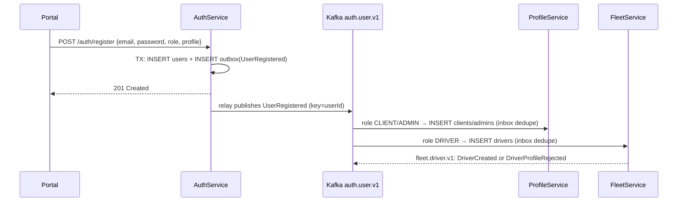

# Kafka Message Broker: Component Architecture

> **Status:** ✅ Implemented 2026-11-10: the broker, Schema Registry and topics run in docker compose, and **AuthService publishes `auth.user.v1`**.
> The consumer side (inbox, retries, DLQ) is built and tested in the shared `LastMile.Messaging` library, ready for ProfileService, FleetService and ShipmentService (§9).
> Code: [`shared/`](../shared) · [`infra/kafka/`](../infra/kafka) · [`docker-compose.yml`](../docker-compose.yml)
> **Related:** [high-level-architecture.md](high-level-architecture.md) §1, §4.3 · [data-ownership-matrix.md](data-ownership-matrix.md) §6 (events) & §8 (decisions) · [data-model.md](data-model.md)

## 1. Role in the system

Kafka is the **asynchronous backbone between the business services**. It carries *facts that already happened* (for example `UserRegistered` or `ShipmentDispatched`) from the service that owns the data to every service that needs to react to them.

| Kafka **is** used for | Kafka is **not** used for |
|---|---|
| Domain events about owned data (create, change, deactivate) | Request/response. Use REST through the gateway, or service-to-service with an M2M token. |
| Building consumers' local read models | Raw GPS pings. 500 writes/s go to Redis (HLA §4.1, matrix §6). |
| Triggering side effects in other services (profile creation, driver availability) | Commands to another service ("please do X"). The owner exposes an API for that. |
| Feeding notifications and analytics later | Storing data. **Kafka owns no data.** The owner's database is the source of truth. |

---

## 2. Topology

```
 ┌──────────────┐  outbox   ┌──────────────────────────────────────────────┐
 │ AuthService  │──────────►│                 Kafka (KRaft)                │
 │  auth_db     │           │                                              │
 └──────────────┘           │  auth.user.v1          ──►  profile-service  │
 ┌──────────────┐  outbox   │                        ──►  fleet-service    │
 │ProfileService│──────────►│  profile.client.v1     ──►  shipment-service │
 └──────────────┘           │                                              │
 ┌──────────────┐  outbox   │  fleet.driver.v1       ──►  shipment-service │
 │ FleetService │──────────►│                        ──►  tracking-service │
 └──────────────┘           │  fleet.vehicle.v1      ──►  shipment-service │
 ┌──────────────┐  outbox   │                                              │
 │ShipmentSvc   │──────────►│  shipment.lifecycle.v1 ──►  fleet-service    │
 └──────────────┘           │                        ──►  tracking-service │
                            │                        ──►  (notifications,  │
 FleetTrackingService ─ ─ ─ │  (no topics: GPS stays     analytics later)  │
   (consumer only)          │   in Redis)                                  │
                            │  *.dlq  dead-letter topics                   │
                            └──────────────────────────────────────────────┘
```

- **Producers:** AuthService, ProfileService, FleetService, ShipmentService. Each service publishes **only to its own topics**.
- **Consumers:** one consumer group per service, named after the service (`profile-service`, `fleet-service`, …). Replicas of the same service share the group, so each event is processed once per service.
- **FleetTrackingService** only consumes. It uses the events to learn which drivers exist and which drivers have an active shipment.

---

## 3. Topic catalogue

Naming: `<owner-service>.<aggregate>.v<major>`. A breaking change to a payload creates a **new topic** (`.v2`), and the two versions run side by side until every consumer has migrated.

| Topic | Producer | Message key | Events | Consumers | Partitions | Retention |
|---|---|---|---|---|:-:|---|
| `auth.user.v1` ✅ | AuthService | `userId` | `UserRegistered`, `UserEmailChanged`, `UserRoleChanged`, `UserDeactivated`, `UserReactivated`, `UserDeleted` | ProfileService, FleetService | 3 | 30 days |
| `profile.client.v1` | ProfileService | `clientId` | `ClientCreated`, `ClientUpdated`, `ClientDeactivated` | ShipmentService | 3 | 30 days |
| `fleet.driver.v1` | FleetService | `driverId` | `DriverCreated`, `DriverAvailabilityChanged`, `DriverUnavailable`, `DriverProfileRejected` | ShipmentService, FleetTrackingService | 3 | 30 days |
| `fleet.vehicle.v1` | FleetService | `vehicleId` | `VehicleCreated`, `VehicleAssigned`, `VehicleDeactivated` | ShipmentService | 3 | 30 days |
| `shipment.lifecycle.v1` | ShipmentService | `shipmentId` | `ShipmentCreated`, `ShipmentDispatched`, `ShipmentInTransit`, `ShipmentDelivered`, `ShipmentFailed`, `ShipmentCancelled` | FleetService, FleetTrackingService | 6 | 30 days |
| `<topic>.dlq` | consumers' error handler | same as source | events that failed after retries | humans / ops | 1 | 30 days |

**Why these choices:**
- **Key = aggregate id.** Kafka keeps order only *within one partition*. Keying by `shipmentId` guarantees that `Dispatched` is processed before `Delivered` for the same shipment. Ordering *between* different shipments is not needed.
- **Partitions:** 3 (6 for shipments, the busiest topic) allows up to 3 or 6 consumer replicas per service. Partitions can be added later, but that reshuffles keys, so start with enough.
- **Retention of 30 days** (confirmed 2026-11-10) allows a consumer to replay a month of events after a bug or outage. Kafka is **not** the long-term history. To rebuild a read model from scratch, a consumer uses the owner's paginated list API (backfill) and then resumes from the topic.
- **One topic per aggregate, many event types per topic.** All events about the same aggregate stay in order relative to each other. Consumers filter on the `type` header.
- **Topics are created explicitly** by [`infra/kafka/create-topics.sh`](../infra/kafka/create-topics.sh), which runs in the `kafka-init` container on every `compose up` and is idempotent. Auto-creation is disabled. A new topic means adding it to that script **and** to `LastMile.Contracts/Topics.cs`.

---

## 4. Message format

**Envelope:** JSON, inspired by CloudEvents. The event type also goes in a Kafka header so consumers can skip unwanted events without parsing the payload.

```jsonc
// key:     "6f1c…-userId"
// headers: type=UserRegistered, schemaVersion=1, correlationId=<request id>
{
  "eventId": "0b9e…",                 // uuid, unique per event: consumers deduplicate on this
  "type": "UserRegistered",
  "schemaVersion": 1,                 // minor/additive changes only within a topic version
  "source": "auth-service",
  "occurredAt": "2026-11-10T10:00:00Z",
  "correlationId": "…",               // from the incoming HTTP request (X-Request-Id), for tracing
  "subject": "6f1c…",                 // aggregate id (= message key)
  "data": {
    "userId": "6f1c…",
    "email": "jane@acme.com",
    "role": "CLIENT",
    "profile": { "firstName": "Jane", "lastName": "Doe", "phoneNumber": "…", "address": "…" }
  }
}
```

The `UserRegistered.data.profile` contract is defined in [data-ownership-matrix.md §8.1](data-ownership-matrix.md#81-registration--profile-contract-d2).

**Evolution rules (within a `.vN` topic):**
- You may **add** optional fields.
- Never remove or rename a field, and never change its meaning or type. Doing any of those means a new `.v(N+1)` topic.
- Consumers ignore fields they don't know.

**Schema registry: Confluent Schema Registry, JSON Schema format** (decided 2026-11-10, with 3 more services going live).

| Aspect | Choice |
|---|---|
| Registry | `confluentinc/cp-schema-registry:7.7.1`, on `http://schema-registry:8081` inside docker and `http://localhost:8081` from the host |
| Format | **JSON Schema.** Messages stay readable JSON in kafka-ui and logs, and no code generation is needed. |
| Source of truth | The C# records in [`shared/LastMile.Contracts`](../shared/LastMile.Contracts). The schema of the whole envelope is **generated** from them (`EventSchemas`), with the same JSON options used for serialization, so schema and payload cannot drift apart. |
| Subject naming | `<topic>-<EventType>`, e.g. `auth.user.v1-UserRegistered`: one subject per event type, several types per topic |
| Wire format | Confluent framing `[0x00][schema id, 4 bytes][UTF-8 JSON]`. Consumers strip the 5-byte header, and plain JSON without the header is accepted too. |
| Registration | `Kafka:AutoRegisterSchemas=true` (dev): the relay registers a schema on first publish. In production, set it to `false` and register from CI, so an incompatible change fails the pipeline instead of the publish. |
| **Compatibility** | **`FORWARD_TRANSITIVE`** (registry default, set in compose). The owner publishes new data, and **every older consumer must still be able to read it.** |

The compatibility level was chosen by testing it against the live registry with our generated schemas (open content model):

| Change to a payload | `BACKWARD_TRANSITIVE` | **`FORWARD_TRANSITIVE`** | `FULL_TRANSITIVE` |
|---|:-:|:-:|:-:|
| add an optional field | ❌ rejected | ✅ | ❌ |
| add a required field | ❌ | ✅ | ❌ |
| remove a field | ✅ (dangerous for our consumers) | ❌ | ❌ |
| change a field's type | ❌ | ❌ | ❌ |
| add an enum value | ✅ (old consumers would fail) | ❌ | ❌ |

`FORWARD_TRANSITIVE` is the only level that matches the evolution rules above. It lets producers add fields, and blocks everything that would break a consumer that hasn't upgraded yet.

**C# rules that follow from this** (for the `LastMile.Contracts` records):
- **New field:** add it as a constructor parameter **with a default value**, e.g. `string? Note = null`. Without the default, *new* consumers would fail on *old* events still in the topic.
- **New enum value** (e.g. a new role): the registry rejects it. Either publish it in a new `.v2` topic, or model the value as a `string` from the start if it is expected to grow.
- Never rename or remove a property, and never change its type. Those changes need a new `.vN` topic.

**Personal data:** events carry only the fields consumers need. Never put passwords, hashes or tokens in an event. `UserRegistered` carries profile fields once, so that the owning services can create the profile (D2).

---

## 5. Reliable publishing: transactional outbox

Writing to the database and then to Kafka as two separate steps loses events when the service crashes between them. Every producer therefore uses the **outbox pattern**:

```
 HTTP request ─► one DB transaction:  INSERT/UPDATE business rows
                                      INSERT INTO outbox (event)
              ─► commit
 OutboxRelay (BackgroundService, every ~1 s):
     SELECT … FROM outbox WHERE published_at IS NULL ORDER BY id LIMIT 100 FOR UPDATE SKIP LOCKED
     produce to Kafka (acks=all, idempotent producer) → on ack: SET published_at = now()
 Cleanup (every 10 min): DELETE published rows older than 1 hour
```

```sql
-- one per publishing service database (auth_db, profile_db, fleet_db, shipment_db)
CREATE TABLE outbox (
    id             BIGINT GENERATED ALWAYS AS IDENTITY PRIMARY KEY,   -- publish order
    event_id       UUID NOT NULL UNIQUE,
    topic          VARCHAR(200) NOT NULL,
    message_key    VARCHAR(100) NOT NULL,
    event_type     VARCHAR(100) NOT NULL,
    payload        JSONB NOT NULL,
    correlation_id VARCHAR(100),
    occurred_at    TIMESTAMP WITH TIME ZONE NOT NULL DEFAULT CURRENT_TIMESTAMP,
    published_at   TIMESTAMP WITH TIME ZONE,
    attempts       INT NOT NULL DEFAULT 0,
    last_error     TEXT
);
CREATE INDEX idx_outbox_unpublished ON outbox(id) WHERE published_at IS NULL;
```

- `FOR UPDATE SKIP LOCKED` lets several replicas run the relay safely.
- The outbox may hold the D2 profile fields **until the row is published and cleaned up** (1 hour by default, `Kafka:Outbox:PublishedRetention`). AuthService still does not own that data (matrix §8.1).
- **On a publish failure the relay stops the batch** and retries after 5 s. Later rows may share the failed row's key and must not overtake it. `attempts` and `last_error` on the row show what went wrong.
- **Verified:** with the broker stopped, `POST /auth/register` still returns 201. The event waits in `outbox` and is published as soon as Kafka is back.
- Later option: replace the polling relay with Debezium CDC. This is not needed at MVP volume.

**Producer settings** (Confluent.Kafka): `Acks=All`, `EnableIdempotence=true`, `MaxInFlight=5`, `CompressionType=Lz4`, `LingerMs=5`.

---

## 6. Reliable consuming: at-least-once + idempotency

Kafka delivers **at least once**, so a consumer **must** tolerate seeing the same event twice.

```
 poll ─► BEGIN
          INSERT INTO inbox(event_id, …) ON CONFLICT DO NOTHING   -- 0 rows → duplicate → skip
          apply business change (e.g. INSERT INTO clients …)
         COMMIT
      ─► commit Kafka offset (manual, after the DB commit)
```

```sql
-- one per consuming service database (profile_db, fleet_db, shipment_db, tracking_db)
CREATE TABLE inbox (
    event_id     UUID PRIMARY KEY,
    topic        VARCHAR(200) NOT NULL,
    event_type   VARCHAR(100) NOT NULL,
    processed_at TIMESTAMP WITH TIME ZONE NOT NULL DEFAULT CURRENT_TIMESTAMP
);  -- purge rows older than the topic retention (30 days)
```

- Consumer settings: `EnableAutoCommit=false`, `AutoOffsetReset=Earliest`, `IsolationLevel=ReadCommitted`.
- Business rules must also be naturally idempotent where possible. For example, `UNIQUE(user_id)` on profiles is a second line of defence.

**Errors and retries:**

| Failure | Handling |
|---|---|
| Transient (DB down, timeout) | Retry in place with exponential backoff: 8 attempts, from 200 ms up to 30 s (≈50 s in total, `Kafka:Consumer:*`). The partition waits, which preserves order. If every attempt fails, the event goes to the DLQ. |
| Permanent (bad payload, business rejection) | Send to `<topic>.dlq` with error headers, commit the offset and continue. Alert on DLQ depth. |
| Business rejection the producer must know about | Publish a **domain event**, not a DLQ message. Example: a duplicate license number makes FleetService publish `DriverProfileRejected` (matrix §8.1). |

The DLQ can be replayed with a small admin tool or with kafka-ui.

---

## 7. Key flows

### 7.1 Registration → profile creation (D2)



The profile appears a short time after the `201` response (eventual consistency). The portal should treat a `404` from `/profiles/me` right after registration as "being created" and retry briefly.

### 7.2 Dispatch → driver availability (D3)

1. ShipmentService checks `GET /fleet/drivers/{id}` → `is_available = true` (sync, needs fresh data).
2. In one transaction it updates `shipments` and inserts the `shipment_status` row and an outbox `ShipmentDispatched` (key = `shipmentId`).
3. FleetService consumes the event, sets `is_available = false` and publishes `DriverAvailabilityChanged`.
4. On `ShipmentDelivered`, `ShipmentFailed` or `ShipmentCancelled`, FleetService sets `is_available = true`.

**Race window:** two dispatches can both see `is_available = true` before the event lands. For the MVP, ShipmentService also rejects a dispatch if it already has an active shipment for that `driverId` in its own database. A later MVP could make this a reservation call to FleetService.

---

## 8. Deployment

### Local / demo (docker compose)

All of it lives in [`docker-compose.yml`](../docker-compose.yml) on `app-net`:

| Container | Image | Purpose | Host port |
|---|---|---|---|
| `kafka` | `apache/kafka:3.9.0` | single broker in KRaft mode (broker + controller, no ZooKeeper), 30-day retention, auto-create off | `9094` (EXTERNAL listener, for running services or tools outside docker) |
| `kafka-init` | `apache/kafka:3.9.0` | one-shot: [`infra/kafka/create-topics.sh`](../infra/kafka/create-topics.sh) creates the §3 topics and their `.dlq` | — |
| `schema-registry` | `confluentinc/cp-schema-registry:7.7.1` | schema store, `FORWARD_TRANSITIVE` | `8081` |
| `kafka-ui` | `provectuslabs/kafka-ui:v0.7.2` | dev only: browse topics, messages (decoded through the registry), consumer lag, DLQs, schemas | `8090` → http://localhost:8090 |

Listeners: services in docker use `kafka:9092` (INTERNAL). Anything on the host uses `localhost:9094` (EXTERNAL).

Service configuration (section `Kafka`, overridable with `Kafka__…` environment variables):

```jsonc
"Kafka": {
  "BootstrapServers": "kafka:9092",                     // localhost:9094 outside docker
  "SchemaRegistryUrl": "http://schema-registry:8081",   // http://localhost:8081 outside docker
  "AutoRegisterSchemas": true,
  "Outbox":   { "PollInterval": "00:00:01", "BatchSize": 100, "PublishedRetention": "01:00:00", "HealthMaxLag": "00:01:00" },
  "Consumer": { "GroupId": null, "MaxAttempts": 8, "InitialBackoff": "00:00:00.2", "MaxBackoff": "00:00:30", "InboxRetention": "30.00:00:00" }
}
```

Producers deliberately **do not** `depends_on` Kafka: events wait in the outbox until the broker comes back.

The .NET services are built with the **repository root as the Docker build context** (`build.context: .`), because they need `shared/`. See [`AuthService/Dockerfile`](../AuthService/Dockerfile) and the root [`.dockerignore`](../.dockerignore).

### Production-like (later)

| Concern | Demo | Production-like |
|---|---|---|
| Brokers | 1 (combined broker + controller) | 3 brokers + 3 controllers, or a managed service |
| Replication | RF = 1 | RF = 3, `min.insync.replicas = 2` |
| Security | PLAINTEXT on the private `app-net` | TLS + SASL/SCRAM per service, with ACLs: each service may write only its own topics and read only the topics it consumes |
| Topic creation | `kafka-init` container | IaC (Terraform / Strimzi `KafkaTopic` CRDs) |

The ACL model mirrors the ownership matrix: **write = owner only, read = the R columns of matrix §3.**

---

## 9. .NET integration: the shared libraries

Two class libraries under [`shared/`](../shared). Every service references both with a `ProjectReference`.

| Project | Contains | Rule |
|---|---|---|
| **`LastMile.Contracts`** | `Topics`, `EventEnvelope<T>`, `EventHeaders`, `ContractJson.Options`, `[IntegrationEvent(topic, type, version)]` + `EventCatalog`, and the event records, e.g. `Auth/UserEvents.cs` | **Data only**: no infrastructure and no logic. The owning service's team edits its own namespace (e.g. `Fleet/DriverEvents.cs`). |
| **`LastMile.Messaging`** | outbox (`IEventOutbox`, `OutboxRelay<TDb>`, `OutboxHealthCheck<TDb>`), inbox consumer (`EventConsumer<TDb>`, `ConsumedEvent`, `PermanentEventException`, `InboxCleanupService<TDb>`), Schema Registry framing (`EventSerializer`, `EventSchemas`), EF mappings (`AddOutbox()` / `AddInbox()`), DI (`AddKafkaMessaging`, `AddOutbox<TDb>`, `AddEventConsumer<TConsumer,TDb>`) | Infrastructure shared so that 4+ services don't each re-implement outbox/inbox. It contains no domain logic. |

Library: `Confluent.Kafka` 2.6.1 / `Confluent.SchemaRegistry` 2.6.1, with EF Core + Npgsql.

### Publishing (how AuthService does it)

```csharp
// Program.cs
builder.Services.AddKafkaMessaging(builder.Configuration, "auth-service");   // name = envelope source + client id
builder.Services.AddOutbox<AuthDbContext>();                                 // IEventOutbox + OutboxRelay
builder.Services.AddHealthChecks().AddDbContextCheck<AuthDbContext>("database").AddOutboxCheck<AuthDbContext>();

// DbContext.OnModelCreating
b.AddOutbox();                          // + `dotnet ef migrations add AddOutbox`

// In the use case, BEFORE SaveChanges (same transaction as the business change):
db.Users.Add(user.ToEntity());
outbox.Enqueue(user.Id.ToString(), new UserRegistered(user.Id, user.Email, role, profile));   // key = aggregate id
await db.SaveChangesAsync(ct);
```

AuthService wraps these calls in [`Services/UserEventPublisher.cs`](../AuthService/Services/UserEventPublisher.cs), so the use cases read `events.Registered(user, profile)`.

### Consuming (template for ProfileService / FleetService)

```csharp
public sealed class AuthUserConsumer(IServiceScopeFactory s, KafkaProducer k, MessagingService m,
    IOptions<MessagingOptions> o, ILogger<AuthUserConsumer> l) : EventConsumer<ProfileDbContext>(s, k, m, o, l)
{
    protected override IReadOnlyCollection<string> Topics => [LastMile.Contracts.Topics.AuthUserV1];

    protected override async Task HandleAsync(ConsumedEvent evt, ProfileDbContext db, CancellationToken ct)
    {
        if (evt.Is<UserRegistered>())
        {
            var e = evt.Data<UserRegistered>();
            if (e.Role is UserRole.CLIENT) db.Clients.Add(/* map e.Profile */);
        }
        else if (evt.Is<UserDeactivated>()) { /* soft-delete */ }
        // other types: ignore. Do NOT call SaveChanges; the base class commits handler + inbox together.
    }
}

// Program.cs
builder.Services.AddKafkaMessaging(builder.Configuration, "profile-service");   // = consumer group
builder.Services.AddEventConsumer<AuthUserConsumer, ProfileDbContext>();
// DbContext: b.AddInbox();  (+ b.AddOutbox() if the service also publishes)
```

Throw `PermanentEventException` when retrying cannot help, and the event goes straight to the DLQ. Any other exception is retried. Verified with a smoke-test consumer against the live broker:
- real `auth.user.v1` events were deserialized
- a duplicate `eventId` was skipped through the inbox
- a poison message landed in `<topic>.dlq` with `dlq-error`, `dlq-original-topic/partition/offset` and `dlq-consumer-group` headers

**Tracing:** `correlationId` comes from the incoming `X-Request-Id` header, falling back to the W3C trace id. It travels in the envelope and in the `correlationId` header.

## 10. Observability

| Signal | Alert when |
|---|---|
| Outbox backlog (`COUNT(*) WHERE published_at IS NULL`, oldest age) | older than 1 min, which means the relay or Kafka is down |
| Consumer lag per group/partition | growing for more than 5 min |
| DLQ message count | more than 0 |
| Producer errors / retries | sustained |

## 11. Implementation status

1. ✅ `kafka`, `kafka-init`, `schema-registry`, `kafka-ui` in `docker-compose.yml`; `LastMile.Contracts` + `LastMile.Messaging`.
2. ✅ **AuthService:** `outbox` table (migration `AddOutbox`), `OutboxRelay`, publishes all 6 `auth.user.v1` events. The `profile` object is required on `POST /auth/register` and `POST /users`, and the portal forms collect it.
3. ⏳ **ProfileService and FleetService:** `inbox` table and an `auth.user.v1` consumer (D2), using the §9 template.
4. ⏳ **ShipmentService:** outbox + `shipment.lifecycle.v1`. **FleetService:** consumer for availability (D3) + `fleet.*` contracts.
5. ⏳ **FleetTrackingService:** consumers for `fleet.driver.v1` and `shipment.lifecycle.v1`.

## 12. Decisions (2026-11-10)

| # | Question | Decision |
|---|---|---|
| K1 | Is 30-day retention enough? | **Yes**, for every topic including `shipment.lifecycle.v1`. |
| K2 | NotificationService? | A **future** service with its own consumer group. **Not in this MVP.** No topic or contract is reserved for it yet. |
| K3 | Schema registry? | **Adopted now**: Confluent Schema Registry, JSON Schema, `FORWARD_TRANSITIVE`, subjects `<topic>-<EventType>` (§4). |
| K4 | How should the outbox/inbox code be shared? | One shared **`LastMile.Messaging`** library instead of a copy per service (§9). This supersedes the earlier "contracts are the only shared code" note. |
