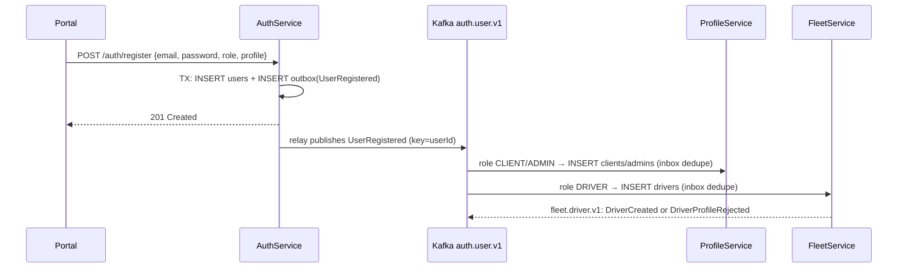

# Kafka Message Broker: Component Architecture (proposal)

> **Status:** 💡 Proposed, 2026-11-10. Not built yet.
> **Related:** [high-level-architecture.md](high-level-architecture.md) §1, §4.3 · [data-ownership-matrix.md](data-ownership-matrix.md) §6 (events) & §8 (decisions) · [data-model.md](data-model.md)

## 1. Role in the system

Kafka is the **asynchronous backbone between the business services**. It carries *facts that already happened* (for example `UserRegistered` or `ShipmentDispatched`) from the service that owns the data to every service that needs to react to them.

| Kafka **is** used for | Kafka is **not** used for |
|---|---|
| Domain events about owned data (create, change, deactivate) | Request/response. Use REST through the gateway, or service-to-service with an M2M token. |
| Building consumers' local read models | Raw GPS pings. 500 writes/s go to Redis (HLA §4.1, matrix §6). |
| Triggering side effects in other services (profile creation, driver availability) | Commands to another service ("please do X"). The owner exposes an API for that. |
| Feeding notifications and analytics later | Storing data. **Kafka owns no data.** The owner's database is the source of truth. |

---

## 2. Topology

```
 ┌──────────────┐  outbox   ┌──────────────────────────────────────────────┐
 │ AuthService  │──────────►│                 Kafka (KRaft)                │
 │  auth_db     │           │                                              │
 └──────────────┘           │  auth.user.v1          ──►  profile-service  │
 ┌──────────────┐  outbox   │                        ──►  fleet-service    │
 │ProfileService│──────────►│  profile.client.v1     ──►  shipment-service │
 └──────────────┘           │                                              │
 ┌──────────────┐  outbox   │  fleet.driver.v1       ──►  shipment-service │
 │ FleetService │──────────►│                        ──►  tracking-service │
 └──────────────┘           │  fleet.vehicle.v1      ──►  shipment-service │
 ┌──────────────┐  outbox   │                                              │
 │ShipmentSvc   │──────────►│  shipment.lifecycle.v1 ──►  fleet-service    │
 └──────────────┘           │                        ──►  tracking-service │
                            │                        ──►  (notifications,  │
 FleetTrackingService ─ ─ ─ │  (no topics: GPS stays     analytics later)  │
   (consumer only)          │   in Redis)                                  │
                            │  *.dlq  dead-letter topics                   │
                            └──────────────────────────────────────────────┘
```

- **Producers:** AuthService, ProfileService, FleetService, ShipmentService. Each service publishes **only to its own topics**.
- **Consumers:** one consumer group per service, named after the service (`profile-service`, `fleet-service`, …). Replicas of the same service share the group, so each event is processed once per service.
- **FleetTrackingService** only consumes. It uses the events to learn which drivers exist and which drivers have an active shipment.

---

## 3. Topic catalogue

Naming: `<owner-service>.<aggregate>.v<major>`. A breaking change to a payload creates a **new topic** (`.v2`), and the two versions run side by side until every consumer has migrated.

| Topic | Producer | Message key | Events | Consumers | Partitions | Retention |
|---|---|---|---|---|:-:|---|
| `auth.user.v1` | AuthService | `userId` | `UserRegistered`, `UserEmailChanged`, `UserRoleChanged`, `UserDeactivated`, `UserDeleted` | ProfileService, FleetService | 3 | 30 days |
| `profile.client.v1` | ProfileService | `clientId` | `ClientCreated`, `ClientUpdated`, `ClientDeactivated` | ShipmentService | 3 | 30 days |
| `fleet.driver.v1` | FleetService | `driverId` | `DriverCreated`, `DriverAvailabilityChanged`, `DriverUnavailable`, `DriverProfileRejected` | ShipmentService, FleetTrackingService | 3 | 30 days |
| `fleet.vehicle.v1` | FleetService | `vehicleId` | `VehicleCreated`, `VehicleAssigned`, `VehicleDeactivated` | ShipmentService | 3 | 30 days |
| `shipment.lifecycle.v1` | ShipmentService | `shipmentId` | `ShipmentCreated`, `ShipmentDispatched`, `ShipmentInTransit`, `ShipmentDelivered`, `ShipmentFailed`, `ShipmentCancelled` | FleetService, FleetTrackingService | 6 | 30 days |
| `<topic>.dlq` | consumers' error handler | same as source | events that failed after retries | humans / ops | 1 | 30 days |

**Why these choices:**
- **Key = aggregate id.** Kafka keeps order only *within one partition*. Keying by `shipmentId` guarantees that `Dispatched` is processed before `Delivered` for the same shipment. Ordering *between* different shipments is not needed.
- **Partitions:** 3 (6 for shipments, the busiest topic) allows up to 3 or 6 consumer replicas per service. Partitions can be added later, but that reshuffles keys, so start with enough.
- **Retention of 30 days** allows a consumer to replay a month of events after a bug or outage. Kafka is **not** the long-term history. To rebuild a read model from scratch, a consumer uses the owner's paginated list API (backfill) and then resumes from the topic.
- **One topic per aggregate, many event types per topic.** All events about the same aggregate stay in order relative to each other. Consumers filter on the `type` header.

---

## 4. Message format

**Envelope:** JSON, inspired by CloudEvents. The event type also goes in a Kafka header so consumers can skip unwanted events without parsing the payload.

```jsonc
// key:     "6f1c…-userId"
// headers: type=UserRegistered, schemaVersion=1, correlationId=<request id>
{
  "eventId": "0b9e…",                 // uuid, unique per event: consumers deduplicate on this
  "type": "UserRegistered",
  "schemaVersion": 1,                 // minor/additive changes only within a topic version
  "source": "auth-service",
  "occurredAt": "2026-11-10T10:00:00Z",
  "correlationId": "…",               // from the incoming HTTP request (X-Request-Id), for tracing
  "subject": "6f1c…",                 // aggregate id (= message key)
  "data": {
    "userId": "6f1c…",
    "email": "jane@acme.com",
    "role": "CLIENT",
    "profile": { "firstName": "Jane", "lastName": "Doe", "phoneNumber": "…", "address": "…" }
  }
}
```

The `UserRegistered.data.profile` contract is defined in [data-ownership-matrix.md §8.1](data-ownership-matrix.md#81-registration--profile-contract-d2).

**Evolution rules (within a `.vN` topic):**
- You may **add** optional fields.
- Never remove or rename a field, and never change its meaning or type. Doing any of those means a new `.v(N+1)` topic.
- Consumers ignore fields they don't know.

**Schema registry:** not used in the MVP. Contracts live as C# record types in a small shared `LastMile.Contracts` project, which is the only code shared between services, plus the examples in this document. If the number of teams or services grows, move to Avro/Protobuf with a schema registry (Confluent, Apicurio or Karapace).

**Personal data:** events carry only the fields consumers need. Never put passwords, hashes or tokens in an event. `UserRegistered` carries profile fields once, so that the owning services can create the profile (D2).

---

## 5. Reliable publishing: transactional outbox

Writing to the database and then to Kafka as two separate steps loses events when the service crashes between them. Every producer therefore uses the **outbox pattern**:

```
 HTTP request ─► one DB transaction:  INSERT/UPDATE business rows
                                      INSERT INTO outbox (event)
              ─► commit
 OutboxRelay (BackgroundService, every ~1 s):
     SELECT … FROM outbox WHERE published_at IS NULL ORDER BY id LIMIT 100 FOR UPDATE SKIP LOCKED
     produce to Kafka (acks=all, idempotent producer) → on ack: SET published_at = now()
 Cleanup job: DELETE published rows older than 7 days
```

```sql
-- one per publishing service database (auth_db, profile_db, fleet_db, shipment_db)
CREATE TABLE outbox (
    id             BIGINT GENERATED ALWAYS AS IDENTITY PRIMARY KEY,   -- publish order
    event_id       UUID NOT NULL UNIQUE,
    topic          VARCHAR(200) NOT NULL,
    message_key    VARCHAR(100) NOT NULL,
    event_type     VARCHAR(100) NOT NULL,
    payload        JSONB NOT NULL,
    occurred_at    TIMESTAMP WITH TIME ZONE NOT NULL DEFAULT CURRENT_TIMESTAMP,
    published_at   TIMESTAMP WITH TIME ZONE,
    attempts       INT NOT NULL DEFAULT 0,
    last_error     TEXT
);
CREATE INDEX idx_outbox_unpublished ON outbox(id) WHERE published_at IS NULL;
```

- `FOR UPDATE SKIP LOCKED` lets several replicas run the relay safely.
- The outbox may hold the D2 profile fields **until the row is published and cleaned up**. AuthService still does not own that data (matrix §8.1).
- Later option: replace the polling relay with Debezium CDC. This is not needed at MVP volume.

**Producer settings** (Confluent.Kafka): `Acks=All`, `EnableIdempotence=true`, `MaxInFlight=5`, `CompressionType=Lz4`, `LingerMs=5`.

---

## 6. Reliable consuming: at-least-once + idempotency

Kafka delivers **at least once**, so a consumer **must** tolerate seeing the same event twice.

```
 poll ─► BEGIN
          INSERT INTO inbox(event_id, …) ON CONFLICT DO NOTHING   -- 0 rows → duplicate → skip
          apply business change (e.g. INSERT INTO clients …)
         COMMIT
      ─► commit Kafka offset (manual, after the DB commit)
```

```sql
-- one per consuming service database (profile_db, fleet_db, shipment_db, tracking_db)
CREATE TABLE inbox (
    event_id     UUID PRIMARY KEY,
    topic        VARCHAR(200) NOT NULL,
    event_type   VARCHAR(100) NOT NULL,
    processed_at TIMESTAMP WITH TIME ZONE NOT NULL DEFAULT CURRENT_TIMESTAMP
);  -- purge rows older than the topic retention (30 days)
```

- Consumer settings: `EnableAutoCommit=false`, `AutoOffsetReset=Earliest`, `IsolationLevel=ReadCommitted`.
- Business rules must also be naturally idempotent where possible. For example, `UNIQUE(user_id)` on profiles is a second line of defence.

**Errors and retries:**

| Failure | Handling |
|---|---|
| Transient (DB down, timeout) | Retry in place with exponential backoff (e.g. 5 tries, from 200 ms up to 10 s). The partition pauses, which preserves order. |
| Permanent (bad payload, business rejection) | Send to `<topic>.dlq` with error headers, commit the offset and continue. Alert on DLQ depth. |
| Business rejection the producer must know about | Publish a **domain event**, not a DLQ message. Example: a duplicate license number makes FleetService publish `DriverProfileRejected` (matrix §8.1). |

The DLQ can be replayed with a small admin tool or with kafka-ui.

---

## 7. Key flows

### 7.1 Registration → profile creation (D2)



The profile appears a short time after the `201` response (eventual consistency). The portal should treat a `404` from `/profiles/me` right after registration as "being created" and retry briefly.

### 7.2 Dispatch → driver availability (D3)

1. ShipmentService checks `GET /fleet/drivers/{id}` → `is_available = true` (sync, needs fresh data).
2. In one transaction it updates `shipments` and inserts the `shipment_status` row and an outbox `ShipmentDispatched` (key = `shipmentId`).
3. FleetService consumes the event, sets `is_available = false` and publishes `DriverAvailabilityChanged`.
4. On `ShipmentDelivered`, `ShipmentFailed` or `ShipmentCancelled`, FleetService sets `is_available = true`.

**Race window:** two dispatches can both see `is_available = true` before the event lands. For the MVP, ShipmentService also rejects a dispatch if it already has an active shipment for that `driverId` in its own database. A later MVP could make this a reservation call to FleetService.

---

## 8. Deployment

### Local / demo (docker compose)

A **single broker in KRaft mode** (no ZooKeeper) on `app-net`. It is not published to the host by default.

```yaml
  kafka:
    image: apache/kafka:3.9.0
    container_name: kafka
    restart: unless-stopped
    networks: [app-net]
    environment:
      KAFKA_NODE_ID: 1
      KAFKA_PROCESS_ROLES: broker,controller
      KAFKA_LISTENERS: INTERNAL://:9092,CONTROLLER://:9093
      KAFKA_ADVERTISED_LISTENERS: INTERNAL://kafka:9092
      KAFKA_LISTENER_SECURITY_PROTOCOL_MAP: INTERNAL:PLAINTEXT,CONTROLLER:PLAINTEXT
      KAFKA_INTER_BROKER_LISTENER_NAME: INTERNAL
      KAFKA_CONTROLLER_LISTENER_NAMES: CONTROLLER
      KAFKA_CONTROLLER_QUORUM_VOTERS: 1@kafka:9093
      KAFKA_OFFSETS_TOPIC_REPLICATION_FACTOR: 1
      KAFKA_TRANSACTION_STATE_LOG_REPLICATION_FACTOR: 1
      KAFKA_TRANSACTION_STATE_LOG_MIN_ISR: 1
      KAFKA_AUTO_CREATE_TOPICS_ENABLE: "false"     # topics are created explicitly (below)
      KAFKA_LOG_RETENTION_HOURS: 720               # 30 days default
    volumes: [kafka_data:/var/lib/kafka/data]
    healthcheck:
      test: ["CMD-SHELL", "/opt/kafka/bin/kafka-broker-api-versions.sh --bootstrap-server localhost:9092 > /dev/null 2>&1"]
      interval: 10s
      timeout: 5s
      retries: 10

  kafka-init:                                      # one-shot: creates the topic catalogue (§3)
    image: apache/kafka:3.9.0
    depends_on: { kafka: { condition: service_healthy } }
    networks: [app-net]
    entrypoint: ["/bin/sh", "-c"]
    command: |
      "for t in auth.user.v1:3 profile.client.v1:3 fleet.driver.v1:3 fleet.vehicle.v1:3 shipment.lifecycle.v1:6; do
         name=$${t%%:*}; parts=$${t##*:};
         /opt/kafka/bin/kafka-topics.sh --bootstrap-server kafka:9092 --create --if-not-exists --topic $$name --partitions $$parts --replication-factor 1;
         /opt/kafka/bin/kafka-topics.sh --bootstrap-server kafka:9092 --create --if-not-exists --topic $$name.dlq --partitions 1 --replication-factor 1;
       done"

  kafka-ui:                                        # dev only: browse topics, messages, consumer lag, DLQs
    image: provectuslabs/kafka-ui:v0.7.2
    networks: [app-net]
    ports: ["8090:8080"]
    environment:
      KAFKA_CLUSTERS_0_NAME: last-mile
      KAFKA_CLUSTERS_0_BOOTSTRAPSERVERS: kafka:9092
```

Services receive `Kafka__BootstrapServers=kafka:9092` and use `depends_on: kafka: condition: service_healthy`. Because of the outbox, a producer **does not** need Kafka to be up to accept requests: events wait in the outbox until the broker comes back.

### Production-like (later)

| Concern | Demo | Production-like |
|---|---|---|
| Brokers | 1 (combined broker + controller) | 3 brokers + 3 controllers, or a managed service |
| Replication | RF = 1 | RF = 3, `min.insync.replicas = 2` |
| Security | PLAINTEXT on the private `app-net` | TLS + SASL/SCRAM per service, with ACLs: each service may write only its own topics and read only the topics it consumes |
| Topic creation | `kafka-init` container | IaC (Terraform / Strimzi `KafkaTopic` CRDs) |

The ACL model mirrors the ownership matrix: **write = owner only, read = the R columns of matrix §3.**

---

## 9. .NET integration

- **Client library:** `Confluent.Kafka`. Producer and consumer loops run as `BackgroundService`s (`OutboxRelay`, `<Topic>Consumer`).
- **Shared contracts:** a `LastMile.Contracts` class library with the event envelope and payload records. It contains no logic and no infrastructure.
- **Health checks:** each service adds a Kafka check to its health endpoint, alongside the existing EF Core check.
- **Tracing:** propagate `correlationId` (and W3C `traceparent` once OpenTelemetry is added) in message headers.

## 10. Observability

| Signal | Alert when |
|---|---|
| Outbox backlog (`COUNT(*) WHERE published_at IS NULL`, oldest age) | older than 1 min, which means the relay or Kafka is down |
| Consumer lag per group/partition | growing for more than 5 min |
| DLQ message count | more than 0 |
| Producer errors / retries | sustained |

## 11. Implementation order

1. Add `kafka` + `kafka-init` + `kafka-ui` to `docker-compose.yml`, and create the `LastMile.Contracts` project.
2. **AuthService:** `outbox` table and migration, `OutboxRelay`, publish `auth.user.v1`. Add the `profile` object to the registration DTOs (matrix §7 items #6 and #7).
3. **ProfileService and FleetService:** `inbox` table and `auth.user.v1` consumers (D2).
4. **ShipmentService:** outbox + `shipment.lifecycle.v1`. **FleetService:** consumer for availability (D3).
5. **FleetTrackingService:** consumers for `fleet.driver.v1` and `shipment.lifecycle.v1`.

## 12. Open questions

1. Is 30-day retention enough for the replay needs of the demo/report, or should `shipment.lifecycle.v1` keep events for longer (for analytics)?
2. Should notifications (email/SMS, out of scope for the demo) be a separate future `NotificationService` consumer group? This document assumes yes.
3. Should we move to a schema registry once ≥ 3 services publish? Recommended if the team grows.
