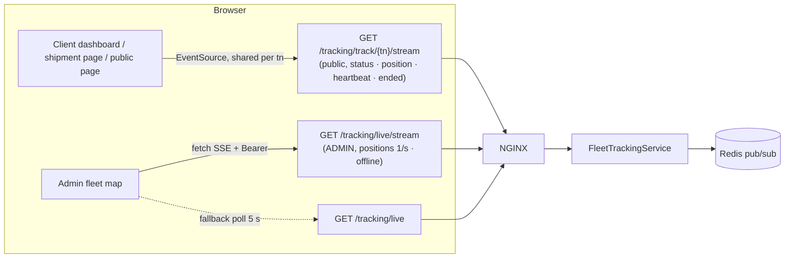

# Frontend definition: mile-portal (v2: tracking & operations)

**Version:** 2.0.0 (2026-11-14) · **Status:** ✅ implemented ([`mile-portal/`](../../mile-portal)) and checked against the running stack (§10). This document was written before the code, and the build follows it.
**Related:** [high-level-architecture.md](../high-level-architecture.md) §4.2 · [product-requirements-document.md](../product-requirements-document.md) UC-2, FR-3 · [FleetTrackingService](../FleetTrackingService/FleetTrackingService.md) §4.3, §7 · [ShipmentService](../ShipmentService/ShipmentService.md) §7 · [FleetService](../FleetService/FleetService.md) §7 · [ProfileService](../ProfileService/ProfileService.md) §7 · [AuthService API](../AuthService/api-reference.md) · v1 (auth MVP): [project-architecture-071126.md](../changelog/project-architecture-071126.md) §4

## 1. Description

mile-portal is the **only browser entry point** to the platform. v1 was an authentication test bench. v2 turns it into the product:
- **Customers (CLIENT)** send shipments and watch their **current delivery live on a map**.
- **Operations managers (ADMIN)** watch **every vehicle live on one map**, dispatch shipments, and manage drivers, vehicles and accounts.
- **Drivers (DRIVER)** get a small workspace: start and end a shift, and pick up, deliver or fail their current shipment.
- **Anyone with a tracking number** can follow a delivery without an account (PRD persona 2: "a unique tracking link").

It stays a static React SPA behind the NGINX gateway: same origin, no CORS, every call to `/api/v1/...`.

### Decisions (2026-11-14)

| # | Decision |
|---|---|
| P1 | **Map stack:** MapLibre GL JS with **OpenFreeMap** vector tiles (`https://tiles.openfreemap.org/styles/liberty`). It is free, needs no API key, and uses OpenStreetMap data. The style URL is a build-time setting (`VITE_MAP_STYLE_URL`), so a self-hosted or paid style can replace it. The HLA's "Leaflet / MapLibre" choice is settled on MapLibre. |
| P2 | **The client map uses the public tracking endpoints** (`/tracking/track/{tn}` and `/stream`). The CLIENT role has no other read access to positions (T3), so the signed-in client view and the public link show exactly the same data: no driver identity, no history. No backend change is needed. |
| P3 | **The admin map uses the authenticated fleet stream** (`/tracking/live/stream`) through a small **fetch-based SSE client**, because `EventSource` cannot send `Authorization`. The client refreshes the token on `401`, reconnects with backoff, and falls back to polling `GET /tracking/live` every 5 s while the stream is down. |
| P4 | **Vehicles are drawn as a GeoJSON layer**, not DOM markers, so 1 000 live vehicles stay smooth. Each update replaces the source data at most once per animation frame. The single delivery marker on the client map is **animated** between pings. |
| P5 | **No destination pins for now.** Shipments store addresses as text. Geocoding them in the browser would send customer addresses to a third party (Nominatim), so it is left as an open point (§11) until ShipmentService stores coordinates. |
| P6 | **Server state uses TanStack Query** (cache, polling, invalidation after mutations). The existing axios client, with its single-flight refresh, stays the transport. |
| P7 | **Role-based navigation.** The sidebar only shows what the role can open. v1's 🔒 entries, which existed to demo the route guard, are removed. The v1 diagnostics (access checks, token claims) move to **Account → Session**. |
| P8 | **One public SSE connection per tracking number**, shared by every component that shows it. NGINX allows 10 public streams per IP, and the dashboard and the detail page can show the same shipment. |

## 2. Tech stack

| | |
|---|---|
| UI | React 19, TypeScript, Vite, react-router 7 (unchanged) |
| Map | `maplibre-gl` 5, OpenFreeMap style (P1) |
| Server state | `@tanstack/react-query` 5 (P6), axios transport |
| Streams | native `EventSource` (public), own fetch-based SSE reader (admin) |
| Container | node build → `nginx:alpine` static server (unchanged) |

## 3. Requirements

### Functional requirements

| # | Requirement | Role |
|---|---|---|
| FR-1 | A live map of the signed-in client's **active deliveries** (sender or recipient, `DISPATCHED` or `IN_TRANSIT`), updated in real time | CLIENT |
| FR-2 | A live **fleet map** with every vehicle on shift: driver, plate, shipment, speed, last ping. Click a vehicle to follow it and see its trail. | ADMIN |
| FR-3 | A **public tracking page** `/track/:trackingNumber`: status timeline plus a live map while in transit | anyone |
| FR-4 | **Shipments:** list, filter and search; create (CLIENT by recipient email, ADMIN for any sender); detail with timeline, map and the actions the role allows (dispatch / pick up / deliver / fail / cancel) | all, scoped |
| FR-5 | **Route replay** of a shipment from the sampled history (`/tracking/shipments/{id}/route`) | ADMIN |
| FR-6 | **Fleet management:** drivers (edit, availability), vehicles (create, edit, assign, retire) | ADMIN |
| FR-7 | **Operations dashboard:** live vehicles, drivers available, shipments per status, shipments waiting for dispatch with a one-click auto-dispatch | ADMIN |
| FR-8 | **Driver workspace:** profile and vehicle, start/end shift, current shipment with its actions, own live position | DRIVER |
| FR-9 | **Account:** edit own profile (ProfileService for CLIENT/ADMIN, FleetService for DRIVER), email, password, delete account, session diagnostics | all |

### Non-functional requirements

| # | Requirement |
|---|---|
| NFR-1 | Ping-to-screen latency < 500 ms (PRD §2). The map adds no polling delay while the stream is up. |
| NFR-2 | The fleet map stays responsive with **1 000 vehicles** updating once per second. |
| NFR-3 | **Degrades, doesn't break:** if FleetTrackingService is down, shipments, fleet and accounts keep working, and the map shows "live tracking unavailable". |
| NFR-4 | No personal data on the public page. Tokens never in URLs. |
| NFR-5 | Usable at phone width (the client and public map pages especially). |

## 4. Architecture

```
src/
├── shared/
│   ├── api/        client.ts (axios + refresh), sse.ts (fetch SSE reader), profilesApi, fleetApi, shipmentsApi, trackingApi
│   ├── map/        MapView (MapLibre wrapper + context), layers (vehicles, trail, single marker), icons, mapStyle
│   ├── query/      QueryClient + query keys
│   ├── types/      auth.ts, profiles.ts, fleet.ts, shipments.ts, tracking.ts (mirror the service DTOs)
│   └── components/ + StatusBadge, KpiTile, Pagination, EmptyState, Tabs
└── features/
    ├── auth/              login, register, account (+ profile section, + session tab)
    ├── dashboard/         role-specific /home: AdminDashboard, ClientDashboard, DriverWorkspace
    ├── tracking/          FleetMapPage, useFleetStream, usePublicTracking (shared EventSource registry), LiveDeliveryMap
    ├── shipments/         list, create, detail, actions, timeline
    ├── fleet/             drivers + vehicles pages
    ├── public-tracking/   /track and /track/:tn (no login)
    └── admin-portal/      Users (v1)
```

### 4.1 Live data paths



**Admin stream reader (`shared/api/sse.ts`):**
1. `fetch` with `Authorization: Bearer <memory token>` and `Accept: text/event-stream`.
2. Parse the body line by line: `event:` and `data:` fields, with a blank line ending each event.
3. `401` → one `refreshAccessToken()` (the same single-flight refresh as axios), then retry. `403` → stop, no retry.
4. Any other end of stream or network error → reconnect after 1, 2, 4… seconds, at most 30 s. While it is disconnected, the map polls `/tracking/live`.
5. The first `positions` event is a full snapshot, so the map **replaces** its state. Later ones are merged per driver. `offline {driverIds}` removes vehicles.

**Public stream registry (P8):** `usePublicTracking(tn)` ref-counts one `EventSource` per tracking number. The last unsubscribe closes it after a 2 s grace period, which also absorbs StrictMode's double mount. `ended` closes it for good. `EventSource`'s own retry handles reconnects. Before the first event, the hook shows the result of `GET /tracking/track/{tn}`, so the map isn't empty while the stream connects.

### 4.2 Map

- **`MapView`** creates one `maplibregl.Map` and exposes it through context once its style has loaded. Layers are child components that add their sources and layers on mount and remove them on unmount. It includes navigation and scale controls, keeps itself sized to its container (`ResizeObserver`), and shows an overlay message if the style fails to load (no internet).
- **Vehicle layer:** a GeoJSON source of points with properties `driverId, heading, moving, hasShipment, stale, selected`. It is drawn as a halo circle plus an arrow icon rotated by `headingDeg`. Purple means on a delivery, grey means available, and transparency means the last ping is more than 60 s old. Clicking a vehicle selects it.
- **Trail layer:** a line from history points plus the live tail received since the page opened.
- **Delivery marker (client/public):** one animated marker. It moves smoothly between pings and rotates with the heading.
- **Camera:** fit to all vehicles on the first snapshot, then never move unless the user turns on "follow" for a selected vehicle.

## 5. Pages and routes

| Route | Roles | Content | Calls |
|---|---|---|---|
| `/track`, `/track/:tn` | **public** | tracking number form; status, timeline, live map | `GET /shipments/track/{tn}`, `GET /tracking/track/{tn}` + `/stream` |
| `/home` | ADMIN | KPIs, waiting for dispatch (auto-dispatch), recent shipments, mini fleet map | shipments `?status=…&pageSize=1` (counts), `/fleet/drivers?available=true`, `/tracking/live` |
| `/home` | CLIENT | active deliveries map + cards, recent shipments, "Send a parcel" | `/shipments?status=DISPATCHED|IN_TRANSIT`, public tracking per tn |
| `/home` | DRIVER | shift toggle, vehicle, current shipment + actions, own position | `/fleet/drivers/me` (+ `/availability`), `/shipments?…` (assigned), `/tracking/drivers/me/live` |
| `/map` | ADMIN | full-screen fleet map with a searchable vehicle panel, follow, trail | `/tracking/live/stream`, `/fleet/drivers`, `/tracking/drivers/{id}/history` |
| `/shipments` | all | list, status filter, search, paging; CLIENT: as sender / recipient | `GET /shipments` |
| `/shipments/new` | CLIENT, ADMIN | create form (ADMIN picks the sender and recipient from client profiles) | `POST /shipments`, `/profiles/clients?search` |
| `/shipments/:id` | parties, driver, ADMIN | details, timeline, actions, map (live; ADMIN: route replay) | `GET /shipments/{id}`, actions, `/tracking/shipments/{id}/route` |
| `/fleet/drivers` | ADMIN | drivers, availability, edit | `/fleet/drivers…` |
| `/fleet/vehicles` | ADMIN | vehicles, create / edit / assign / retire | `/fleet/vehicles…` |
| `/admin/users` | ADMIN | unchanged (v1) | AuthService |
| `/account` | all | profile, email, password, delete, session diagnostics | Profile/Fleet `me`, AuthService |

**Names on admin screens** come from the owners' APIs: driver names and plates from FleetService (`/fleet/drivers`, all pages), and sender and recipient names from ProfileService (`/profiles/clients/{id}`, cached). The CLIENT role cannot read other clients' profiles, so the client UI shows its own role in the shipment ("You → recipient") and the address snapshot.

## 6. Role rules the UI mirrors

The backend is the authority. The UI hides actions the role cannot do and still shows any `403` or `409` the backend returns.

| Action | Shown to |
|---|---|
| Dispatch (choose a driver or auto) | ADMIN, `CREATED` |
| Pick up | ADMIN, assigned DRIVER, `DISPATCHED` |
| Deliver / Fail (reason required) | ADMIN, assigned DRIVER, `IN_TRANSIT` |
| Cancel | ADMIN (any non-final status), sender (`CREATED`) |
| Route replay | ADMIN |

## 7. Configuration

| Variable (build time) | Default | Purpose |
|---|---|---|
| `VITE_MAP_STYLE_URL` | `https://tiles.openfreemap.org/styles/liberty` | MapLibre style |
| `VITE_MAP_CENTER` | `3.0588,36.7538` (Algiers, matching the simulator) | initial center when nothing is live |

## 8. Running it

```bash
docker compose up -d --build mile-portal         # portal at http://localhost
cd mile-portal && npm run dev                     # hot reload on :5173 (proxies /api to the gateway)
# live data: put Jane on shift, then
python3 tools/telemetry-simulator/simulator.py drive --email jane@doe.com --password Driver12345!
```

## 9. Test plan (after build, API-level + manual)

Typecheck and production build; the stream reader against the real gateway (snapshot, batches, offline, 401 refresh, reconnect); the public stream closing on delivery; role-scoped pages loading against live services; container rebuild. The full end-to-end UI tests are run manually by the user.

## 10. Build notes

Checked on 2026-11-14 against the full docker compose stack, through the gateway, with a scripted headless Chromium (Playwright, kept outside the repo) plus the telemetry simulator driving Jane.

| Check | Result |
|---|---|
| `tsc -b`, `vite build`, container rebuild | ✅ Map pages are lazy-loaded, so the main chunk is 282 kB and MapLibre (1 MB, 276 kB gzip) loads only with a map. |
| Every page, per role (ADMIN 8, CLIENT 3, DRIVER 1, public 2) | ✅ no JS errors. The only console error is the expected `404` for an unknown tracking number. |
| Admin fleet map / dashboard | ✅ live stream snapshot + 1/s batches, Jane's vehicle with plate label and heading, panel, trail from history |
| Client dashboard, shipment page, public page | ✅ the same live vehicle from the public stream, animated marker, no driver identity |
| Lifecycle in the UI | ✅ John creates `LM-KJS1W7ADPH7J` → admin dispatch shows the backend's `409` ("No available driver…") → admin cancels with a note → Jane picks up (the public page switches to *In transit* live) → Jane delivers with a note → the public page hides the position (T3) and shows *Delivered* → admin sees the route replay |
| Tracking service stopped with the admin map open (NFR-3) | ✅ the map shows "Live tracking unavailable" and keeps the last positions, shipments keep working, and the map recovers on its own 10–20 s after restart |
| Phone width (390 px) | ✅ no horizontal scroll; the fleet map stacks the panel under the map |

**Found and fixed during the checks:**
1. **Gateway took 60 s to fail.** With FleetTrackingService down, authenticated tracking calls hung until NGINX's default connect timeout, then returned 504. The tracking locations now set `proxy_connect_timeout 3s`.
2. **The admin stream's `offline` event** carries `{driverIds: [...]}`, not the `{driverId}` that FleetTrackingService.md §4.3 showed. The portal follows the code, and the doc is corrected.
3. **The camera stayed zoomed out** on the delivery map. Follow mode re-centres every frame, which cancelled the initial zoom animation, so the first view now uses `jumpTo`.
4. **The query cache is cleared on login, logout and session expiry.** Without this, the next account in the same browser could briefly see the previous account's cached data.

**Not verified:**
- 1 000 vehicles on the fleet map (NFR-2): only one driver exists. The layer design (one GeoJSON source, one `setData` per frame) is what makes it scale, but it has not been measured.
- Token refresh in the middle of an open admin stream (the 15 min expiry): the code path reuses the axios single-flight refresh but was not exercised.

**Implementation notes:**
- The sidebar is per role (P7). v1's diagnostics (access checks, token) moved to `/account/session`. `/account` is now the profile, and `/account/security` holds email, password and account deletion.
- Shipment counts on the admin dashboard read `totalCount` from one `pageSize=1` request per status. A stats endpoint in ShipmentService would replace these six requests.
- The admin dashboard's "Waiting for dispatch" list is newest first, because that is ShipmentService's only order.

**Test data left:** `LM-EPJC85BD1889` is now DELIVERED (Jane picked it up and delivered it through the UI), and `LM-KJS1W7ADPH7J` (John → Mary) is CANCELLED. Jane is off shift.

## 11. Open points

1. **Destination pins and ETA** need coordinates on shipments (P5; FleetTrackingService open point 3).
2. **Refresh token in `localStorage`** (from v1). Move it to an HttpOnly cookie set by the gateway before production.
3. **Notifications** (toasts on status changes) would need a user-scoped event stream. NotificationService is future work (K2).
4. **Fleet map beyond ~5 000 vehicles:** switch to server-side clustering or viewport-filtered streams.
5. **Off-shift driver lingers on the admin map** for up to 10 min after a delivery when no availability event follows. This is a FleetTrackingService gap (its open point 5), not a portal issue.
6. **Shipment stats endpoint** to replace the six count requests on the admin dashboard.
7. **Admin client directory** (list / edit client profiles). The API exists (`PUT /profiles/clients/{id}`), but the portal only uses it for picking a sender or recipient.
